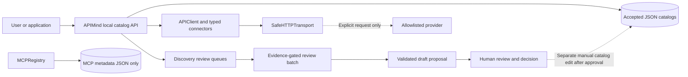
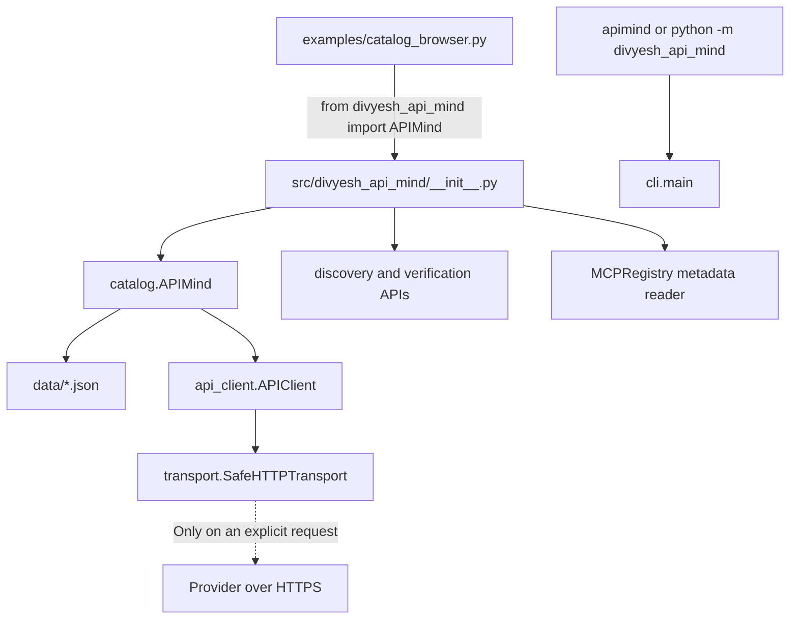

<p></p>

# DIVYESH API MIND

**Evidence-backed API, model, dataset, and MCP discovery—with safe, opt-in Python connectors.**

A Python library, offline API/model/dataset/MCP catalogs, and human-review discovery queues. It separates **what is documented** from **what has actually been tested**, provides safe opt-in HTTPS requests for selected APIs, and keeps unverified imports out of the callable catalog.

[](pyproject.toml)
[](LICENSE)
[](pyproject.toml)
[](docs/security.md)
[](pyproject.toml)

> **Important:** a `FREE_*` label summarizes a documented access path; it is not a promise of unlimited use, uptime, commercial rights, or free compute. Review current provider terms and quotas before use. The MCP list is **metadata only**: this package does not install, launch, or invoke MCP servers.

## Contents

1. [Project overview](#01-project-overview)
2. [Badges and project facts](#02-badges-and-project-facts)
3. [What the records mean](#03-what-the-records-mean)
4. [Installation](#04-installation)
5. [Quick start](#05-quick-start)
6. [Python API](#06-python-api)
7. [Command-line interface](#07-command-line-interface)
8. [Accepted catalogs](#08-accepted-catalogs)
9. [Discovery queues](#09-discovery-queues)
10. [Phase 3 verification workflow](#10-phase-3-verification-workflow)
11. [Network and security model](#11-network-and-security-model)
12. [Credentials and privacy](#12-credentials-and-privacy)
13. [MCP metadata directory](#13-mcp-metadata-directory)
14. [Example application](#14-example-application)
15. [Architecture and import diagrams](#15-architecture-and-import-diagrams)
16. [Attribution and licensing](#16-attribution-and-licensing)
17. [Tests and quality checks](#17-tests-and-quality-checks)
18. [Contributing and governance](#18-contributing-and-governance)
19. [Roadmap](#19-roadmap)
20. [Documentation and support](#20-documentation-and-support)

## 01. Project overview

DIVYESH API MIND is an offline-first Python catalog and evidence-review toolkit. Its local records describe selected APIs, models, datasets, and MCP directory entries; optional typed connectors and a guarded generic client make network requests only when explicitly called. Source imports are kept in separate review queues and are not silently promoted into accepted API records.

**The project does not claim that every catalogued service is currently available, that a source-directory claim is independently verified, or that an MCP entry is a working integration.**

## 02. Badges and project facts

| Fact | Current value |
| --- | --- |
| Supported Python | 3.10+ |
| Mandatory third-party runtime dependencies | None (`dependencies = []` in `pyproject.toml`) |
| Optional extras | `test` (pytest), `discovery-yaml` (PyYAML) |
| Network on import, catalog load, local search, and validation | None |
| Project maturity | Alpha, as declared in package metadata |
| Package metadata version | `0.1.0`; publication to PyPI has not been verified, so there is no package-version badge |
| Current catalog data date | 2026-11-12 |

The badges above describe repository metadata and documented behavior only; they are not release, adoption, CI, coverage, or uptime metrics.

## 03. What the records mean

Keep these evidence levels separate:

- **Accepted catalog record:** a local, curated entry in one of the four catalog JSON files. It is not an endorsement or a guarantee that the provider is reachable today.
- **Source claim:** a statement copied from a directory, repository, OpenAPI document, or other source. Its origin is retained; it is not automatically a finding by this project.
- **Review candidate:** an attributed lead in a discovery queue. Candidate auth, price, quota, and license values remain unresolved until supported by reviewed evidence.
- **MCP metadata record:** directory or repository metadata. It does not mean the server was launched, safely reviewed, or protocol-tested.
- **Live probe:** a dated result for one specific request and endpoint. It is not a monitor or a claim about other endpoints.

Upstream `verified` and checked-date labels remain upstream claims. A source/repository license, OpenAPI security declaration, or directory “free/no auth” field does not establish provider terms, API/data rights, or current endpoint behavior. See the [verification rules](docs/verification.md) and [third-party notices](docs/third-party-notices.md).

## 04. Installation

The repository metadata declares version `0.1.0`, but a published PyPI release has not been verified. Install from a checkout containing this source tree:

```bash
python -m pip install .
```

For editable development and tests:

```bash
python -m pip install -e '.[test]'
```

YAML parsing for OpenAPI imports is optional:

```bash
python -m pip install '.[discovery-yaml]'
```

See [`pyproject.toml`](pyproject.toml) for package metadata and extras.

## 05. Quick start

Catalog loading and these searches are local; they do not contact a provider:

```python
from divyesh_api_mind import APIMind

mind = APIMind()

for item in mind.search(kind="api", category="research", limit=5):
    print(item["id"], item["free_status"], item["name"])

# References only; this does not fetch the documentation page.
for source in mind.get_docs("openalex"):
    print(source["title"], source["url"], source["checked_on"])

# Local helpers: neither operation sends a request.
print(mind.integration_template("openalex"))
print([item["id"] for item in mind.alternatives("openalex", limit=5)])
```

A request happens only when an explicit connector method is invoked. For example, this sends a request to OpenAlex and returns provider data:

```python
works = mind.connector("openalex").search_works("climate adaptation", per_page=5)
```

Review the provider's current policy and the [network safety notes](docs/security.md) before making live calls.

## 06. Python API

The public package exports:

| API | Purpose |
| --- | --- |
| `APIMind` | Load/search accepted catalogs, inspect evidence, export records, create templates, find alternatives, and explicitly request documented APIs |
| `APIConnector` and typed connectors | Generic access plus OpenAlex, Crossref, World Bank Indicators, Frankfurter, USGS Earthquakes, OSV, arXiv, and Nominatim wrappers |
| `SafeHTTPTransport` | Bounded HTTPS transport with hostname checks, no redirects, response caps, and conservative retries |
| Discovery functions | Import, validate, browse, and merge review-only Public APIs, API Atlas, and OpenAPI queues |
| Verification functions | Rank leads, manage evidence and review stages, validate proposals, and record human decisions without automatic catalog writes |
| `MCPRegistry` | Browse local MCP directory/repository metadata only |

`APIMind.request` parses JSON; `request_text` returns decoded text, and `request_raw` returns a bounded `HTTPResult`. `json_body` and `form_body` are supported for documented POST requests. A generic connector does not override provider terms or make an unreviewed endpoint safe. The full connector surface is in [`docs/connectors.md`](docs/connectors.md).

The arXiv and Nominatim wrappers apply process-local pacing. Nominatim additionally requires an identifying User-Agent and explicit policy acknowledgement. Process-local limits cannot coordinate other processes, machines, or unrelated clients; read and comply with each provider's current policy before use.

## 07. Command-line interface

Install the package to use `apimind`, or run `python -m divyesh_api_mind` from a configured checkout. Local examples:

```bash
apimind validate
apimind summary
apimind search --kind api --category research --limit 5
apimind review-candidates --query weather --limit 10
apimind mcp --status directory_entry
apimind verify-validate src/divyesh_api_mind/data/verification_review_batch_2026-11-12.json
```

`validate`, `summary`, `search`, queue browsing, and MCP metadata inspection are offline. Network-enabled commands are clearly opt-in: `docs RECORD_ID --fetch`, `health-check RECORD_ID`, `discover-import --url HTTPS_URL`, `verify-probe`, and explicit Python connector/request calls. See `apimind --help` and [`docs/configuration.md`](docs/configuration.md) for settings and boundaries.

## 08. Accepted catalogs

The bundled local files contain:

| File | Records | Scope |
| --- | ---: | --- |
| [`apis.json`](src/divyesh_api_mind/data/apis.json) | 26 | API/provider metadata, endpoint descriptions, auth, quotas, privacy, rights notes, and source references |
| [`models.json`](src/divyesh_api_mind/data/models.json) | 5 | Model metadata and access/terms notes; open weights do not imply hosted or free inference |
| [`datasets.json`](src/divyesh_api_mind/data/datasets.json) | 8 | Dataset access, license/update notes, and related API IDs where applicable |
| [`mcp_registry.json`](src/divyesh_api_mind/data/mcp_registry.json) | 6 | Five `directory_entry` and one `reviewed_repository`; zero `working_integration` records |

The API records span 19 catalog categories. Across the API/model/dataset catalogs there are 39 records; MCP metadata is counted separately. Every count is a record count, not a distinct-provider, uptime, or quality metric. Each catalog file records `last_updated` as 2026-11-12.

The catalog's free-access vocabulary is defined in [`docs/catalog-maintenance.md`](docs/catalog-maintenance.md). In particular, `OPEN_SOURCE_SELF_HOSTED` does not include hardware or operations, and a `FREE_*` tier can have significant limits.

## 09. Discovery queues

The bundled [`discovery_candidates.json`](src/divyesh_api_mind/data/discovery_candidates.json) is a review queue, not an extension of the accepted API catalog:

| Measure | Count |
| --- | ---: |
| Source rows | 4,455 |
| Unique review candidates | 2,964 |
| Exact duplicate rows merged in the combined queue | 1,488 |
| Candidates with possible-duplicate flags | 717 |
| Source categories | 127 |
| API Atlas API rows represented | 2,092 |
| Those API Atlas rows marked checked by API Atlas itself | 197 |

The Public APIs import had already merged three repeated rows before the combined-queue merge; see [`docs/discovery.md`](docs/discovery.md) for the count definitions and source breakdown. API Atlas “checked” is an upstream claim, not an independent review here. The queue also includes three OpenAPI parser examples in [`openapi_review_candidates.json`](src/divyesh_api_mind/data/openapi_review_candidates.json).

All candidates remain non-callable with unresolved free status, authentication, quotas/rates, and API/service license; source attributions and raw claims are retained. Importing or merging queues never changes `apis.json`.

```bash
apimind review-candidates --priority upstream_checked_pointer --limit 20
apimind discover-import --format openapi --input openapi.yaml \
  --source-url https://github.com/vendor/spec/blob/COMMIT/openapi.yaml \
  --checked-on 2026-11-12 --output review.json
apimind review-merge review-a.json review-b.json --output combined-review.json
```

API Atlas imports require a hexadecimal `--revision` for pinned attribution. YAML support is optional. See the [discovery guide](docs/discovery.md) for import formats, source revisions, deduplication, and attribution.

## 10. Phase 3 verification workflow

The evidence-gated workflow is implemented, but the first saved batch is **not a set of verified APIs**. Batch [`review-batch-20261112-100`](src/divyesh_api_mind/data/verification_review_batch_2026-11-12.json) contains 100 ranked leads; all 100 passed local structural metadata validation. At the recorded checkpoint there were:

- **0** independently completed primary-source reviews;
- **0** API/provider identity, documentation, auth, access/free-tier, quota, maintenance, licensing, or Python-feasibility findings;
- **0** candidate endpoint accessibility tests or probe records;
- **0** proposals, human approvals, or catalog acceptances.

All 100 accessibility states are `NOT_TESTED`; unresolved facts remain `UNKNOWN`. The batch's 33 `upstream_checked_pointer`, 64 `unverified_directory_pointer`, and 3 `not_provided` labels are triage metadata only. Ranking is for investigation order, never verification. See the [Phase 3 report](docs/phase-3-verification-report.md) and [workflow specification](docs/verification.md).

The workflow enforces ordered stages, primary-source evidence rules, an auditable hash-linked event chain, duplicate review gates, and separate proposal/approval/acceptance steps. It does not automatically write candidates into accepted catalogs.

## 11. Network and security model

The default path is offline. Importing the package, loading records, local search, queue operations, template generation, validation, and MCP metadata browsing do not contact providers.

When explicitly called, the shared transport:

- accepts HTTPS requests to catalog-allowlisted hosts and rejects unsafe/local destinations;
- refuses redirects, unsafe path forms, user-info, and caller attempts to replace catalogued authentication;
- reads credentials only from declared environment-variable names;
- defaults to a 10-second timeout, a 5 MiB response cap, and retries selected transient GET/HEAD failures only (POST is not retried);
- avoids logging URLs, bodies, and secret values.

These are guardrails, not a security audit, a DNS-pinning network sandbox, or proof that every catalog record is accurate. A GET can still have provider-specific consequences; review methods and parameters before sending data. See [`docs/security.md`](docs/security.md).

The only endpoint probes recorded in the repository are three dated, one-shot reads of GitHub, PyPI, and npm metadata endpoints on 2026-11-12. Their statuses are preserved in [`docs/live-probes.md`](docs/live-probes.md); they are not ongoing checks and are unrelated to the 100 Phase 3 candidates.

## 12. Credentials and privacy

Set only credentials required by a reviewed API record, using the environment variable named there. Never put real keys in source, notebooks, catalog data, URLs, review notes, issue reports, or logs. For example:

```bash
export CENSUS_API_KEY='your-key'
export GEMINI_API_KEY='your-key'
export OPENROUTER_API_KEY='your-key'
```

Some providers require query-string keys. The client URL-encodes them and avoids printing URLs, but provider, proxy, or server logs may still record them. Prefer provider-supported header authentication when available. Search strings, coordinates, package names, and AI prompts can be sensitive; review provider retention and terms before sending them. The package does not persist request or response content.

See [configuration](docs/configuration.md) and [security/privacy notes](docs/security.md). Use an environment or deployment secret manager for production; environment variables alone are not a secrets-management system.

## 13. MCP metadata directory

`MCPRegistry` reads local JSON metadata. It does not install, launch, initialize, or call a server. Current state: six entries—five directory entries, one reviewed-repository record, and **zero `working_integration` records**. Even `reviewed_repository` is not a security audit or proof of live service behavior; an upstream `active` status is not an uptime signal.

```python
from divyesh_api_mind import MCPRegistry

registry = MCPRegistry()
print(registry.counts())
for entry in registry.list(status="directory_entry"):
    print(entry["id"], entry["official_registry_status"], entry["verification_scope"])
```

Review server publisher, code, dependencies, permissions, and data handling independently before connecting it to credentials or tools.

## 14. Example application

[`examples/catalog_browser.py`](examples/catalog_browser.py) is a small offline-first CLI using the package's public `APIMind` import. It sends no network request unless `--health-check API_ID` is supplied and that record has a configured probe.

```bash
PYTHONPATH=src python examples/catalog_browser.py --category research --limit 5
PYTHONPATH=src python examples/catalog_browser.py --capability weather --no-auth
```

Only when explicitly intended, a configured read-only probe can be requested:

```bash
PYTHONPATH=src python examples/catalog_browser.py --health-check pypi-json
```

See [`examples/README.md`](examples/README.md) and [`docs/configuration.md`](docs/configuration.md).

## 15. Architecture and import diagrams

### Data and review boundaries



A proposal or approval does not write to a catalog. Catalog acceptance is a separate human action after checking the exact approved record; the library records evidence and decisions but does not auto-promote candidates.

### Application import path



## 16. Attribution and licensing

The root [`LICENSE`](LICENSE) applies MIT terms to the project code and associated material it covers. It does **not** grant rights to third-party APIs, services, provider data, model weights, trademarks, or imported discovery-source content.

Discovery material retains source/revision/file/row attribution and separate license context. The notices describe Public APIs' MIT-licensed directory, API Atlas's CC BY 4.0 catalog compilation and retained upstream origins, and APIs.guru's CC0/fair-use caveat and per-file provenance. OpenAPI specification licensing is not treated as an API or data license. No upstream endorsement is implied.

Review [`docs/third-party-notices.md`](docs/third-party-notices.md) before copying, redistributing, or promoting imported material, and check each provider's current terms. License interpretation is not legal advice.

## 17. Tests and quality checks

The recovery pass ran the project test suite and local/offline checks. At the documented checkpoint, `pytest` reported **75 passed and 13 subtests passed**. The project also passed Python byte-compilation, all four accepted-catalog validators, discovery queue validation, Phase 3 batch validation, package build checks, and the repository's internal Markdown-link check. Exact commands, results, and the limits of secret scanning are recorded in [`docs/project-history/TEST_EVIDENCE.md`](docs/project-history/TEST_EVIDENCE.md).

Validation and tests do not make provider requests. Mocked transport tests cover request safety; the Phase 3 candidate batch itself has not been endpoint-tested.

## 18. Contributing and governance

Contributions should preserve the difference between a source claim and an independently reviewed finding. Keep imports review-only, retain provenance, use `UNKNOWN` for unresolved facts, and never store credentials. Do not add a health probe or perform a provider request without reviewing the provider's official endpoint documentation and applicable policy.

Start with [`CONTRIBUTING.md`](CONTRIBUTING.md), [`docs/catalog-maintenance.md`](docs/catalog-maintenance.md), and [`docs/third-party-notices.md`](docs/third-party-notices.md). Issue and pull-request templates are in [`.github/`](.github/). There is no claim of an automated provider-validation or CI workflow in this repository.

## 19. Roadmap

| Phase | Status |
| --- | --- |
| Foundation | Package, offline catalogs, transport guardrails, CLI, tests, and example application are present. |
| API discovery | 2,964 attributed review candidates are preserved; candidates remain separate from accepted records. |
| Verification workflow | Workflow and 100-lead batch are preserved; independent primary-source review has not started. |
| Phase 4 | To be scoped only after the Mission 04 recovery snapshot is synchronized. The next work must be bounded, documentary primary-source review of the existing batch; endpoint probes remain out of scope unless provider permission and exact official endpoint documentation are reviewed first. |
| Longer-term target | The 500 independently verified API-record goal has **not** been reached; the accepted API catalog currently contains 26 records. |

No candidate is automatically accepted. Do not change a candidate's status without evidence and the separate human decisions required by the verification workflow.

## 20. Documentation and support

| Guide | What it covers |
| --- | --- |
| [Project history](docs/project-history/IMPLEMENTATION_TIMELINE.md) | Artifact-backed phases and the limits of the available Git history |
| [Current project status](docs/project-history/CURRENT_PROJECT_STATUS.md) | Counts, preservation checkpoint, and open scope |
| [Test evidence](docs/project-history/TEST_EVIDENCE.md) | Reproducible checks and results |
| [Catalog maintenance](docs/catalog-maintenance.md) | Evidence, statuses, and safe record updates |
| [Configuration](docs/configuration.md) | Alternate catalogs, credentials, and explicit network commands |
| [Connectors](docs/connectors.md) | Typed and generic request interfaces |
| [Discovery](docs/discovery.md) | Source imports, review queues, and attribution |
| [Verification](docs/verification.md) | Evidence rules, review stages, guarded probes, and acceptance gates |
| [Security](docs/security.md) | Network and privacy boundaries |
| [Third-party notices](docs/third-party-notices.md) | Upstream source attribution and license context |
| [Phase 3 report](docs/phase-3-verification-report.md) | Actual findings and blockers for the 100-lead batch |

For a bug or feature request, use the repository's [issue templates](.github/ISSUE_TEMPLATE/). For a possible security vulnerability, follow [`SECURITY.md`](SECURITY.md) and avoid posting secrets or exploit details in a public issue.
