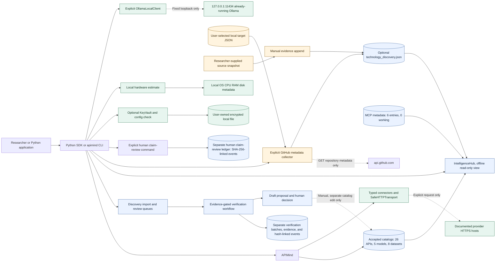
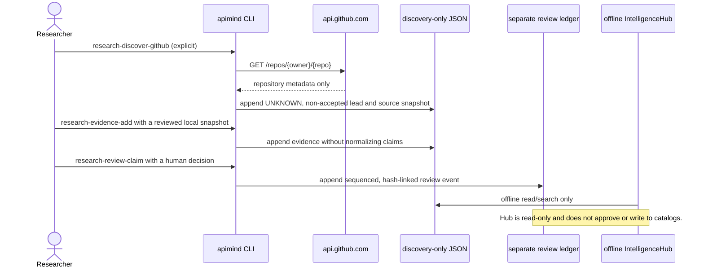

<p align="center">
  
</p>

<h1 align="center">🧠 DIVYESH API MIND</h1>

<p align="center"><strong>An evidence-first, offline-by-default Python catalog and research workbench for APIs, models, datasets, and MCP metadata.</strong></p>
<p align="center"><strong>Created by DIVYESH BAMBHANIYA</strong></p>

<p align="center">
  <a href="pyproject.toml"></a>
  <a href="LICENSE"></a>
  <a href="pyproject.toml"></a>
  <a href="pyproject.toml"></a>
  <a href="docs/security.md"></a>
</p>

> **Candidates are not verified APIs.** Discovery queues contain attributed leads that still require review; they are not accepted records or permission to call an endpoint.
>
> **MCP entries are metadata, not running servers.** The current registry has **0 working integrations**. This package does not start or invoke an MCP server.
>
> **Offline and network behavior are separate.** Catalog reads, search, recommendations, validation, review-queue browsing, and hardware estimates are local. Provider requests, remote source imports, the GitHub metadata collector, and local Ollama requests occur only through explicit commands or method calls.

<a id="contents"></a>
## 🧭 Contents

- [⚡ 30-second overview](#overview)
- [🏗️ Architecture and data flow](#architecture)
- [🗂️ What the data means](#data-model)
- [📊 Feature status](#feature-status)
- [🧠 Mission 09 implementation](#mission-09)
  - [Offline Intelligence Hub](#mission-09-hub)
  - [GitHub metadata research](#mission-09-github)
  - [Manual evidence and human-review ledger](#mission-09-review)
  - [Encrypted local Key Vault](#mission-09-vault)
  - [Hardware estimates](#mission-09-hardware)
  - [Loopback-only Ollama client](#mission-09-ollama)
  - [SDK and CLI](#mission-09-sdk-cli)
  - [Tests and implementation report](#mission-09-tests)
- [📦 Installation](#installation)
- [🚀 Quick start](#quick-start)
- [⌨️ CLI guide](#cli-guide)
- [📚 Data, research, and Phase 4 history](#research-transparency)
- [🔐 Security and privacy](#security)
- [🗺️ Project status and roadmap](#roadmap)
- [📖 Documentation](#documentation)
- [🤝 Contributing, support, and license](#governance)
- [✅ Final validation snapshot](#validation)

<a id="overview"></a>
## ⚡ 30-second overview

DIVYESH API MIND is a Python package and command-line toolkit for exploring a small, curated set of API/model/dataset records alongside much larger **unverified** source-review queues. It records evidence and human workflow separately, exposes an offline Intelligence Hub, and provides selected guarded connectors for explicit use.

| At a glance | Current repository snapshot |
| --- | ---: |
| Accepted APIs / models / datasets | **26 / 5 / 8** |
| MCP metadata entries | **6** — 5 directory entries, 1 reviewed repository, **0 working integrations** |
| General discovery candidates | **2,964** unique review candidates; not accepted or verified |
| OpenAPI review examples | **3**; not accepted or verified |
| Mandatory third-party runtime dependencies | **None** |
| Python requirement / package version | Python **3.10+** / metadata version `0.1.0` |
| Development maturity | Alpha; no PyPI publication or CI badge is claimed |

The counts are a snapshot of bundled local files, not live availability, distinct providers, quality, or uptime measurements. See [data transparency](#research-transparency) and the [Mission 09 report](docs/research/mission-09-implementation-report.md).

<a id="architecture"></a>
## 🏗️ Architecture and data flow

The repository keeps accepted records, imported leads, evidence, and decisions in separate files and workflows. The Intelligence Hub is a read-only local view; there is no automatic path from a candidate or a review event to an accepted catalog record.



### Research data flow



**Boundary:** GitHub metadata is not provider product documentation. Manual evidence input is supplied by the researcher; this code does not fetch that URL. Review records do not promote anything. Any accepted catalog update still requires the existing separate human review and manual acceptance workflow.

<a id="data-model"></a>
## 🗂️ What the data means

| Term | Meaning in this repository | What it does **not** mean |
| --- | --- | --- |
| **Accepted catalog record** | Curated entry in `apis.json`, `models.json`, `datasets.json`, or `mcp_registry.json`. | Endorsement, guaranteed current service, or permission to use a provider. |
| **Discovery candidate** | Attributed lead in a separate queue awaiting review. | Verified API, callable endpoint, or accepted catalog entry. |
| **Source claim** | A statement preserved from a directory, repository, spec, or user-supplied source snapshot. | Independent confirmation or provider endorsement. |
| **Evidence record** | Dated, scoped source pointer/snapshot with an explicit claim boundary. | A legal conclusion or complete validation of all product terms. |
| **Verification finding** | Evidence-linked result for a specific workflow dimension and review scope. | A live endpoint test, blanket rights grant, or production approval. |
| **MCP metadata** | Directory/repository information stored locally. | Installed, launched, protocol-tested, or security-reviewed server. |
| **Live probe** | A saved result for one specific request and endpoint. | Monitoring, a guarantee of future availability, or evidence about other candidates. |

Unknown authentication, pricing, quotas, licensing, data rights, and availability remain **UNKNOWN** until supported by reviewed evidence. A repository/spec license is not a provider API or data license. Upstream “verified” labels remain upstream claims until independently reviewed here.

<a id="feature-status"></a>
## 📊 Feature status

`IMPLEMENTED` means the local behavior exists and is covered by offline/mocked tests; it does not imply the external service was tested. `PARTIALLY IMPLEMENTED` marks intentionally narrow scope. `NOT VERIFIED` means no suitable runtime/source evidence was gathered. `PLANNED` means the work is not implemented.

| Feature | Status | Offline / online behavior | Evidence | Limitations |
| --- | --- | --- | --- | --- |
| Accepted API, model, dataset catalogs and validation | **IMPLEMENTED** | Local JSON; no request for loading/search/validation | [`data/`](src/divyesh_api_mind/data/), [`validation.py`](src/divyesh_api_mind/validation.py) | Curated subset; saved terms and availability can age. |
| Discovery queues and import/review tools | **IMPLEMENTED** | Queue operations are local; remote import requires explicit `--url` | [`discovery.py`](src/divyesh_api_mind/discovery.py), [`docs/discovery.md`](docs/discovery.md) | 2,964 leads are not verified APIs and are not auto-promoted. |
| Phase 3 evidence-gated review workflow | **PARTIALLY IMPLEMENTED** | Local batch/evidence/workflow files; a probe is a separate explicit command | [`verification.py`](src/divyesh_api_mind/verification.py), [Phase 4 map](docs/research/phase-4-consolidated-evidence-map-1-30.md) | The 100-lead original batch has 0 primary-source reviews; candidate endpoints are untested. |
| Intelligence Hub | **IMPLEMENTED** | Local search/compare/recommend; no provider, MCP, or Ollama calls | [`intelligence.py`](src/divyesh_api_mind/intelligence.py) | Results reflect only the bundled snapshot; recommendation scores are heuristics. |
| GitHub repository metadata research | **PARTIALLY IMPLEMENTED** | Network only on explicit `research-discover-github`; fixed `api.github.com` repository metadata route | [`research.py`](src/divyesh_api_mind/research.py), [`docs/research/mission-09-implementation-report.md`](docs/research/mission-09-implementation-report.md) | Maximum 25 targets/run; no product endpoints, broad web crawler, or provider-terms verification. Collector not run for the bundled snapshot. |
| Manual source evidence and human claim ledger | **IMPLEMENTED** | User-supplied snapshot is local; review appends a separate ledger event | [`research.py`](src/divyesh_api_mind/research.py) | No new evidence/decisions bundled; hashes are tamper-evident, not signatures or protected backups. |
| Optional encrypted local Key Vault | **IMPLEMENTED** | Local file only; explicit hidden prompts and unlock | [`vault.py`](src/divyesh_api_mind/vault.py), [`docs/security.md`](docs/security.md) | Not a production secret manager or independently audited; filesystem races, recovery, and memory erasure are not certified. |
| Hardware inventory / memory estimate | **IMPLEMENTED** | Local OS reads only | [`local_ai.py`](src/divyesh_api_mind/local_ai.py) | Low-confidence RAM rule of thumb; GPU/VRAM, compatibility, and performance are not assessed. |
| Ollama loopback client code | **IMPLEMENTED** | Explicit calls only to `http://127.0.0.1:11434`; proxy bypass; no hosted fallback | [`local_ai.py`](src/divyesh_api_mind/local_ai.py) | Tested with mocks only; no local Ollama runtime/model was exercised. |
| End-to-end hosted provider terms and candidate availability | **NOT VERIFIED** | Not performed during Mission 09 | [Research limitations](docs/research/mission-09-implementation-report.md#research-sources-limitations-and-blockers) | No new official-source review, provider product call, candidate endpoint probe, or live availability result. |
| Dedicated productivity, media-modality, and India-specific inventories | **PLANNED** | No dedicated verified inventories added | [Prioritized remaining work](docs/research/mission-09-implementation-report.md#single-prioritized-remaining-work-list) | Current tags/data are incomplete and not exhaustive. |
| MCP server launches / tool integrations | **NOT VERIFIED** | No server is launched or called by this project | [`mcp.py`](src/divyesh_api_mind/mcp.py), [`docs/security.md`](docs/security.md) | Six metadata entries; 0 working integrations. |
| Cross-platform QA and independent vault security review | **PLANNED** | Not completed | [Mission 09 report](docs/research/mission-09-implementation-report.md) | Python 3.10–3.13 / Windows and POSIX behavior needs broader QA; no independent audit. |

<a id="mission-09"></a>
## 🧠 Mission 09 implementation

Mission 09 adds an offline intelligence SDK/CLI, a deliberately narrow opt-in metadata collector, local-only utilities, and an optional user-owned vault. No Mission 09 discovery lead, evidence item, or claim-review event is seeded in the repository (**0 / 0 / 0**). Details and the remaining-work list are in the [implementation report](docs/research/mission-09-implementation-report.md).

<a id="mission-09-hub"></a>
### 1. Offline Intelligence Hub

**What it does:** [`IntelligenceHub`](src/divyesh_api_mind/intelligence.py) unifies read-only views of accepted API/model/dataset records, MCP metadata, and an optional separate `technology_discovery.json`. Search filters cover category, capability, access, auth, explicit limits, commercial/open-source/local status, SDK and provenance. Compare and recommend results retain evidence gaps, source references, and limitations.

```python
from divyesh_api_mind import IntelligenceHub

hub = IntelligenceHub()  # local bundled data; no network calls
matches = hub.search(kind="api", category="research", limit=5)
ranked = hub.recommend(capability="coding", limit=5)
print(hub.counts)
print(hub.explain(ranked))
if len(matches) >= 2:
    print(hub.compare([item["id"] for item in matches[:2]]))
```

**Boundaries:** unknown values do not match negative filters; missing quotas are not unlimited. `access="FREE"` does not include unknown, paid, or free-data/paid-service states. Recommendation ranks are documentary heuristics, not probabilities. Suggested fallback IDs never trigger calls or substitutions. CLI: `apimind hub-search` and `apimind hub-recommend`.

<a id="mission-09-github"></a>
### 2. Opt-in GitHub repository metadata research

[`TechnologyResearchPipeline`](src/divyesh_api_mind/research.py) accepts an explicit local target list and, only when called, makes bounded HTTPS `GET` requests to `api.github.com/repos/{owner}/{repo}`. The transport bypasses environment proxies, rejects redirects, caps response size and timeout, does not authenticate or retry, and limits each run to 25 repositories. The response creates a separate discovery-only lead with the repository snapshot hash; product/auth/pricing/quota/license/maintenance/availability claims remain `UNKNOWN`.

Example target-file shape (choose repositories deliberately; tags are editorial, not provider claims):

```json
{
  "schema_version": "1.0",
  "targets": [
    {
      "repo": "OWNER/REPOSITORY",
      "kind": "software_tool",
      "categories": ["developer-tools"],
      "capabilities": ["example capability"]
    }
  ]
}
```

The following command is **network-enabled** and is not part of offline validation:

```bash
apimind research-discover-github \
  --targets targets.json \
  --output research/technology_discovery.json \
  --checked-on YYYY-MM-DD
```

The output must be a separate `technology_discovery.json`; accepted catalogs and review queues are protected. Follow GitHub's current API terms and rate limits. The collector does not fetch repository README files or provider product endpoints, and repository metadata cannot establish a provider's API access, pricing, rights, or security.

<a id="mission-09-review"></a>
### 3. Manual evidence and human-review ledger

`research-evidence-add` appends a researcher-supplied, dated HTTPS source reference and canonical SHA-256 hash of the provided snapshot to a discovery lead. It **does not fetch the URL or alter normalized claims**. `research-review-claim` adds a separate sequenced event with raw/normalized values, decision, evidence references, reviewer, notes, confidence, date, claim hash, and a link to the prior event hash.

```bash
# The named lead, evidence ID, source snapshot, and discovery file must already exist.
apimind research-evidence-add \
  --record-id DISCOVERY_RECORD_ID \
  --discovery technology_discovery.json \
  --evidence official-source-snapshot.json

# Record a human decision separately; choose evidence IDs from that lead.
apimind research-review-claim \
  --record-id DISCOVERY_RECORD_ID \
  --field python_sdk_status \
  --raw-value-json '"not established by the source"' \
  --normalized-value-json '"UNKNOWN"' \
  --decision INSUFFICIENT \
  --evidence-id EVIDENCE_ID \
  --reviewer "Researcher Name" \
  --notes "The cited source does not establish provider-supported SDK availability." \
  --confidence 0.2 \
  --recorded-on YYYY-MM-DD \
  --ledger research/technology_research_reviews.json \
  --output research/technology_research_reviews.json
```

**Limitations:** replace the uppercase placeholders with IDs from the validated files. The hash chain is not a digital signature, trusted timestamp, backup, or access-control mechanism. The ledger does not change discovery claims or accepted catalogs. Validate with `apimind research-validate FILE` and `apimind research-review-validate FILE`.

<a id="mission-09-vault"></a>
### 4. Optional encrypted local Key Vault

[`KeyVault`](src/divyesh_api_mind/vault.py) is an optional local utility (`pip install '.[security]'`) using AES-256-GCM and scrypt (N=32768, r=8, p=1). New vaults require a user-supplied passphrase of at least 12 characters. On POSIX, writes request `0700` directory and `0600` file permissions with an atomic replacement. The CLI uses hidden input for master passphrases and key values; commands return names/status, not values.

```bash
apimind vault status
apimind vault set MY_SERVICE_API_KEY
apimind vault list
apimind config-check --use-vault
```

No value is passed as a command-line argument. The default vault path is `$APIMIND_VAULT_PATH` when set, otherwise `$XDG_CONFIG_HOME/divyesh-api-mind/keys.vault` (or `~/.config/divyesh-api-mind/keys.vault`). `.env` is never auto-loaded; `config-check --env-file PATH` uses a restricted, non-executing parser. Precedence is shell environment over explicitly loaded `.env` values over explicitly unlocked vault values. The Python API returns decrypted values to the caller by design; callers must not log them.

**Limitations:** this is not a cloud secret manager, HSM, certified key lifecycle, or production-ready security claim. There is no passphrase recovery or guaranteed memory zeroization. POSIX permissions/symlink checks reduce risk but do not eliminate filesystem races; Windows ACL behavior, backups, recovery, multi-user operation, and independent security review remain outstanding. See [security notes](docs/security.md).

<a id="mission-09-hardware"></a>
### 5. Local hardware estimates

[`detect_hardware()` and `estimate_model_memory()`](src/divyesh_api_mind/local_ai.py) read basic CPU, total RAM, and free disk metadata locally. GPU/accelerator information is intentionally `UNKNOWN`. The illustrative estimate is **1.3 × model-file size + 2 GiB** for a rough RAM budget; this is not a benchmark or model-fit guarantee.

```bash
apimind local-hardware --model-size-gib 8
```

The estimate does not account for usable/free RAM, GPU memory, quantization, context/KV cache, runtime, OS overhead, concurrency, or model-specific requirements. Verify official hardware guidance before downloading or running a model.

<a id="mission-09-ollama"></a>
### 6. Explicit loopback-only Ollama client

[`OllamaLocalClient`](src/divyesh_api_mind/local_ai.py) supports `/api/tags` and non-streaming `/api/chat` only at `http://127.0.0.1:11434`. It bypasses configured proxies, rejects redirects, bounds request/response size and timeouts, and never downloads models, starts a service, or falls back to a hosted provider.

After installing and starting Ollama yourself and ensuring the model is already present, the explicit commands are:

```bash
apimind local-ollama-list
printf '%s\n' 'Summarize this text locally.' | apimind local-ollama-chat "$MODEL_TAG"
```

Set `MODEL_TAG` to a model name returned by the first command. These are local-runtime operations, **not** part of offline validation. The actual Ollama runtime/model was not contacted during this mission; tests use a mocked transport. The local Ollama process may have its own logs and policies—do not send sensitive prompts unless you understand them.

<a id="mission-09-sdk-cli"></a>
### 7. SDK exports and CLI

`divyesh_api_mind.__init__` exports `IntelligenceHub`, `TechnologyResearchPipeline`, discovery/review helpers, `KeyVault`, `compose_environment`, `detect_hardware`, `estimate_model_memory`, and `OllamaLocalClient`, along with the existing `APIMind`, transport, connectors, validators, and verification workflow. The console script is `apimind`; `python -m divyesh_api_mind` is also supported.

```bash
apimind --help
apimind hub-search --kind api --category research --limit 5
apimind hub-recommend --capability coding --limit 5
apimind local-hardware --model-size-gib 8
```

All four commands above are local/offline. The help text lists explicit network-enabled subcommands separately.

<a id="mission-09-tests"></a>
### 8. Tests, docs, and scope

Mission 09 adds 35 offline/mocked tests in [`tests/test_mission09.py`](tests/test_mission09.py), plus usage and safety material in [`docs/configuration.md`](docs/configuration.md), [`docs/security.md`](docs/security.md), [`docs/catalog-maintenance.md`](docs/catalog-maintenance.md), the [implementation report](docs/research/mission-09-implementation-report.md), the [preservation manifest](docs/research/mission-09-preservation-manifest.md), and [test evidence](docs/project-history/TEST_EVIDENCE.md). No tests call live GitHub, provider, MCP, or Ollama services. Passing tests establish code-path behavior, not provider truth or an independent security audit.

<a id="installation"></a>
## 📦 Installation

Clone the active feature branch to get the documented Mission 09 implementation:

```bash
git clone --branch arena/e2a56ea8-divyesh-api-mind \
  https://github.com/dhundhwana-arch/DIVYESH-API-MIND.git
cd DIVYESH-API-MIND
python3 -m venv .venv
. .venv/bin/activate
python -m pip install -e '.[test]'
```

On Windows PowerShell, create the environment with `py -3 -m venv .venv`, activate with `\.venv\Scripts\Activate.ps1`, then install with `python -m pip install -e '.[test]'`.

Optional extras:

```bash
python -m pip install -e '.[security]'         # cryptography for the optional Key Vault
python -m pip install -e '.[discovery-yaml]'    # PyYAML for YAML OpenAPI imports
python -m pip install -e '.[test,security,discovery-yaml]'  # all local QA extras
```

For a non-editable local install, use `python -m pip install .`. The project declares no mandatory third-party runtime dependencies. A PyPI release has not been verified; package version `0.1.0` is repository metadata, not a publication claim.

<a id="quick-start"></a>
## 🚀 Quick start

### Offline checks

```bash
apimind --help
apimind validate
apimind summary
python -m pytest -q
python -m compileall -q src tests examples
```

Catalog loading/search/validation do not contact providers. The full suite uses local files and mocked transports.

### Python SDK

```python
from divyesh_api_mind import APIMind, IntelligenceHub

mind = APIMind()
hub = IntelligenceHub()
print("accepted APIs:", mind.counts["apis"])
print("catalog counts:", hub.counts)

matches = hub.search(kind="api", category="research", limit=5)
for item in matches:
    print(item["id"], item["free_status"], item["record_state"])
if len(matches) >= 2:
    print(hub.compare([item["id"] for item in matches[:2]]))

recommendations = hub.recommend(capability="coding", limit=5)
print(hub.explain(recommendations))
```

This snippet only reads bundled local JSON. `IntelligenceHub.compare([...])` returns an evidence-aware side-by-side view; use record IDs returned from `search()`.

### Explicit configuration and local utilities

```bash
# Reports configured variable names/presence, never values; may exit 1 if required keys are missing.
apimind config-check

# Local hardware inventory and a low-confidence memory estimate; no GPU probe or network.
apimind local-hardware --model-size-gib 8

# Metadata only; this does not start an MCP server.
apimind mcp --status directory_entry
```

Network-enabled operations are shown separately in the [CLI guide](#cli-guide) and [security notes](#security). Read the provider's current terms, quotas, privacy and rate limits before any explicit request.

<a id="cli-guide"></a>
## ⌨️ CLI guide

Use `apimind --help` and command-specific `--help` for all options. Common commands:

| Command | Behavior | Network boundary |
| --- | --- | --- |
| `apimind validate`, `summary`, `search` | Validate/count/search accepted local catalogs. | Offline. |
| `apimind review-candidates`, `review-merge` | Browse or merge separate discovery queues. | Offline. |
| `apimind verify-create`, `verify-validate`, `verify-add-evidence`, `verify-finding`, `verify-transition`, `verify-propose` | Manage evidence-gated review files and draft records. | Local; no endpoint calls unless `verify-probe` is explicitly invoked. |
| `apimind mcp` | Browse local MCP metadata. | Offline; no server launch. |
| `apimind hub-search`, `hub-recommend` | Search or rank local records with provenance and caveats. | Offline. |
| `apimind research-validate`, `research-review-validate` | Validate separate research/history files. | Offline. |
| `apimind research-discover-github` | Fetch explicit public repository metadata targets. | Explicit HTTPS to `api.github.com` only; no product calls. |
| `apimind research-evidence-add`, `research-review-claim` | Append manually supplied evidence or a human decision. | Local; source URLs are not fetched. |
| `apimind vault`, `config-check` | Manage encrypted local values / check key presence. | Local; `.env` is never auto-loaded. |
| `apimind local-hardware` | Read local CPU/RAM/disk estimate. | Offline. |
| `apimind local-ollama-list`, `local-ollama-chat` | Query an already-running local Ollama process. | Explicit loopback `127.0.0.1:11434`; never hosted. |
| `apimind docs ID --fetch`, `health-check ID`, `discover-import --url URL`, `verify-probe` | Fetch a named docs/source page or run a specifically configured probe. | Explicit network action; obey source permissions and provider policy. |

`config-check` prints variable names and whether values are configured; it does not print values. It returns a nonzero status when required catalog variables are missing. `vault set` prompts for the master phrase and key value without echoing them; do not put secrets in shell history or source files.

<a id="research-transparency"></a>
## 📚 Data, research, and Phase 4 history

### Bundled counts

| Collection | Count | Interpretation |
| --- | ---: | --- |
| `apis.json` | **26** | Accepted local API records. |
| `models.json` | **5** | Accepted model metadata; “open weights” does not imply free hosted inference. |
| `datasets.json` | **8** | Accepted dataset metadata; check record-specific access and rights. |
| `mcp_registry.json` | **6** | 5 directory entries, 1 reviewed repository, 0 working integrations. |
| `discovery_candidates.json` | **4,455 source rows / 2,964 unique candidates** | Separate unverified review queue; 1,488 exact duplicate rows merged and 717 possible-duplicate flags. |
| `openapi_review_candidates.json` | **3** | Parser/review examples only; not promoted. |
| Mission 09 discovery / evidence / review events | **0 / 0 / 0** | No new research records are seeded in this implementation. |

A candidate count is not an API count. The 100-candidate batch is a ranked/review workflow, **not 100 verified APIs**. The original source batch has 100 metadata-validated leads but **0 primary-source reviews**, 0 endpoint probes, and 100 `NOT_TESTED` accessibility states. A separate working Phase 4 batch contains primary-source evidence for 29 of its 100 candidates; no candidate endpoints were probed and no proposals/approvals/acceptances were recorded.

### Phase 4 #1–#30 preservation

The consolidated Phase 4 slice preserves exactly 30 candidates, 300 findings, **261 evidence records (219 marked primary, 42 non-primary)**, and **793 hash-linked workflow events**. Twenty-nine candidates have at least one primary-source record; #14 ClickMeter and #30 City Context are deferred at `license_review`; 28 workflows remain `human_approval / not_started`. All 30 candidate accessibility findings are `NOT_TESTED`, with 0 probes, proposals, approvals, or acceptances. Documentary `VERIFIED` findings do not mean endpoint reachability, legal clearance, or production readiness.

The saved evidence/event date fields say 2026-11-12, while later repository review commit timestamps are recorded as 2026-11-14; the audit marks chronology **INCONCLUSIVE**. Historical entries and hash-linked event dates were preserved, not rewritten. The current implementation does not refresh the provider documentation.

- [Consolidated evidence map #1–#30](docs/research/phase-4-consolidated-evidence-map-1-30.md) and [machine-readable evidence/workflow registry](docs/research/phase-4-consolidated-evidence-map-1-30.json)
- [Candidates #11–#20 research report](docs/research/phase-4-batch-11-20-report-2026-11-12.md) and [#21–#30 report](docs/research/phase-4-batch-21-30-report-2026-11-12.md)
- [Consolidated audit](docs/research/phase-4-consolidated-audit-report-1-30.md), [human-approval queue](docs/research/phase-4-human-approval-queue-1-30.md), and [unresolved issues](docs/research/phase-4-unresolved-issues-1-30.md)
- [Phase 4 research plan](docs/phase-4-research-plan.md), [pilot batch](docs/research/phase-4-pilot-batch-2026-11-12.json), and [working review batch](docs/research/phase-4-review-batch-2026-11-12.json)
- [Repository preservation report](docs/research/phase-4-repository-preservation-report-2026-11-14.md) and [Mission 09 preservation manifest](docs/research/mission-09-preservation-manifest.md)

The only endpoint probes saved in the repository are three historical, one-shot metadata reads documented in [`docs/live-probes.md`](docs/live-probes.md); they are unrelated to the 100 candidates. No GitHub collector request, provider product endpoint, candidate endpoint, MCP server, Ollama runtime, account, or paid service was contacted for Mission 09 verification.

<a id="security"></a>
## 🔐 Security and privacy

DIVYESH API MIND is a catalog/client with guardrails—not a network sandbox, vault certification, provider verifier, or security audit.

- **Credentials:** no real credentials are intentionally included. Samples are placeholders; tests use deliberately fake values. Read credentials from catalog-declared environment names. Do not commit, log, put in URLs, or include in evidence, review notes, support issues, or prompts.
- **Configuration:** `.env` is opt-in and parsed as a restricted non-executing format. No automatic environment-file loading or variable expansion. Shell values take precedence over explicitly loaded `.env`/vault values. The vault Python API returns secrets to a caller only by explicit request.
- **Vault:** AES-GCM and scrypt protect a local file, but passphrase loss is unrecoverable; memory is not guaranteed erased; POSIX modes do not remove filesystem race, malware, backup, ACL, recovery, or multi-user risks. Do not treat this as a production secrets manager.
- **GitHub research:** only an explicit command fetches `api.github.com` repository metadata. No authentication, redirects, proxy forwarding, retry, product endpoint, or candidate endpoint is used. A target cap does not replace GitHub's terms or rate limits.
- **Ollama:** client accepts only `http://127.0.0.1:11434`, bypasses proxies and rejects redirects. It calls only an already-running local server; no download/start/hosted fallback. Local runtime logging is outside this package's control.
- **Existing provider connectors:** HTTPS host/method/auth checks and bounded responses are guardrails, not proof an API call is harmless. The default transport may honor configured environment proxies; query-string credentials can be visible to the proxy. Hostname DNS is not pinned. Review proxy/egress policy, exact documentation, data sent, retention, licensing, provider terms, pricing, and quotas before use. A GET request can still have provider-specific consequences.
- **Tests and claims:** HTTP/Ollama tests use fakes/mocks; provider services and candidate endpoints were not exercised. A test pass is not a provider verification or independent security audit.

See [`docs/security.md`](docs/security.md), [`SECURITY.md`](SECURITY.md), and the [Mission 09 security limitations](docs/research/mission-09-implementation-report.md#3-user-owned-key-vault-and-configuration--implemented-as-an-optional-local-utility).

<a id="roadmap"></a>
## 🗺️ Project status and roadmap

### Implemented

- Offline catalogs, SDK, CLI, discovery queues, validators, and evidence-gated workflow.
- Mission 09 Intelligence Hub, bounded opt-in GitHub metadata collector, manual evidence append and separate hash-linked claim-review ledger.
- Optional AES-GCM/scrypt local vault, hardware inventory/rough memory estimate, and fixed-loopback Ollama client.
- Project history, Phase 4 research artifacts, security and contribution documentation.

### Partial or outstanding

1. Broaden source-backed research from official documentation for hosted/local AI and terms, image/video/audio, productivity/documents, developer/backend services, and India government/open data. Do not treat GitHub repository metadata as product evidence.
2. Populate separate research targets/evidence and invoke the collector only for deliberately selected public repositories; retain exact source scope and dates.
3. Use human review and existing acceptance gates before any future catalog change; no automatic promotion.
4. Add source-specific collection adapters only with documented allowlists, rate limits, attribution/license handling, and offline tests.
5. Complete supported-Python/POSIX/Windows QA and obtain an independent vault threat-model/security review, including filesystem races, memory, backup, and recovery.
6. Keep MCP integrations and real Ollama/provider probes unverified until explicitly authorized and tested in an isolated, policy-compliant environment.

The implementation is **not an exhaustive technology inventory**, and no production-readiness or security-certification claim is made. See the [single prioritized remaining-work list](docs/research/mission-09-implementation-report.md#single-prioritized-remaining-work-list).

<a id="documentation"></a>
## 📖 Documentation

| Guide or artifact | Purpose |
| --- | --- |
| [Mission 09 implementation report](docs/research/mission-09-implementation-report.md) | Implemented/partial/blocked/not-started scope, checks, limitations, and prioritized work. |
| [Mission 09 preservation manifest](docs/research/mission-09-preservation-manifest.md) | Pre-sync file status, relation to fetched branch, preservation action, and SHA-256 values. |
| [Current project status](docs/project-history/CURRENT_PROJECT_STATUS.md) | Catalog snapshot, project status, and historical checkpoints. |
| [Test evidence](docs/project-history/TEST_EVIDENCE.md) | Reproducible tests, validation, security scan, hashes, and limitations. |
| [Implementation timeline](docs/project-history/IMPLEMENTATION_TIMELINE.md) | Artifact-based project chronology. |
| [Phase 1 foundation](docs/project-history/PHASE_01_FOUNDATION.md), [Phase 2 discovery](docs/project-history/PHASE_02_API_DISCOVERY.md), [Phase 3 workflow](docs/project-history/PHASE_03_VERIFICATION_WORKFLOW.md) | Earlier phase scope and saved work. |
| [Phase 3 verification report](docs/phase-3-verification-report.md) and [workflow specification](docs/verification.md) | 100-lead workflow, review requirements, and actual status. |
| [Phase 4 research plan](docs/phase-4-research-plan.md) | Bounded documentary research scope. |
| [Phase 4 reports #11–#20](docs/research/phase-4-batch-11-20-report-2026-11-12.md), [#21–#30](docs/research/phase-4-batch-21-30-report-2026-11-12.md) | Preserved rank-specific findings and checkpoint outcomes. |
| [Phase 4 consolidated Markdown map #1–#30](docs/research/phase-4-consolidated-evidence-map-1-30.md) and [JSON registry](docs/research/phase-4-consolidated-evidence-map-1-30.json) | Candidate findings, full evidence, workflow events, and source references. |
| [Phase 4 human approval queue](docs/research/phase-4-human-approval-queue-1-30.md), [unresolved issues](docs/research/phase-4-unresolved-issues-1-30.md), [audit](docs/research/phase-4-consolidated-audit-report-1-30.md) | Decisions remain unmade; risks, unknowns, integrity and history. |
| [Pilot batch](docs/research/phase-4-pilot-batch-2026-11-12.json), [working review batch](docs/research/phase-4-review-batch-2026-11-12.json), [original 100-candidate source batch](src/divyesh_api_mind/data/verification_review_batch_2026-11-12.json) | Separate source, pilot, and human-review workflow files. |
| [Repository preservation report](docs/research/phase-4-repository-preservation-report-2026-11-14.md) | Earlier branch synchronization and preservation checkpoint. |
| [Catalog maintenance](docs/catalog-maintenance.md), [configuration](docs/configuration.md), [connectors](docs/connectors.md), [discovery](docs/discovery.md) | Record policy, setup, network calls, and review-only imports. |
| [Security and privacy](docs/security.md), [third-party notices](docs/third-party-notices.md), [historical probes](docs/live-probes.md) | Security boundaries, attribution/licensing, and one-shot saved reads. |
| [Research master progress report](docs/research/MASTER_PROGRESS_REPORT.md) | Consolidated research progress and limits. |
| [Example browser](examples/README.md) | Offline-first usage sample. |

<a id="governance"></a>
## 🤝 Contributing, support, and license

- Read [`CONTRIBUTING.md`](CONTRIBUTING.md) before changing catalog or review data. Preserve attribution, separate source claims from findings, and keep tests offline/mocked.
- For security reports, follow [`SECURITY.md`](SECURITY.md); do not publish credentials or exploit details in a public issue.
- Use the [bug](.github/ISSUE_TEMPLATE/bug_report.md), [feature](.github/ISSUE_TEMPLATE/feature_request.md), and [pull request](.github/PULL_REQUEST_TEMPLATE.md) templates.
- The project is distributed under the [MIT License](LICENSE). The project license does not grant rights to third-party APIs, provider data, model weights, trademarks, or imported source material. Review [`docs/third-party-notices.md`](docs/third-party-notices.md).

<a id="validation"></a>
## ✅ Final validation snapshot

**Final integrated repository rerun: 2026-11-18 (UTC).** These are delivery checks against the reconciled feature-branch tree, not copied pre-sync results. Detailed commands and protected hashes are recorded in [`docs/project-history/TEST_EVIDENCE.md`](docs/project-history/TEST_EVIDENCE.md).

- Full suite: **110 passed, 13 subtests passed**; Mission 09 tests: **35 passed**.
- Compile checks, catalog/discovery/OpenAPI validation, and all three preserved verification-batch validators passed.
- Source distribution/wheel build, fresh isolated wheel install/import, and isolated module CLI help passed.
- Both README Python examples and documented offline CLI examples ran successfully; the sample GitHub target JSON shape was checked without fetching.
- **144** local Markdown destinations across 8 implementation/status Markdown files passed; the logo parsed as SVG XML and both Mermaid diagrams parsed with Mermaid 12.3.0. External URLs were not fetched.
- `git diff --check` passed. The `detect-secrets==1.5.0 --no-verify` scan reported 7 reviewed heuristic matches in 2 files; details and limitations are in test evidence.
- Four protected artifact SHA-256 values were rechecked; accepted catalogs and preserved Phase 4 evidence/history were not changed.

External provider pages, candidate endpoints, GitHub metadata collection, MCP servers, and Ollama inference were not used for these checks. The historical three one-shot metadata probes in [`docs/live-probes.md`](docs/live-probes.md) are preserved separately.
