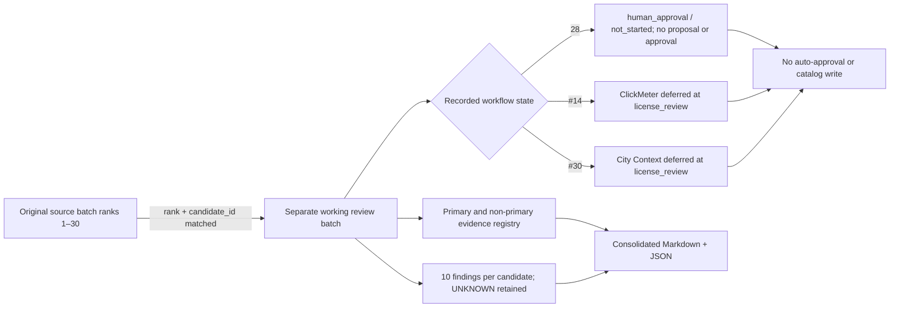

# Phase 4 Consolidated Evidence Map — Candidates #1–#30

- **Consolidation record date:** 2026-11-14 (candidate-record chronology remains separately inconclusive)
- **Scope:** exactly source-batch ranks #1–#30; no additional candidates are included.
- **Mode:** documentary consolidation only; no candidate endpoint, API, account or credential was used.
- **Machine-readable source of truth:** [`phase-4-consolidated-evidence-map-1-30.json`](phase-4-consolidated-evidence-map-1-30.json)
- **Workflow source:** [`phase-4-review-batch-2026-11-12.json`](phase-4-review-batch-2026-11-12.json)
- **Baseline preservation:** [`phase-4-repository-preservation-report-2026-11-14.md`](phase-4-repository-preservation-report-2026-11-14.md)

> **Decision boundary:** this is evidence organization, not a recommendation to connect, an integration result, legal advice, a proposal, an approval, or catalog acceptance. Do not interpret `UNKNOWN`, missing fields, source pointers, or access-tier names as affirmative rights or production readiness.

## Status legend

| Indicator | Meaning |
| --- | --- |
| ✅ `VERIFIED` | Narrow claim supported by reviewed primary evidence; see cited source and scope. |
| 🟨 `PARTIALLY_VERIFIED` | A bounded subclaim is supported; material scope/condition remains unresolved. |
| ❓ `UNKNOWN` | Evidence does not establish a positive or negative answer. |
| ⚠️ `INCONCLUSIVE` | Conflicting, inaccessible, stale, ambiguous or scope-limited evidence. |
| ⏸️ `DEFERRED` | Workflow work stopped at a deferred stage; not rejection or approval. |
| 🚫 `NOT_TESTED` | Accessibility/operation was not tested. |
| — `NOT_APPLICABLE` | Only for a genuinely inapplicable field; missing evidence is never mapped here. |

## Executive summary

The preserved working batch matches the original 100-candidate source batch by rank and ID for every item #1–#30. This consolidated slice contains **30 unique candidates, 300 workflow findings, 261 evidence records (219 marked primary; 42 non-primary), and 793 hash-linked transition events**. Twenty-nine candidates have at least one primary-source record; City Context (#30) has only source-pointer and page-fetch observations and remains deferred. The recorded workflow has 28 candidates at `human_approval / not_started` and two deferred at `license_review` (#14 ClickMeter, #30 City Context).

The stored workflow records **196 verified and 104 inconclusive** findings; the latter include all 30 `NOT_TESTED` accessibility findings. Verified documentary evidence is not a live-access result. There are **0 endpoint probes, 0 candidate live API calls in this consolidation, 0 proposals, 0 approval records and 0 catalog acceptances**. Existing accepted catalogs and batch history are preserved.

**Date caveat:** all evidence/event/candidate-date fields in the working batch say 2026-11-12, but the Mission 07 and Mission 09 commits are timestamped 2026-11-14 and the handoff indicates some source review occurred on 2026-11-14. No prior timestamp/hash-linked event has been rewritten; chronology remains `INCONCLUSIVE`. See the [audit report](phase-4-consolidated-audit-report-1-30.md).

## Scope, method and source hierarchy

1. Select exactly ranks 1–30 from the original source batch and verify `rank`, `candidate_id`, and product name against the separate working review batch.
2. Read the workflow findings/evidence and full ordered transition log from the saved working batch. The JSON includes all candidate evidence records and all events, not only the subset cited by the Markdown. Workflow-event registry entries carry index-only `rank` and `candidate_id` fields for traceability; the original `event_sha256` is copied verbatim and authenticates the source event payload without those added indexes.
3. Prefer evidence marked `primary_source: true` and classified `official_provider` or `official_repository`; preserve secondary directories, imported OpenAPI pointers and failed-page observations as leads/observations only.
4. Preserve service/API terms separately from dataset/content rights and source/spec licenses. Preserve free account/trial/sandbox access separately from free production use and commercial permissions.
5. Retain the exact stored workflow status/value and add a normalized status label; all raw values, evidence IDs, confidence values, notes and event hashes remain in the JSON.
6. Do not call endpoints or APIs, create accounts, use credentials, buy access, propose/approve/accept records, or modify the accepted catalog.

## Counts and current workflow state

| Measure | Candidates / records |
| --- | ---: |
| Candidates in scope / unique candidate IDs | 30 / 30 |
| Findings in scope | 300 (196 workflow-verified; 104 workflow-inconclusive) |
| Evidence records | 261 (219 primary; 42 non-primary) |
| Candidates with primary evidence / without | 29 / 1 (#30) |
| Workflow transition events / unique IDs | 793 / 793 |
| At `human_approval / not_started` | 28 |
| Deferred at `license_review` | 2 (#14, #30) |
| Proposals / approval records / acceptances | 0 / 0 / 0 |
| Endpoint probes / candidate live calls | 0 / 0 |
| Accessibility | 30 `NOT_TESTED` |

| Finding dimension | VERIFIED | PARTIALLY_VERIFIED | UNKNOWN | INCONCLUSIVE | NOT_TESTED |
| --- | ---: | ---: | ---: | ---: | ---: |
| API existence / scope | 29 | 0 | 0 | 1 | 0 |
| Provider identity | 29 | 0 | 0 | 1 | 0 |
| Official documentation / version | 29 | 0 | 0 | 1 | 0 |
| Authentication | 22 | 0 | 5 | 3 | 0 |
| Free tier / pricing / eligibility | 15 | 2 | 12 | 1 | 0 |
| Quota / rate / usage limits | 13 | 8 | 8 | 1 | 0 |
| API/service terms and data/content rights | 14 | 1 | 13 | 2 | 0 |
| Date-qualified API maintenance | 8 | 0 | 19 | 3 | 0 |
| Documentary Python feasibility | 28 | 0 | 1 | 1 | 0 |
| Live endpoint accessibility | 0 | 0 | 0 | 0 | 30 |

The normalized categories may not sum to 30 because `PARTIALLY_VERIFIED` splits out bounded access/limit/rights claims; raw workflow statuses are retained in JSON. Accessibility is a separate axis, never a positive assertion.

## Category and functional-group analysis

The source-batch category field is reproduced as metadata, not treated as a provider statement. Two source labels are absent/non-taxonomic (#1 YouTube and #7 APOD); their original tags are preserved. Functional groups below are editorial, non-exclusive groupings based on the candidate description and documentary scope.

### Source categories as recorded

| Original category label | Count |
| --- | ---: |
| NOT_PROVIDED / NON-TAXONOMIC | 2 |
| agriculture | 1 |
| ai-ml | 1 |
| business-commerce | 1 |
| cloud-infrastructure | 1 |
| communication | 1 |
| developer-tools | 4 |
| economics | 1 |
| energy | 1 |
| entertainment-media | 2 |
| finance | 2 |
| geospatial | 2 |
| government | 1 |
| humanitarian-development | 1 |
| identity-security | 2 |
| legal | 1 |
| marketing-social | 1 |
| open-data | 2 |
| payments | 1 |
| telecommunications | 1 |
| weather-climate | 1 |

### Non-exclusive functional families

| Functional family | Candidate ranks | Count |
| --- | --- | ---: |
| Government, research and public-interest datasets | #3, #7, #9, #11, #22, #23, #25, #26, #30 | 9 |
| Weather, climate and geospatial/location | #2, #4, #9, #24, #25, #27, #30 | 7 |
| Finance, commerce and payments | #3, #10, #15, #17, #21, #25 | 6 |
| Media, entertainment and community | #1, #7, #13, #16, #19 | 5 |
| Developer, cloud, identity and cybersecurity | #5, #8, #12, #14, #20, #29 | 6 |
| Communications, messaging and verification | #18, #28 | 2 |

The set spans public/government and research data, weather/geospatial services, finance/commerce, media and community services, developer/cloud/security tools, communications and identity. A single product may belong to multiple groups. Category membership does not imply data quality, legal suitability, access, or implementation readiness.

## Duplicate and overlap analysis — no merges

| Candidate | Observed overlap | Treatment |
| --- | --- | --- |
| #1 YouTube Data API v3 | Candidate metadata lists `youtube-data-v3` as a possible existing match. | Keep review candidate and accepted API record separate; no proposal/write. |
| #7 APOD | Candidate metadata lists `nasa-open-apis`, whose catalog summary scopes that record to APOD example usage. | Preserve both IDs; no merge or acceptance. |
| #2 Visual Crossing | Broader source queue has `candidate-visual-crossing-1785665833` (same canonical URL) and `candidate-visual-crossing-91f43c53a3` (same normalized name, different URL), both outside #1–#30. | Preserve all IDs/attributions; flags are not evidence and do not authorize deduplication. |
| #24 OpenWeatherMap | Sibling candidate `candidate-openweathermap-33fadeaff5`; Open-Meteo candidate `candidate-open-meteo-f6a4cac428` (#39) and accepted `open-meteo` are distinct records. | Keep both OpenWeatherMap candidates and Open-Meteo/accepted `open-meteo` separate. |
| #25 Census Bureau | Conceptual overlap with accepted API `census-data`, accepted dataset `census-acs-5year`, and distinct lead `candidate-us-census-ffc0d93378` outside #1–#30. | Preserve separate candidate/API/dataset IDs and histories; no merge. |

The duplicate/overlap flags are queue metadata, not provider facts. The `find_candidate_duplicates` check over the 30 selected candidates returned no within-slice pair; known sibling IDs above are retained from the larger preserved source queue. See the JSON `overlap_analysis_no_merges` and original queue record.

## Access, pricing and authentication patterns

The `free_tier` field describes a documented access path, not a broad “free API” badge. For this slice, 15 workflow access findings are verified and 15 remain inconclusive/unknown. The verified set includes no-key access (#2), a keyed free plan (#5), limited trials/credits (#6, #13, #18), paid or tiered services, and plan-specific developer access (#10, #12, #15, #16, #20, #22, #24, #25, #27, #29). Per-candidate terms and numeric limits are listed below and in JSON; no access pathway is inferred for unresolved leads.

Important distinctions supported by the evidence:

- **Account vs production:** TAGGUN's #6 time/scan trial, SportsDataIO's #13 scrambled trial, Mastercard's #17 Sandbox, and The SMS Works' #18 test credits are not unconditional free production service. Xero #10's no-charge Starter developer app/demo path is not a free live Xero accounting subscription. 1Password Connect #29 is included for paid customers but is self-hosted, not a free public API.
- **No-key vs keyed:** Visual Crossing #2 documents a limited no-key Timeline path; ExchangeRate-API #15 has both a no-key Open Access path and a separate keyed Free Plan; IP2WHOIS #5 requires a key; OpenWeatherMap #24 requires a key/subscription. No-key does not mean unlimited, unrestricted, or free for all commercial use.
- **Unsettled access:** BNM #3 says free-for-everyone but does not settle auth/quotas/access classification; bng2latlong #4 says free for any purpose but auth and quota remain unknown; Census #25's official key instructions conflict; GovInfo/NLR key-service defaults are not service pricing guarantees.
- **Paid/contractual use:** CFB #13 production real data is purchase/contract based; Telesign #28 unified Verify is full-service/sales-enabled and no unified price is established; RevAddress #27's USPS DPV is paid even though other operations are free-limited.

Authentication is independently verified for 22 candidates and unknown/inconclusive for eight. The 22 recorded findings distinguish API keys, Bearer tokens, Basic authentication, OAuth and product-/operation-specific methods; the remaining eight are not assumed to be no-auth. Candidate #25 retains its explicit key-threshold conflict.

## API terms, data rights and licensing

Fifteen workflow license findings are verified and 15 remain unknown/inconclusive. 'Verified' here means the scoped provider terms/rights statement was found; it does not mean an open license or unrestricted commercial use. A provider's API terms, a dataset/content license, an OpenAPI repository/spec license and third-party rights are separate.

Examples that must remain distinct: YouTube #1 terms/policies restrict content copying/storage; Healthsites #22 separates API terms from ODbL data and BSD-3-Clause code, with attribution/share-alike and provider contact before training/fine-tuning; OpenWeatherMap #24 uses ODbL attribution/share-alike conditions for relevant data; Xero #10 limits API data to an approved purpose and restricts AI model training; APOD #7 rights vary by asset/source; Census #25 and GovInfo #26 require dataset/collection-specific review; 1Password #29 is customer secrets, not public licensed data. The API Atlas/OpenAPI license labels never substitute for any of these terms.

## Documentary suitability (not integration, testing or production approval)

The tracked repository does not define NYAYMITRA-AI or GRANTH-AI requirements. Suitability is therefore conditional and does not certify coverage, authority, legal use, safety, accuracy, or implementation.

| Target | Assessment | Documentary evidence scope and limits |
| --- | --- | --- |
| NYAYMITRA-AI | ⚠️ INCONCLUSIVE | GovInfo #26 is U.S. government publications; Census #25 is U.S. statistical data. These sources do not establish Indian legal coverage. GovInfo collection rights and Census auth guidance need resolution. |
| GRANTH-AI | ⚠️ INCONCLUSIVE | Repository requirements/corpus are unspecified. NASA APOD #7, GovInfo #26, NLR #23, Census #25 and Healthsites #22 are distinct information domains, not evidence of a suitable books/manuscript corpus or rights. |
| General AI R&D | 🟨 PARTIALLY_VERIFIED | Multiple research/data scopes are documented, but API access does not grant training rights; Healthsites requires provider contact before training/fine-tuning, YouTube/Xero have restrictions, and many rights remain unknown. |
| Education | 🟨 PARTIALLY_VERIFIED | Some government/science/weather/health content may be documented for evaluation, but no blanket educational exception/license is inferred; asset and dataset rights vary. |
| Analytics / visualization | 🟨 PARTIALLY_VERIFIED | Weather, finance, energy, geospatial and census data shapes are documented; attribution, quotas, redistribution and derived-data rules differ. No visualization was built or tested. |
| Mobile / web work | 🟨 PARTIALLY_VERIFIED | REST/OAuth/API-key patterns and Mastercard's online/mobile banking use case are documented; production eligibility, CORS, credentials, costs and customer-data controls need separate review. No app was built or tested. |

- **NYAYMITRA-AI supporting evidence:** [evidence-m09-25-endpoint](https://www.census.gov/data/developers/guidance/api-user-guide.Example_API_Queries.html), [evidence-m09-25-training](https://www2.census.gov/about/training-workshops/2026/2026-02-19-getting-started-with-census-api-presentation.pdf), [evidence-m09-26-api_docs](https://api.govinfo.gov/docs/), [evidence-m09-26-copyright](https://www.govinfo.gov/about/policies#copyright).
- **GRANTH-AI supporting evidence:** [evidence-c45270ae059757cd](https://api.nasa.gov/assets/files/apod/APOD-APIs-and-RSS-info.pdf), [evidence-7de0223190dad581](https://science.nasa.gov/apod/apod-about/), [evidence-m09-22-api_terms](https://github.com/healthsites/healthsites/wiki/API-Terms), [evidence-m09-23-docs](https://developer.nlr.gov/docs/), [evidence-m09-26-api_docs](https://api.govinfo.gov/docs/).
- **General AI research and development supporting evidence:** [p4-yt-policy](https://developers.google.com/youtube/terms/developer-policies), [p4-yt-terms](https://developers.google.com/youtube/terms/api-services-terms-of-service), [evidence-9417bbf3934cc513](https://developer.xero.com/xero-developer-platform-terms-conditions), [evidence-m09-22-api_terms](https://github.com/healthsites/healthsites/wiki/API-Terms), [evidence-m09-22-license](https://github.com/healthsites/healthsites/blob/develop/ATTRIBUTION.md), [evidence-m09-24-license](https://openweathermap.org/full-price).
- **Education supporting evidence:** [evidence-7de0223190dad581](https://science.nasa.gov/apod/apod-about/), [evidence-m09-22-docs](https://healthsites.io/api/docs/), [evidence-m09-23-docs](https://developer.nlr.gov/docs/), [evidence-m09-26-api_docs](https://api.govinfo.gov/docs/).
- **Analytics and visualization supporting evidence:** [p4-vc-pricing](https://www.visualcrossing.com/resources/documentation/weather-api/free-weather-api-no-key/), [p4-vc-terms](https://www.visualcrossing.com/weather-service-terms/), [p4-bnm-free](https://apikijangportal.bnm.gov.my/faq), [p4-bnm-quota-gap](https://apikijangportal.bnm.gov.my/openapi), [p4-bng-free](https://www.getthedata.com/bng2latlong), [p4-bng-license](https://www.getthedata.com/bng2latlong), [evidence-70b57f2154fa0729](https://www.exchangerate-api.com/docs/free), [evidence-m09-22-quota](https://github.com/healthsites/healthsites/wiki/API-Terms), [evidence-m09-24-license](https://openweathermap.org/full-price), [evidence-m09-25-limits](https://www.census.gov/data/developers/guidance/api-user-guide.Query_Limits.html), [evidence-m09-27-pricing](https://revaddress.com/pricing/).
- **Mobile and web development supporting evidence:** [p4-vc-auth](https://www.visualcrossing.com/resources/documentation/weather-api/free-weather-api-no-key/), [evidence-521fbbe3ab0eca15](https://developer.xero.com/documentation/guides/oauth2/overview), [evidence-ddae9c4af118763e](https://developer.mastercard.com/presentment/documentation/api-basics/), [evidence-45a65b0d89f4501f](https://vercel.com/docs/rest-api), [evidence-be9d8359e7c527dd](https://thesmsworks.co.uk/developers), [evidence-m09-28-auth](https://developer.telesign.com/enterprise/docs/verify-api-get-started-with-sms), [evidence-m09-29-auth](https://www.1password.dev/connect/security).

Candidate-specific evidence IDs and every full evidence item are resolvable in the JSON registry; linked provider sources are enumerated in each section below.

## Candidate-by-candidate record

The table preserves the candidate source category. The sections keep the product/provider, stated purpose, official docs, spec pointer, all required finding dimensions, workflow state and candidate-specific unknowns together.

| # | Product | Candidate ID | Provider | Source category | Workflow |
| ---: | --- | --- | --- | --- | --- |
| 1 | [YouTube Data API v3](#candidate-1) | `candidate-youtube-data-api-v3-e1c8359956` | Google / YouTube | NOT_PROVIDED / non-taxonomic tags | human_approval / not_started |
| 2 | [Visual Crossing Weather API](#candidate-2) | `candidate-visual-crossing-weather-api-e97aed0fba` | Visual Crossing | geospatial | human_approval / not_started |
| 3 | [Bank Negara Malaysia Open Data](#candidate-3) | `candidate-bank-negara-malaysia-open-data-b0cff73d9d` | Bank Negara Malaysia (BNM) | government | human_approval / not_started |
| 4 | [bng2latlong](#candidate-4) | `candidate-bng2latlong-97d9ad5db0` | GetTheData | geospatial | human_approval / not_started |
| 5 | [IP2WHOIS Domain Lookup](#candidate-5) | `candidate-ip2whois-domain-lookup-9f73a9ca7c` | IP2Location.io (current sign-up route; legacy IP2WHOIS brand retained in candidate name) | developer-tools | human_approval / not_started |
| 6 | [TAGGUN Receipt OCR Scanning API](#candidate-6) | `candidate-taggun-receipt-ocr-scanning-api-b55fde580b` | TAGGUN | ai-ml | human_approval / not_started |
| 7 | [APOD](#candidate-7) | `candidate-apod-fb659cb117` | NASA (APOD product; route-specific current support/auth remain limited) | NOT_PROVIDED / non-taxonomic tags | human_approval / not_started |
| 8 | [CyCAT.org API](#candidate-8) | `candidate-cycat-org-api-d423696460` | CyCAT.org | identity-security | human_approval / not_started |
| 9 | [Groundwater Wells, Aquifers and Registry API](#candidate-9) | `candidate-groundwater-wells-aquifers-and-registry-16109d78d4` | Government of British Columbia (BC Data Catalogue) | open-data | human_approval / not_started |
| 10 | [Xero Assets API](#candidate-10) | `candidate-xero-assets-api-585af6f87a` | Xero | finance | human_approval / not_started |
| 11 | [USDA ERS](#candidate-11) | `candidate-usda-ers-be60dab8d0` | USDA Economic Research Service (ERS) | agriculture | human_approval / not_started |
| 12 | [Browshot](#candidate-12) | `candidate-browshot-e01a9ec3f5` | Browshot | developer-tools | human_approval / not_started |
| 13 | [CFB v3 Scores](#candidate-13) | `candidate-cfb-v3-scores-274b76b3c0` | SportsDataIO | entertainment-media | human_approval / not_started |
| 14 | [ClickMeter](#candidate-14) | `candidate-clickmeter-6295c914e4` | ClickMeter (historical provider identity; current service/legal status unresolved) | developer-tools | license_review / deferred |
| 15 | [ExchangeRate-API](#candidate-15) | `candidate-exchangerate-api-47f3e350f1` | ExchangeRate-API | finance | human_approval / not_started |
| 16 | [JSON2Video](#candidate-16) | `candidate-json2video-ae32ed51fc` | JSON2Video | entertainment-media | human_approval / not_started |
| 17 | [Personalized Offers](#candidate-17) | `candidate-personalized-offers-3ef4d01fa1` | Mastercard (Offers for Publishers product) | payments | human_approval / not_started |
| 18 | [The SMS Works API](#candidate-18) | `candidate-the-sms-works-api-c4a3fea09f` | The SMS Works | communication | human_approval / not_started |
| 19 | [Trash Nothing](#candidate-19) | `candidate-trash-nothing-d6fee4380e` | Trash Nothing | marketing-social | human_approval / not_started |
| 20 | [Vercel API](#candidate-20) | `candidate-vercel-api-d95586b8bf` | Vercel | cloud-infrastructure | human_approval / not_started |
| 21 | [Zalando Shop](#candidate-21) | `candidate-zalando-shop-04d1e2ab90` | Zalando (historical Shop Public API documentation) | business-commerce | human_approval / not_started |
| 22 | [Healthsites.io](#candidate-22) | `candidate-healthsites-io-f3ca26b767` | Healthsites.io | humanitarian-development | human_approval / not_started |
| 23 | [NLR Developer Network](#candidate-23) | `candidate-nlr-developer-network-ec3f818d2c` | National Renewable Energy Laboratory / NLR Developer Network | energy | human_approval / not_started |
| 24 | [OpenWeatherMap](#candidate-24) | `candidate-openweathermap-414a390f3e` | OpenWeatherMap | weather-climate | human_approval / not_started |
| 25 | [Census Bureau](#candidate-25) | `candidate-census-bureau-670fd2a556` | U.S. Census Bureau | economics | human_approval / not_started |
| 26 | [GovInfo](#candidate-26) | `candidate-govinfo-d67a219b74` | U.S. Government Publishing Office (GovInfo) | legal | human_approval / not_started |
| 27 | [RevAddress](#candidate-27) | `candidate-revaddress-3b7f8a6f2c` | RevAddress | developer-tools | human_approval / not_started |
| 28 | [Telesign](#candidate-28) | `candidate-telesign-b322500dc2` | Telesign | telecommunications | human_approval / not_started |
| 29 | [1Password Connect](#candidate-29) | `candidate-1password-connect-e5ab7cffc9` | 1Password | identity-security | human_approval / not_started |
| 30 | [City Context](#candidate-30) | `candidate-city-context-30c2c95ecb` | UNKNOWN — the City Context lead name is retained; current provider identity was not confirmed. | open-data | license_review / deferred |

### #1 — YouTube Data API v3

- **Candidate ID:** `candidate-youtube-data-api-v3-e1c8359956` (source batch rank 1; checked against the original batch)
- **Provider:** Google / YouTube — ✅ VERIFIED; evidence: [p4-yt-base](https://developers.google.com/youtube/data/getting-started)
- **Source category:** `UNKNOWN / not supplied`. **Functional grouping:** media / video platform, developer API. No source taxonomy category is supplied; the source categories/tags are YouTube API resource/operation names.
- **Purpose (documentary scope):** REST resources for YouTube videos, channels, playlists and related platform data; method-specific operations and quotas apply. — ✅ VERIFIED; evidence: [p4-yt-base](https://developers.google.com/youtube/data/getting-started), [p4-yt-docs](https://developers.google.com/youtube/data/getting-started)
- **Official documentation links:** [p4-yt-auth](https://developers.google.com/youtube/data/guides/authentication), [p4-yt-base](https://developers.google.com/youtube/data/getting-started), [p4-yt-code](https://developers.google.com/youtube/data/code_samples), [p4-yt-docs](https://developers.google.com/youtube/data/getting-started), [p4-yt-endpoint](https://developers.google.com/youtube/data/reference/rest/v3/search/list), [p4-yt-price-gap](https://developers.google.com/youtube/data/getting-started)
- **Original documentation/spec pointers (not automatically provider facts):** [OpenAPI 3.0.0 specification: YouTube Data API v3](https://github.com/APIs-guru/openapi-directory/blob/f04b8d0bcd39c52e1cf3ad7a5fe744709832ae49/APIs/googleapis.com/youtube/v3/openapi.yaml)
- **Spec/repository license boundary:** {"name":"Creative Commons Attribution 3.0","url":"http://creativecommons.org/licenses/by/3.0/"}. A spec/repository license is not the provider's API/service terms or a license for the API's data/content.

| Finding | Status | Stored value and reviewer note | Resolvable evidence |
| --- | --- | --- | --- |
| API existence / scope | ✅ VERIFIED | `true` — Google for Developers documents the YouTube Data API v3 as an API service. | [p4-yt-base](https://developers.google.com/youtube/data/getting-started) |
| Provider identity | ✅ VERIFIED | `"yes"` — The documentation is on the provider-controlled Google/YouTube developer site and identifies YouTube Data API v3. | [p4-yt-base](https://developers.google.com/youtube/data/getting-started) |
| Official documentation / version | ✅ VERIFIED | `true` — Current provider documentation for YouTube Data API v3 is available and identifies the documented version. | [p4-yt-docs](https://developers.google.com/youtube/data/getting-started) |
| Authentication | ✅ VERIFIED | `"API key for public-data requests; OAuth 2.0 for private user data and insert, update, or delete operations; Google Cloud project and API enablement required."` — Provider authentication guide distinguishes public-data API-key access from OAuth-authorized private/write operations. | [p4-yt-auth](https://developers.google.com/youtube/data/guides/authentication) |
| Free tier / pricing / eligibility | ❓ UNKNOWN | `"UNKNOWN"` — A quota allocation is documented, but the reviewed provider pages do not establish a monetary price or an unconditional free tier; retain UNKNOWN. | [p4-yt-price-gap](https://developers.google.com/youtube/data/getting-started) |
| Quota / rate / usage limits | ✅ VERIFIED | `{"cash_price":"UNKNOWN","default_units_per_day_other_methods":10000,"reset":"midnight Pacific Time","separate_daily_buckets":{"search.list":{"calls":100,"units_per_call":1},"videos.insert":{"calls":100,"units_per_call":1}}}` — Current provider quota documentation supplies separate method buckets and a daily default; the stated units are not a cash price. | [p4-yt-quota](https://developers.google.com/youtube/data/determine_quota_cost) |
| API/service terms and data/content rights | ✅ VERIFIED | `{"data":"There is no blanket open-data or audiovisual-content license. The terms reserve rights not expressly granted; policies prohibit unauthorized audiovisual-content copying/storage and impose retention, consent, and deletion constraints on API data.","service":"Use is governed by the YouTube API Services Terms of Service and incorporated Developer Policies; YouTube retains YouTube Property and grants only express, limited rights, with access subject to change or termination."}` — Service terms and API-data/content rights are documented separately; this is restrictive terms evidence, not an open-data license. | [p4-yt-terms](https://developers.google.com/youtube/terms/api-services-terms-of-service), [p4-yt-policy](https://developers.google.com/youtube/terms/developer-policies) |
| Date-qualified API maintenance | ✅ VERIFIED | `true` — The official revision history records a dated API method/quota update on 2026-06-03. | [p4-yt-maint](https://developers.google.com/youtube/data/revision_history) |
| Documentary Python feasibility | ✅ VERIFIED | `"feasible"` — Provider publishes Python code samples through the API Explorer and documents a REST method; Python integration is documentarily feasible, not implemented or tested. | [p4-yt-code](https://developers.google.com/youtube/data/code_samples), [p4-yt-endpoint](https://developers.google.com/youtube/data/reference/rest/v3/search/list) |
| Live endpoint accessibility | 🚫 NOT_TESTED | `NOT_TESTED` — Endpoint accessibility remains NOT_TESTED: Phase 4 permits documentary review only and no YouTube API endpoint was contacted. | [p4-yt-endpoint](https://developers.google.com/youtube/data/reference/rest/v3/search/list) |

**Open questions / caveats:**
- **❓ UNKNOWN — free_tier_and_pricing:** A quota allocation is documented, but the reviewed provider pages do not establish a monetary price or an unconditional free tier; retain UNKNOWN. Evidence: [p4-yt-price-gap](https://developers.google.com/youtube/data/getting-started).

**Actual workflow state:** `human_approval` / `not_started`; overall `in_review`; no proposal, approval or acceptance record; last event [event-d35e21ea8b8fb7b1] (SHA-256 `125f3a56ae97…`). Accessibility remains `NOT_TESTED`; Python feasibility is documentary only. Confidence for ten stored findings: min/median/max 0.50/0.94/0.95; confidence is reviewer confidence, not a probability of uptime, legality or suitability.

### #2 — Visual Crossing Weather API

- **Candidate ID:** `candidate-visual-crossing-weather-api-e97aed0fba` (source batch rank 2; checked against the original batch)
- **Provider:** Visual Crossing — ✅ VERIFIED; evidence: [p4-vc-base](https://www.visualcrossing.com/resources/documentation/weather-api/timeline-weather-api/)
- **Source category:** `geospatial`. **Functional grouping:** weather / climate, geospatial. VERIFIED means the source-batch field is present exactly as recorded; it does not certify that the source taxonomy is meaningful or provider-defined.
- **Purpose (documentary scope):** Visual Crossing Timeline REST API for current, forecast and historical weather data. — ✅ VERIFIED; evidence: [p4-vc-base](https://www.visualcrossing.com/resources/documentation/weather-api/timeline-weather-api/), [p4-vc-docs](https://www.visualcrossing.com/resources/documentation/weather-api/timeline-weather-api/)
- **Official documentation links:** [p4-vc-auth](https://www.visualcrossing.com/resources/documentation/weather-api/free-weather-api-no-key/), [p4-vc-base](https://www.visualcrossing.com/resources/documentation/weather-api/timeline-weather-api/), [p4-vc-docs](https://www.visualcrossing.com/resources/documentation/weather-api/timeline-weather-api/), [p4-vc-endpoint](https://www.visualcrossing.com/resources/documentation/weather-api/timeline-weather-api/), [p4-vc-python](https://www.visualcrossing.com/resources/documentation/weather-api/free-weather-api-no-key/)
- **Original documentation/spec pointers (not automatically provider facts):** [documentation_url](https://api.apis.guru/v2/specs/visualcrossing.com/weather/4.6/openapi.json), [API Atlas curated API row: Visual Crossing Weather API](https://github.com/CTCycle/api-atlas/blob/547dae1fcc8356b11091200c76906787cc817ebc/data/catalog.jsonl#L1371)
- **Spec/repository license boundary:** No spec license recorded. A spec/repository license is not the provider's API/service terms or a license for the API's data/content.

| Finding | Status | Stored value and reviewer note | Resolvable evidence |
| --- | --- | --- | --- |
| API existence / scope | ✅ VERIFIED | `true` — Visual Crossing provider documentation identifies the Timeline Weather API and its weather-data functions. | [p4-vc-base](https://www.visualcrossing.com/resources/documentation/weather-api/timeline-weather-api/) |
| Provider identity | ✅ VERIFIED | `"yes"` — The named Timeline API is documented on Visual Crossing-controlled documentation pages. | [p4-vc-base](https://www.visualcrossing.com/resources/documentation/weather-api/timeline-weather-api/) |
| Official documentation / version | ✅ VERIFIED | `true` — Current provider Timeline Weather API documentation is available; the reviewed page has no explicit semver label. | [p4-vc-docs](https://www.visualcrossing.com/resources/documentation/weather-api/timeline-weather-api/) |
| Authentication | ✅ VERIFIED | `"No API key required for supported no-key Timeline requests; no account registration required; anonymous access is managed by client IP; advanced requests may require registration."` — Provider explicitly documents a no-key request path and separately notes registration may be required for some advanced products. | [p4-vc-auth](https://www.visualcrossing.com/resources/documentation/weather-api/free-weather-api-no-key/) |
| Free tier / pricing / eligibility | ✅ VERIFIED | `"FREE_NO_KEY"` — The provider documents free supported Timeline requests without key/account; free access is subject to fair use, commercial-use and attribution conditions. | [p4-vc-pricing](https://www.visualcrossing.com/resources/documentation/weather-api/free-weather-api-no-key/) |
| Quota / rate / usage limits | ✅ VERIFIED | `{"no_key_access":{"controls":["request frequency","total usage","data volume","query complexity"],"identity":"public client IP","over_limit":"HTTP 429 may temporarily restrict requests","quota":"No fixed request allowance published; not unlimited","thresholds_may_change":true}}` — Provider publishes qualitative, IP-based usage controls and explicitly says it does not guarantee a fixed request allowance. | [p4-vc-quota](https://www.visualcrossing.com/resources/documentation/weather-api/free-weather-api-no-key/) |
| API/service terms and data/content rights | ✅ VERIFIED | `{"data":"Raw weather data may not be publicly redistributed for download/export. Display/publication is subject to the terms and attribution. Derived results are shareable only if they do not expose, reproduce, or substitute for raw data; high-risk reliance is restricted and warnings are required.","service":"Visual Crossing Weather Service Terms govern access and use; free no-key access remains subject to fair-use controls, attribution and other terms."}` — Provider service terms and no-key documentation distinguish access conditions from raw-data/derived-data rights and attribution. | [p4-vc-terms](https://www.visualcrossing.com/weather-service-terms/), [p4-vc-pricing](https://www.visualcrossing.com/resources/documentation/weather-api/free-weather-api-no-key/) |
| Date-qualified API maintenance | ✅ VERIFIED | `true` — Provider changelog dated 2026-09-04 contains 2026 Q3 feature additions. | [p4-vc-maint](https://www.visualcrossing.com/resources/documentation/weather-api/weather-api-changelog/) |
| Documentary Python feasibility | ✅ VERIFIED | `"feasible"` — Provider publishes runnable-shape Python requests code and a documented Timeline GET/JSON endpoint; feasibility is documentary and no code was run. | [p4-vc-python](https://www.visualcrossing.com/resources/documentation/weather-api/free-weather-api-no-key/), [p4-vc-endpoint](https://www.visualcrossing.com/resources/documentation/weather-api/timeline-weather-api/) |
| Live endpoint accessibility | 🚫 NOT_TESTED | `NOT_TESTED` — Endpoint accessibility remains NOT_TESTED under the documentary-only plan; no Visual Crossing API endpoint was contacted. | [p4-vc-endpoint](https://www.visualcrossing.com/resources/documentation/weather-api/timeline-weather-api/) |

**Actual workflow state:** `human_approval` / `not_started`; overall `in_review`; no proposal, approval or acceptance record; last event [event-62126072427b44e1] (SHA-256 `da0fcd19934f…`). Accessibility remains `NOT_TESTED`; Python feasibility is documentary only. Confidence for ten stored findings: min/median/max 0.50/0.95/0.95; confidence is reviewer confidence, not a probability of uptime, legality or suitability.

### #3 — Bank Negara Malaysia Open Data

- **Candidate ID:** `candidate-bank-negara-malaysia-open-data-b0cff73d9d` (source batch rank 3; checked against the original batch)
- **Provider:** Bank Negara Malaysia (BNM) — ✅ VERIFIED; evidence: [p4-bnm-base](https://apikijangportal.bnm.gov.my/openapi)
- **Source category:** `government`. **Functional grouping:** government / financial data, open-data portal. VERIFIED means the source-batch field is present exactly as recorded; it does not certify that the source taxonomy is meaningful or provider-defined.
- **Purpose (documentary scope):** BNM OpenAPI portal for financial, exchange-rate and statistical datasets. — ✅ VERIFIED; evidence: [p4-bnm-base](https://apikijangportal.bnm.gov.my/openapi), [p4-bnm-docs](https://apikijangportal.bnm.gov.my/faq)
- **Official documentation links:** [p4-bnm-auth-gap](https://apikijangportal.bnm.gov.my/faq), [p4-bnm-base](https://apikijangportal.bnm.gov.my/openapi), [p4-bnm-docs](https://apikijangportal.bnm.gov.my/faq), [p4-bnm-endpoint](https://apikijangportal.bnm.gov.my/openapi), [p4-bnm-maint-gap](https://apikijangportal.bnm.gov.my/openapi), [p4-bnm-python](https://apikijangportal.bnm.gov.my/faq)
- **Original documentation/spec pointers (not automatically provider facts):** [documentation_url](https://apikijangportal.bnm.gov.my/openapi), [API Atlas curated API row: Bank Negara Malaysia Open Data](https://github.com/CTCycle/api-atlas/blob/547dae1fcc8356b11091200c76906787cc817ebc/data/catalog.jsonl#L1382), [Public APIs community directory row: Bank Negara Malaysia Open Data](https://github.com/public-apis/public-apis/blob/cb581147b5e7c808cc2db43c5c590b51679dd44c/README.md#L1582)
- **Spec/repository license boundary:** No spec license recorded. A spec/repository license is not the provider's API/service terms or a license for the API's data/content.

| Finding | Status | Stored value and reviewer note | Resolvable evidence |
| --- | --- | --- | --- |
| API existence / scope | ✅ VERIFIED | `true` — The BNM-controlled OpenAPI portal identifies a production Open API service and version. | [p4-bnm-base](https://apikijangportal.bnm.gov.my/openapi) |
| Provider identity | ✅ VERIFIED | `"yes"` — The OpenAPI portal is controlled by Bank Negara Malaysia and labels the service BNM OpenAPI. | [p4-bnm-base](https://apikijangportal.bnm.gov.my/openapi) |
| Official documentation / version | ✅ VERIFIED | `true` — Provider API FAQ and production v1.0.0 explorer are available; endpoint operations are exposed through the interactive portal. | [p4-bnm-docs](https://apikijangportal.bnm.gov.my/faq) |
| Authentication | ❓ UNKNOWN | `"UNKNOWN"` — The reviewed provider documentation does not establish an authentication requirement; retain UNKNOWN. | [p4-bnm-auth-gap](https://apikijangportal.bnm.gov.my/faq) |
| Free tier / pricing / eligibility | 🟨 PARTIALLY_VERIFIED | `"UNKNOWN"` — The factual claim “free for everyone” is supported, but this workflow enum cannot safely map it to no-key/keyed access while authentication and usage conditions are unstated; preserve UNKNOWN and flag the taxonomy gap. | [p4-bnm-free](https://apikijangportal.bnm.gov.my/faq) |
| Quota / rate / usage limits | ❓ UNKNOWN | `"UNKNOWN"` — No request quota/rate limit is established by the reviewed official pages; retain UNKNOWN. | [p4-bnm-quota-gap](https://apikijangportal.bnm.gov.my/openapi) |
| API/service terms and data/content rights | ❓ UNKNOWN | `"UNKNOWN"` — The official disclaimer is a service/accuracy disclaimer, not an API or dataset reuse license; data rights remain UNKNOWN. | [p4-bnm-terms](https://apikijangportal.bnm.gov.my/disclaimer) |
| Date-qualified API maintenance | ❓ UNKNOWN | `"UNKNOWN"` — No dated provider-controlled release/change record was identified in reviewed BNM sources; activity remains UNKNOWN. | [p4-bnm-maint-gap](https://apikijangportal.bnm.gov.my/openapi) |
| Documentary Python feasibility | ✅ VERIFIED | `"feasible"` — Provider docs specify HTTP API-client use and JSON Accept-version headers; a Python HTTP client can express this pattern, but auth/endpoint details still need confirmation and no code was run. | [p4-bnm-python](https://apikijangportal.bnm.gov.my/faq), [p4-bnm-endpoint](https://apikijangportal.bnm.gov.my/openapi) |
| Live endpoint accessibility | 🚫 NOT_TESTED | `NOT_TESTED` — Accessibility remains NOT_TESTED: the plan forbids candidate endpoint requests; the interactive explorer documentation is not a reachability observation. | [p4-bnm-endpoint](https://apikijangportal.bnm.gov.my/openapi) |

**Open questions / caveats:**
- **❓ UNKNOWN — authentication:** The reviewed provider documentation does not establish an authentication requirement; retain UNKNOWN. Evidence: [p4-bnm-auth-gap](https://apikijangportal.bnm.gov.my/faq).
- **🟨 PARTIALLY_VERIFIED — free_tier_and_pricing:** The factual claim “free for everyone” is supported, but this workflow enum cannot safely map it to no-key/keyed access while authentication and usage conditions are unstated; preserve UNKNOWN and flag the taxonomy gap. Evidence: [p4-bnm-free](https://apikijangportal.bnm.gov.my/faq).
- **❓ UNKNOWN — quota_and_limits:** No request quota/rate limit is established by the reviewed official pages; retain UNKNOWN. Evidence: [p4-bnm-quota-gap](https://apikijangportal.bnm.gov.my/openapi).
- **❓ UNKNOWN — service_and_data_rights:** The official disclaimer is a service/accuracy disclaimer, not an API or dataset reuse license; data rights remain UNKNOWN. Evidence: [p4-bnm-terms](https://apikijangportal.bnm.gov.my/disclaimer).
- **❓ UNKNOWN — maintenance:** No dated provider-controlled release/change record was identified in reviewed BNM sources; activity remains UNKNOWN. Evidence: [p4-bnm-maint-gap](https://apikijangportal.bnm.gov.my/openapi).
- **❓ UNKNOWN — free_tier_and_pricing.access_path:** The FAQ says free for everyone, but authentication/eligibility and limits are not specified; the workflow does not map this to a free no-key or keyed tier. Evidence: [p4-bnm-free](https://apikijangportal.bnm.gov.my/faq).

**Actual workflow state:** `human_approval` / `not_started`; overall `in_review`; no proposal, approval or acceptance record; last event [event-c9faf2a20226d482] (SHA-256 `387d73837dcb…`). Accessibility remains `NOT_TESTED`; Python feasibility is documentary only. Confidence for ten stored findings: min/median/max 0.50/0.72/0.95; confidence is reviewer confidence, not a probability of uptime, legality or suitability.

### #4 — bng2latlong

- **Candidate ID:** `candidate-bng2latlong-97d9ad5db0` (source batch rank 4; checked against the original batch)
- **Provider:** GetTheData — ✅ VERIFIED; evidence: [p4-bng-base](https://www.getthedata.com/bng2latlong)
- **Source category:** `geospatial`. **Functional grouping:** geospatial, coordinate conversion. VERIFIED means the source-batch field is present exactly as recorded; it does not certify that the source taxonomy is meaningful or provider-defined.
- **Purpose (documentary scope):** Convert British National Grid / OSGB36 easting-northing coordinates to WGS84 latitude-longitude. — ✅ VERIFIED; evidence: [p4-bng-base](https://www.getthedata.com/bng2latlong), [p4-bng-docs](https://www.getthedata.com/bng2latlong)
- **Official documentation links:** [p4-bng-auth-gap](https://www.getthedata.com/bng2latlong), [p4-bng-base](https://www.getthedata.com/bng2latlong), [p4-bng-docs](https://www.getthedata.com/bng2latlong), [p4-bng-endpoint](https://www.getthedata.com/bng2latlong), [p4-bng-maint-gap](https://www.getthedata.com/bng2latlong), [p4-bng-python](https://www.getthedata.com/bng2latlong)
- **Original documentation/spec pointers (not automatically provider facts):** [documentation_url](https://www.getthedata.com/bng2latlong/openapi), [API Atlas curated API row: bng2latlong](https://github.com/CTCycle/api-atlas/blob/547dae1fcc8356b11091200c76906787cc817ebc/data/catalog.jsonl#L1270), [Public APIs community directory row: bng2latlong](https://github.com/public-apis/public-apis/blob/cb581147b5e7c808cc2db43c5c590b51679dd44c/README.md#L1468)
- **Spec/repository license boundary:** No spec license recorded. A spec/repository license is not the provider's API/service terms or a license for the API's data/content.

| Finding | Status | Stored value and reviewer note | Resolvable evidence |
| --- | --- | --- | --- |
| API existence / scope | ✅ VERIFIED | `true` — The provider page documents the bng2latlong HTTP API and its coordinate conversion function. | [p4-bng-base](https://www.getthedata.com/bng2latlong) |
| Provider identity | ✅ VERIFIED | `"yes"` — The named service and its endpoint documentation are published on GetTheData-controlled pages. | [p4-bng-base](https://www.getthedata.com/bng2latlong) |
| Official documentation / version | ✅ VERIFIED | `true` — Provider documentation includes endpoint syntax, response fields, and JSON/XML examples. | [p4-bng-docs](https://www.getthedata.com/bng2latlong) |
| Authentication | ❓ UNKNOWN | `"UNKNOWN"` — The provider page does not explicitly state authentication requirements; retain UNKNOWN. | [p4-bng-auth-gap](https://www.getthedata.com/bng2latlong) |
| Free tier / pricing / eligibility | 🟨 PARTIALLY_VERIFIED | `"UNKNOWN"` — The provider says the service is free to use for any purpose, but the workflow access-path enum cannot assert FREE_NO_KEY or FREE_WITH_KEY without an explicit auth statement; preserve UNKNOWN. | [p4-bng-free](https://www.getthedata.com/bng2latlong) |
| Quota / rate / usage limits | ❓ UNKNOWN | `"UNKNOWN"` — No quota/rate limit is established by the reviewed provider page; retain UNKNOWN. | [p4-bng-quota-gap](https://www.getthedata.com/bng2latlong) |
| API/service terms and data/content rights | ❓ UNKNOWN | `"UNKNOWN"` — The free-use/optional-credit statement is preserved, but the reviewed page does not separate service permission from returned-data rights or identify a specific data license; keep the combined service/data license field UNKNOWN. | [p4-bng-license](https://www.getthedata.com/bng2latlong) |
| Date-qualified API maintenance | ❓ UNKNOWN | `"UNKNOWN"` — No dated release/change record is present in the reviewed provider page; retain UNKNOWN. | [p4-bng-maint-gap](https://www.getthedata.com/bng2latlong) |
| Documentary Python feasibility | ✅ VERIFIED | `"feasible"` — The documented GET/JSON interface is feasible to call using a Python HTTP client; no integration code or request was run. | [p4-bng-python](https://www.getthedata.com/bng2latlong), [p4-bng-endpoint](https://www.getthedata.com/bng2latlong) |
| Live endpoint accessibility | 🚫 NOT_TESTED | `NOT_TESTED` — Accessibility remains NOT_TESTED because endpoint calls are outside this Phase 4 plan. | [p4-bng-endpoint](https://www.getthedata.com/bng2latlong) |

**Open questions / caveats:**
- **❓ UNKNOWN — authentication:** The provider page does not explicitly state authentication requirements; retain UNKNOWN. Evidence: [p4-bng-auth-gap](https://www.getthedata.com/bng2latlong).
- **🟨 PARTIALLY_VERIFIED — free_tier_and_pricing:** The provider says the service is free to use for any purpose, but the workflow access-path enum cannot assert FREE_NO_KEY or FREE_WITH_KEY without an explicit auth statement; preserve UNKNOWN. Evidence: [p4-bng-free](https://www.getthedata.com/bng2latlong).
- **❓ UNKNOWN — quota_and_limits:** No quota/rate limit is established by the reviewed provider page; retain UNKNOWN. Evidence: [p4-bng-quota-gap](https://www.getthedata.com/bng2latlong).
- **❓ UNKNOWN — service_and_data_rights:** The free-use/optional-credit statement is preserved, but the reviewed page does not separate service permission from returned-data rights or identify a specific data license; keep the combined service/data license field UNKNOWN. Evidence: [p4-bng-license](https://www.getthedata.com/bng2latlong).
- **❓ UNKNOWN — maintenance:** No dated release/change record is present in the reviewed provider page; retain UNKNOWN. Evidence: [p4-bng-maint-gap](https://www.getthedata.com/bng2latlong).
- **❓ UNKNOWN — free_tier_and_pricing.access_path:** The 'free for any purpose' statement does not establish whether authentication is required or define returned-data rights and quotas. Evidence: [p4-bng-free](https://www.getthedata.com/bng2latlong).

**Actual workflow state:** `human_approval` / `not_started`; overall `in_review`; no proposal, approval or acceptance record; last event [event-1d70209516033545] (SHA-256 `24104ab5316f…`). Accessibility remains `NOT_TESTED`; Python feasibility is documentary only. Confidence for ten stored findings: min/median/max 0.50/0.72/0.95; confidence is reviewer confidence, not a probability of uptime, legality or suitability.

### #5 — IP2WHOIS Domain Lookup

- **Candidate ID:** `candidate-ip2whois-domain-lookup-9f73a9ca7c` (source batch rank 5; checked against the original batch)
- **Provider:** IP2Location.io (current sign-up route; legacy IP2WHOIS brand retained in candidate name) — ✅ VERIFIED; evidence: [p4-ip2-base](https://www.ip2location.io/ip2whois-documentation), [p4-ip2-migration](https://www.ip2whois.com/register)
- **Source category:** `developer-tools`. **Functional grouping:** developer tools, domain / WHOIS lookup. VERIFIED means the source-batch field is present exactly as recorded; it does not certify that the source taxonomy is meaningful or provider-defined.
- **Purpose (documentary scope):** Domain WHOIS lookup with registrar/registration and related response fields; current documentation routes new access through IP2Location.io. — ✅ VERIFIED; evidence: [p4-ip2-base](https://www.ip2location.io/ip2whois-documentation), [p4-ip2-docs](https://www.ip2location.io/ip2whois-documentation)
- **Official documentation links:** [p4-ip2-auth](https://www.ip2location.io/ip2whois-documentation), [p4-ip2-base](https://www.ip2location.io/ip2whois-documentation), [p4-ip2-docs](https://www.ip2location.io/ip2whois-documentation), [p4-ip2-endpoint](https://www.ip2location.io/ip2whois-documentation), [p4-ip2-maint-gap](https://www.ip2location.io/ip2whois-documentation), [p4-ip2-migration](https://www.ip2whois.com/register), [p4-ip2-privacy](https://www.ip2whois.com/privacy-policy), [p4-ip2-python](https://www.ip2location.io/ip2whois-documentation)
- **Original documentation/spec pointers (not automatically provider facts):** [documentation_url](https://api.swaggerhub.com/apis/ip2whois/ip2whois-domain-lookup/1.0), [API Atlas curated API row: IP2WHOIS Domain Lookup](https://github.com/CTCycle/api-atlas/blob/547dae1fcc8356b11091200c76906787cc817ebc/data/catalog.jsonl#L590)
- **Spec/repository license boundary:** No spec license recorded. A spec/repository license is not the provider's API/service terms or a license for the API's data/content.

| Finding | Status | Stored value and reviewer note | Resolvable evidence |
| --- | --- | --- | --- |
| API existence / scope | ✅ VERIFIED | `true` — Current provider-controlled documentation identifies the IP2WHOIS Domain WHOIS API and its v2 route. | [p4-ip2-base](https://www.ip2location.io/ip2whois-documentation) |
| Provider identity | ✅ VERIFIED | `"yes"` — The IP2WHOIS product is documented on IP2Location.io and the legacy IP2WHOIS registration page routes new signup to that provider-controlled product. | [p4-ip2-base](https://www.ip2location.io/ip2whois-documentation), [p4-ip2-migration](https://www.ip2whois.com/register) |
| Official documentation / version | ✅ VERIFIED | `true` — Current provider documentation for the IP2WHOIS Domain WHOIS API is available and specifies endpoint v2 and response formats. | [p4-ip2-docs](https://www.ip2location.io/ip2whois-documentation) |
| Authentication | ✅ VERIFIED | `"API key required; current provider docs allow the key as a URL parameter or Bearer token."` — Provider authentication documentation explicitly requires an API key for Domain WHOIS requests. | [p4-ip2-auth](https://www.ip2location.io/ip2whois-documentation) |
| Free tier / pricing / eligibility | ✅ VERIFIED | `"FREE_WITH_KEY"` — Current product documentation requires an API key; current pricing lists a $0 Free plan with 500 monthly WHOIS queries and required attribution. | [p4-ip2-pricing](https://www.ip2location.io/pricing), [p4-ip2-auth](https://www.ip2location.io/ip2whois-documentation) |
| Quota / rate / usage limits | ✅ VERIFIED | `{"free_plan":{"attribution_required":true,"domain_whois_queries_per_month":500,"overage":"No overage; free service stops when allowance is exhausted","price_usd_per_month":0},"paid_tiers":{"Plus":{"domain_whois_queries":40000,"monthly_price_usd":249},"Security":{"domain_whois_queries":150000,"monthly_price_usd":499},"Starter":{"domain_whois_queries":5000,"monthly_price_usd":49}}}` — Current provider pricing gives plan-specific monthly WHOIS query counts and confirms the free allowance is finite. | [p4-ip2-quota](https://www.ip2location.io/pricing) |
| API/service terms and data/content rights | ❓ UNKNOWN | `"UNKNOWN"` — Reviewed IP2Location.io terms do not clearly extend to WHOIS data, and the IP2WHOIS privacy page does not define WHOIS response reuse/retention rights; keep service/data license UNKNOWN. | [p4-ip2-terms-scope](https://www.ip2location.io/ip2location_io_terms_of_service.pdf), [p4-ip2-privacy](https://www.ip2whois.com/privacy-policy) |
| Date-qualified API maintenance | ❓ UNKNOWN | `"UNKNOWN"` — No dated release/change record was located in the reviewed provider WHOIS documentation; retain UNKNOWN. | [p4-ip2-maint-gap](https://www.ip2location.io/ip2whois-documentation) |
| Documentary Python feasibility | ✅ VERIFIED | `"feasible"` — The provider documents a Python SDK and Python HTTP example, plus the endpoint; the example requires Python 3 syntax cleanup and was not executed. | [p4-ip2-python](https://www.ip2location.io/ip2whois-documentation), [p4-ip2-endpoint](https://www.ip2location.io/ip2whois-documentation) |
| Live endpoint accessibility | 🚫 NOT_TESTED | `NOT_TESTED` — Accessibility remains NOT_TESTED; no IP2WHOIS endpoint call or health check was made. | [p4-ip2-endpoint](https://www.ip2location.io/ip2whois-documentation) |

**Open questions / caveats:**
- **❓ UNKNOWN — service_and_data_rights:** Reviewed IP2Location.io terms do not clearly extend to WHOIS data, and the IP2WHOIS privacy page does not define WHOIS response reuse/retention rights; keep service/data license UNKNOWN. Evidence: [p4-ip2-terms-scope](https://www.ip2location.io/ip2location_io_terms_of_service.pdf), [p4-ip2-privacy](https://www.ip2whois.com/privacy-policy).
- **❓ UNKNOWN — maintenance:** No dated release/change record was located in the reviewed provider WHOIS documentation; retain UNKNOWN. Evidence: [p4-ip2-maint-gap](https://www.ip2location.io/ip2whois-documentation).

**Actual workflow state:** `human_approval` / `not_started`; overall `in_review`; no proposal, approval or acceptance record; last event [event-412fa3243b465c65] (SHA-256 `6edf16b92db6…`). Accessibility remains `NOT_TESTED`; Python feasibility is documentary only. Confidence for ten stored findings: min/median/max 0.50/0.93/0.95; confidence is reviewer confidence, not a probability of uptime, legality or suitability.

### #6 — TAGGUN Receipt OCR Scanning API

- **Candidate ID:** `candidate-taggun-receipt-ocr-scanning-api-b55fde580b` (source batch rank 6; checked against the original batch)
- **Provider:** TAGGUN — ✅ VERIFIED; evidence: [evidence-650ffc61a7c2eb7d](https://developers.taggun.io/reference/overview), [evidence-782f4f0dfce75d69](https://www.taggun.io/terms)
- **Source category:** `ai-ml`. **Functional grouping:** document AI, receipt OCR. VERIFIED means the source-batch field is present exactly as recorded; it does not certify that the source taxonomy is meaningful or provider-defined.
- **Purpose (documentary scope):** Receipt-scanning/OCR service that extracts structured information from submitted receipt images. — ✅ VERIFIED; evidence: [evidence-57d64e186accbe8c](https://developers.taggun.io/reference/overview), [evidence-650ffc61a7c2eb7d](https://developers.taggun.io/reference/overview)
- **Official documentation links:** [evidence-55067243c9cd6edf](https://developers.taggun.io/reference/overview), [evidence-57d64e186accbe8c](https://developers.taggun.io/reference/overview), [evidence-630f444f07f3b89b](https://developers.taggun.io/docs/security-and-privacy), [evidence-650ffc61a7c2eb7d](https://developers.taggun.io/reference/overview), [evidence-8ba02c9983d9a423](https://developers.taggun.io/docs/change-logs)
- **Original documentation/spec pointers (not automatically provider facts):** [documentation_url](https://api.apis.guru/v2/specs/taggun.io/1.10.9/swagger.json), [API Atlas curated API row: TAGGUN Receipt OCR Scanning API](https://github.com/CTCycle/api-atlas/blob/547dae1fcc8356b11091200c76906787cc817ebc/data/catalog.jsonl#L95)
- **Spec/repository license boundary:** No spec license recorded. A spec/repository license is not the provider's API/service terms or a license for the API's data/content.

| Finding | Status | Stored value and reviewer note | Resolvable evidence |
| --- | --- | --- | --- |
| API existence / scope | ✅ VERIFIED | `true` — Official Taggun documentation describes the named receipt/invoice REST API; this does not establish live reachability. | [evidence-650ffc61a7c2eb7d](https://developers.taggun.io/reference/overview) |
| Provider identity | ✅ VERIFIED | `"yes"` — Official Taggun developer and legal pages identify and govern the service. | [evidence-650ffc61a7c2eb7d](https://developers.taggun.io/reference/overview), [evidence-782f4f0dfce75d69](https://www.taggun.io/terms) |
| Official documentation / version | ✅ VERIFIED | `true` — Current provider API reference and Quick Start material describe request/response behavior. | [evidence-650ffc61a7c2eb7d](https://developers.taggun.io/reference/overview), [evidence-57d64e186accbe8c](https://developers.taggun.io/reference/overview) |
| Authentication | ✅ VERIFIED | `{"header":"apikey","kind":"api_key_header","required":true}` — Provider explicitly requires an account-issued API key in the apikey header. No credentials were collected or sent. | [evidence-55067243c9cd6edf](https://developers.taggun.io/reference/overview) |
| Free tier / pricing / eligibility | ✅ VERIFIED | `"FREE_TIER_LIMITED"` — Limited account-based trial: 30 days or 1,000 scans, whichever comes first; afterward the selected plan is billed unless cancelled. No ongoing free tier is documented. | [evidence-d136634906986c17](https://developers.taggun.io/docs/getting-started), [evidence-04ec91d432b8503f](https://www.taggun.io/pricing) |
| Quota / rate / usage limits | ✅ VERIFIED | `{"maximum_request_body_bytes":20971520,"monthly_plan_scans":{"advanced":20000,"business":8000,"developer":500,"startup":1800},"requests_per_hour":2000,"requests_per_minute":300,"requests_per_second":5,"trial":{"days":30,"limit_rule":"whichever comes first","scans":1000},"window_and_scope":"UNKNOWN"}` — Published throughput, body-size and plan-volume limits are supported; gateway rate-window semantics and precise scope remain unspecified by Taggun. | [evidence-dc7e8d37a8ced3ad](https://developers.taggun.io/docs/usage-limit), [evidence-04ec91d432b8503f](https://www.taggun.io/pricing) |
| API/service terms and data/content rights | ✅ VERIFIED | `{"data":"For user-uploaded Data, Taggun says it claims no IP rights and that the data retains original ownership. Reviewed terms do not separately establish ownership/onward-use rights for extracted results or third-party receipt content; those rights remain unresolved.","service":"Taggun Limited Terms govern the service; Taggun retains IP in its service/software/documentation and permits API integration in customer products subject to those terms."}` — Service and uploaded-input claims are directly supported. This is not a blanket license to source receipts or an established license for extraction outputs. | [evidence-782f4f0dfce75d69](https://www.taggun.io/terms), [evidence-630f444f07f3b89b](https://developers.taggun.io/docs/security-and-privacy) |
| Date-qualified API maintenance | ❓ UNKNOWN | `"UNKNOWN"` — The official changelog has August 2026 month-level entries but no exact activity day. Current maintenance remains UNKNOWN under the workflow date rule. | [evidence-8ba02c9983d9a423](https://developers.taggun.io/docs/change-logs) |
| Documentary Python feasibility | ✅ VERIFIED | `"feasible"` — Official docs include a Python requests example and JSON response; no code was executed. | [evidence-57d64e186accbe8c](https://developers.taggun.io/reference/overview) |
| Live endpoint accessibility | 🚫 NOT_TESTED | `NOT_TESTED` — The endpoint is documented; accessibility was intentionally not tested and no health check was made. | [evidence-57d64e186accbe8c](https://developers.taggun.io/reference/overview) |

**Open questions / caveats:**
- **❓ UNKNOWN — maintenance:** The official changelog has August 2026 month-level entries but no exact activity day. Current maintenance remains UNKNOWN under the workflow date rule. Evidence: [evidence-8ba02c9983d9a423](https://developers.taggun.io/docs/change-logs).

**Actual workflow state:** `human_approval` / `not_started`; overall `in_review`; no proposal, approval or acceptance record; last event [event-89b92b129c618140] (SHA-256 `0860ab5a44bd…`). Accessibility remains `NOT_TESTED`; Python feasibility is documentary only. Confidence for ten stored findings: min/median/max 0.92/0.99/0.99; confidence is reviewer confidence, not a probability of uptime, legality or suitability.

### #7 — APOD

- **Candidate ID:** `candidate-apod-fb659cb117` (source batch rank 7; checked against the original batch)
- **Provider:** NASA (APOD product; route-specific current support/auth remain limited) — ✅ VERIFIED; evidence: [evidence-8274d5f6b9904322](https://api.nasa.gov/), [evidence-c45270ae059757cd](https://api.nasa.gov/assets/files/apod/APOD-APIs-and-RSS-info.pdf)
- **Source category:** `UNKNOWN / not supplied`. **Functional grouping:** science / space, imagery and metadata. No meaningful source taxonomy category is supplied; the raw source tag/category is 'request tag'.
- **Purpose (documentary scope):** Astronomy Picture of the Day imagery and associated metadata; the migrated APOD route's specific access behavior remains unresolved. — ✅ VERIFIED; evidence: [evidence-8274d5f6b9904322](https://api.nasa.gov/), [evidence-c45270ae059757cd](https://api.nasa.gov/assets/files/apod/APOD-APIs-and-RSS-info.pdf)
- **Official documentation links:** [evidence-017412754bf161b6](https://api.nasa.gov/assets/html/authentication.html), [evidence-8274d5f6b9904322](https://api.nasa.gov/), [evidence-8e1fc66373f97f29](https://api.nasa.gov/), [evidence-c45270ae059757cd](https://api.nasa.gov/assets/files/apod/APOD-APIs-and-RSS-info.pdf)
- **Original documentation/spec pointers (not automatically provider facts):** [OpenAPI 3.0.0 specification: APOD](https://github.com/APIs-guru/openapi-directory/blob/f04b8d0bcd39c52e1cf3ad7a5fe744709832ae49/APIs/nasa.gov/apod/1.0.0/openapi.yaml)
- **Spec/repository license boundary:** {"name":"Apache 2.0","url":"http://www.apache.org/licenses/LICENSE-2.0.html"}. A spec/repository license is not the provider's API/service terms or a license for the API's data/content.

| Finding | Status | Stored value and reviewer note | Resolvable evidence |
| --- | --- | --- | --- |
| API existence / scope | ✅ VERIFIED | `true` — NASA identifies APOD and the migrated replacement route; legacy API retirement has a published date. | [evidence-8274d5f6b9904322](https://api.nasa.gov/), [evidence-c45270ae059757cd](https://api.nasa.gov/assets/files/apod/APOD-APIs-and-RSS-info.pdf) |
| Provider identity | ✅ VERIFIED | `"yes"` — NASA API portal and NASA-linked APOD guide identify the service and replacement route. | [evidence-8274d5f6b9904322](https://api.nasa.gov/), [evidence-c45270ae059757cd](https://api.nasa.gov/assets/files/apod/APOD-APIs-and-RSS-info.pdf) |
| Official documentation / version | ✅ VERIFIED | `true` — NASA portal and APOD Basic guide document the current JSON route/feed formats. | [evidence-8274d5f6b9904322](https://api.nasa.gov/), [evidence-c45270ae059757cd](https://api.nasa.gov/assets/files/apod/APOD-APIs-and-RSS-info.pdf) |
| Authentication | ❓ UNKNOWN | `"UNKNOWN"` — NASA general API authentication guidance and the legacy api_key model do not establish authentication behavior for the migrated WordPress APOD route; route-specific auth remains UNKNOWN. No key was used. | [evidence-017412754bf161b6](https://api.nasa.gov/assets/html/authentication.html), [evidence-8274d5f6b9904322](https://api.nasa.gov/) |
| Free tier / pricing / eligibility | ❓ UNKNOWN | `"UNKNOWN"` — No APOD-specific monetary price/free-tier statement was found in reviewed NASA documentation; exploratory access and demo-key provisions are not classified as a verified free tier. | [evidence-d1f1f71f77193b16](https://api.nasa.gov/) |
| Quota / rate / usage limits | ❓ UNKNOWN | `"UNKNOWN"` — General NASA limits are 1,000/hour per registered key and 30/hour plus 50/day/IP for DEMO_KEY; NASA warns limits may vary by service. Quota for the migrated APOD route remains UNKNOWN. | [evidence-017412754bf161b6](https://api.nasa.gov/assets/html/authentication.html), [evidence-03018c60d1b79a58](https://api.nasa.gov/assets/html/authentication.html) |
| API/service terms and data/content rights | ❓ UNKNOWN | `"UNKNOWN"` — No uniform APOD service/whole-feed license was established. NASA-origin content is subject to NASA media guidelines; third-party images require per-item rights review and NASA does not convey those rights. | [evidence-08d4e90a332c3c64](https://www.nasa.gov/nasa-brand-center/images-and-media/), [evidence-7de0223190dad581](https://science.nasa.gov/apod/apod-about/) |
| Date-qualified API maintenance | ✅ VERIFIED | `true` — Provider notice dates migration to 2026-09-10 and schedules legacy archival for 2026-12-01. | [evidence-59b8af20adcbe291](https://api.nasa.gov/) |
| Documentary Python feasibility | ✅ VERIFIED | `"feasible"` — The documented HTTPS GET and structured JSON are suitable for a Python HTTP client; no code or request was run. | [evidence-c45270ae059757cd](https://api.nasa.gov/assets/files/apod/APOD-APIs-and-RSS-info.pdf), [evidence-8e1fc66373f97f29](https://api.nasa.gov/) |
| Live endpoint accessibility | 🚫 NOT_TESTED | `NOT_TESTED` — The migrated APOD GET route is documented but was intentionally not contacted. | [evidence-8e1fc66373f97f29](https://api.nasa.gov/) |

**Open questions / caveats:**
- **❓ UNKNOWN — authentication:** NASA general API authentication guidance and the legacy api_key model do not establish authentication behavior for the migrated WordPress APOD route; route-specific auth remains UNKNOWN. No key was used. Evidence: [evidence-017412754bf161b6](https://api.nasa.gov/assets/html/authentication.html), [evidence-8274d5f6b9904322](https://api.nasa.gov/).
- **❓ UNKNOWN — free_tier_and_pricing:** No APOD-specific monetary price/free-tier statement was found in reviewed NASA documentation; exploratory access and demo-key provisions are not classified as a verified free tier. Evidence: [evidence-d1f1f71f77193b16](https://api.nasa.gov/).
- **❓ UNKNOWN — quota_and_limits:** General NASA limits are 1,000/hour per registered key and 30/hour plus 50/day/IP for DEMO_KEY; NASA warns limits may vary by service. Quota for the migrated APOD route remains UNKNOWN. Evidence: [evidence-017412754bf161b6](https://api.nasa.gov/assets/html/authentication.html), [evidence-03018c60d1b79a58](https://api.nasa.gov/assets/html/authentication.html).
- **❓ UNKNOWN — service_and_data_rights:** No uniform APOD service/whole-feed license was established. NASA-origin content is subject to NASA media guidelines; third-party images require per-item rights review and NASA does not convey those rights. Evidence: [evidence-08d4e90a332c3c64](https://www.nasa.gov/nasa-brand-center/images-and-media/), [evidence-7de0223190dad581](https://science.nasa.gov/apod/apod-about/).

**Actual workflow state:** `human_approval` / `not_started`; overall `in_review`; no proposal, approval or acceptance record; last event [event-c7da00ccc28c7cdd] (SHA-256 `c9f50b520f20…`). Accessibility remains `NOT_TESTED`; Python feasibility is documentary only. Confidence for ten stored findings: min/median/max 0.84/0.96/0.99; confidence is reviewer confidence, not a probability of uptime, legality or suitability.

### #8 — CyCAT.org API

- **Candidate ID:** `candidate-cycat-org-api-d423696460` (source batch rank 8; checked against the original batch)
- **Provider:** CyCAT.org — ✅ VERIFIED; evidence: [evidence-93b6667c6473abf9](https://cycat.org/about/), [evidence-4ccca13826dc4fc8](https://cycat.org/services/)
- **Source category:** `identity-security`. **Functional grouping:** cybersecurity, resource catalogue. VERIFIED means the source-batch field is present exactly as recorded; it does not certify that the source taxonomy is meaningful or provider-defined.
- **Purpose (documentary scope):** Cybersecurity Resource Catalogue API (CyCAT), exposing catalogue records through documented routes. — ✅ VERIFIED; evidence: [evidence-4ccca13826dc4fc8](https://cycat.org/services/), [evidence-b9569ffe204f07bf](https://api.cycat.org/swagger.json)
- **Official documentation links:** [evidence-4ccca13826dc4fc8](https://cycat.org/services/), [evidence-6a9cad572f54e8be](https://api.cycat.org/swagger.json), [evidence-8860950dfa0d285a](https://cycat.org/services/), [evidence-93b6667c6473abf9](https://cycat.org/about/), [evidence-b9569ffe204f07bf](https://api.cycat.org/swagger.json)
- **Original documentation/spec pointers (not automatically provider facts):** [documentation_url](https://api.apis.guru/v2/specs/cycat.org/0.9/swagger.json), [API Atlas curated API row: CyCAT.org API](https://github.com/CTCycle/api-atlas/blob/547dae1fcc8356b11091200c76906787cc817ebc/data/catalog.jsonl#L1615)
- **Spec/repository license boundary:** No spec license recorded. A spec/repository license is not the provider's API/service terms or a license for the API's data/content.

| Finding | Status | Stored value and reviewer note | Resolvable evidence |
| --- | --- | --- | --- |
| API existence / scope | ✅ VERIFIED | `true` — CyCAT Services identifies the API and links provider-hosted OpenAPI documentation with GET operations. | [evidence-4ccca13826dc4fc8](https://cycat.org/services/), [evidence-b9569ffe204f07bf](https://api.cycat.org/swagger.json) |
| Provider identity | ✅ VERIFIED | `"yes"` — Official CyCAT site identifies the catalogue and links API documentation on api.cycat.org. | [evidence-93b6667c6473abf9](https://cycat.org/about/), [evidence-4ccca13826dc4fc8](https://cycat.org/services/) |
| Official documentation / version | ✅ VERIFIED | `true` — Official Services page, PDF link and provider-hosted OpenAPI 2.0 document are available. | [evidence-4ccca13826dc4fc8](https://cycat.org/services/), [evidence-b9569ffe204f07bf](https://api.cycat.org/swagger.json) |
| Authentication | ❓ UNKNOWN | `"UNKNOWN"` — Public GET examples omit credentials and the spec lacks a security declaration, but no explicit provider statement establishes no-auth; requirements remain UNKNOWN. | [evidence-6a9cad572f54e8be](https://api.cycat.org/swagger.json), [evidence-4ccca13826dc4fc8](https://cycat.org/services/) |
| Free tier / pricing / eligibility | ❓ UNKNOWN | `"UNKNOWN"` — No monetary price/free-tier statement was found in reviewed official sources; public/open API wording is insufficient to classify access price. | [evidence-8aab84996b5fd068](https://cycat.org/services/) |
| Quota / rate / usage limits | ❓ UNKNOWN | `"UNKNOWN"` — No request quota/rate-limit schedule was found in reviewed official docs; unlimited use is not inferred. | [evidence-1a748be87b015140](https://api.cycat.org/swagger.json) |
| API/service terms and data/content rights | ⚠️ INCONCLUSIVE | `"UNKNOWN"` — Official site says CyCAT.org content is CC-BY-SA and the OpenAPI spec lists CC-BY, but scope for API service/output and third-party records is unclear; API/data rights remain UNKNOWN. | [evidence-19f44987a5f44713](https://cycat.org/services/), [evidence-2cbbf05592eb5915](https://api.cycat.org/swagger.json) |
| Date-qualified API maintenance | ❓ UNKNOWN | `"UNKNOWN"` — Spec lists version 0.9, but reviewed official sources provide no dated release/change record; current maintenance remains UNKNOWN. | [evidence-b9569ffe204f07bf](https://api.cycat.org/swagger.json), [evidence-4ccca13826dc4fc8](https://cycat.org/services/) |
| Documentary Python feasibility | ✅ VERIFIED | `"feasible"` — Official docs show GET routes and JSON responses, sufficient for a standard Python HTTP client; no code was executed. | [evidence-8860950dfa0d285a](https://cycat.org/services/) |
| Live endpoint accessibility | 🚫 NOT_TESTED | `NOT_TESTED` — GET routes are documented, but no API operation or health endpoint was contacted. | [evidence-8860950dfa0d285a](https://cycat.org/services/) |

**Open questions / caveats:**
- **❓ UNKNOWN — authentication:** Public GET examples omit credentials and the spec lacks a security declaration, but no explicit provider statement establishes no-auth; requirements remain UNKNOWN. Evidence: [evidence-6a9cad572f54e8be](https://api.cycat.org/swagger.json), [evidence-4ccca13826dc4fc8](https://cycat.org/services/).
- **❓ UNKNOWN — free_tier_and_pricing:** No monetary price/free-tier statement was found in reviewed official sources; public/open API wording is insufficient to classify access price. Evidence: [evidence-8aab84996b5fd068](https://cycat.org/services/).
- **❓ UNKNOWN — quota_and_limits:** No request quota/rate-limit schedule was found in reviewed official docs; unlimited use is not inferred. Evidence: [evidence-1a748be87b015140](https://api.cycat.org/swagger.json).
- **⚠️ INCONCLUSIVE — service_and_data_rights:** Official site says CyCAT.org content is CC-BY-SA and the OpenAPI spec lists CC-BY, but scope for API service/output and third-party records is unclear; API/data rights remain UNKNOWN. Evidence: [evidence-19f44987a5f44713](https://cycat.org/services/), [evidence-2cbbf05592eb5915](https://api.cycat.org/swagger.json).
- **❓ UNKNOWN — maintenance:** Spec lists version 0.9, but reviewed official sources provide no dated release/change record; current maintenance remains UNKNOWN. Evidence: [evidence-b9569ffe204f07bf](https://api.cycat.org/swagger.json), [evidence-4ccca13826dc4fc8](https://cycat.org/services/).

**Actual workflow state:** `human_approval` / `not_started`; overall `in_review`; no proposal, approval or acceptance record; last event [event-2d6fbc237802c37f] (SHA-256 `0ae0678a6f7d…`). Accessibility remains `NOT_TESTED`; Python feasibility is documentary only. Confidence for ten stored findings: min/median/max 0.82/0.94/0.99; confidence is reviewer confidence, not a probability of uptime, legality or suitability.

### #9 — Groundwater Wells, Aquifers and Registry API

- **Candidate ID:** `candidate-groundwater-wells-aquifers-and-registry-16109d78d4` (source batch rank 9; checked against the original batch)
- **Provider:** Government of British Columbia (BC Data Catalogue) — ✅ VERIFIED; evidence: [evidence-a53948e261935294](https://apps.nrs.gov.bc.ca/gwells/api/), [evidence-082526b525d50f7d](https://www2.gov.bc.ca/gov/content/data/policy-standards/data-policies/open-data/api-terms-of-use-for-ogl-information)
- **Source category:** `open-data`. **Functional grouping:** environment / water, government geospatial data. VERIFIED means the source-batch field is present exactly as recorded; it does not certify that the source taxonomy is meaningful or provider-defined.
- **Purpose (documentary scope):** British Columbia groundwater wells, aquifers and registry information; data-record licensing is distinct from API terms. — ✅ VERIFIED; evidence: [evidence-4b33a77295611b13](https://apps.nrs.gov.bc.ca/gwells/api/?format=openapi), [evidence-a53948e261935294](https://apps.nrs.gov.bc.ca/gwells/api/)
- **Official documentation links:** [evidence-4b33a77295611b13](https://apps.nrs.gov.bc.ca/gwells/api/?format=openapi), [evidence-a53948e261935294](https://apps.nrs.gov.bc.ca/gwells/api/), [evidence-bc67fb996accd7a2](https://catalogue.data.gov.bc.ca/dataset/e4731a85-ffca-4112-8caf-cb0a96905778), [evidence-e1946a5b9b6c7010](https://apps.nrs.gov.bc.ca/gwells/api/?format=openapi), [evidence-e5018e542239104e](https://apps.nrs.gov.bc.ca/gwells/api/)
- **Original documentation/spec pointers (not automatically provider facts):** [documentation_url](https://api.apis.guru/v2/specs/gov.bc.ca/gwells/v1/openapi.json), [API Atlas curated API row: Groundwater Wells, Aquifers and Registry API](https://github.com/CTCycle/api-atlas/blob/547dae1fcc8356b11091200c76906787cc817ebc/data/catalog.jsonl#L2116)
- **Spec/repository license boundary:** No spec license recorded. A spec/repository license is not the provider's API/service terms or a license for the API's data/content.

| Finding | Status | Stored value and reviewer note | Resolvable evidence |
| --- | --- | --- | --- |
| API existence / scope | ✅ VERIFIED | `true` — Official BC documentation identifies the GWELLS API and documents operations. | [evidence-a53948e261935294](https://apps.nrs.gov.bc.ca/gwells/api/), [evidence-4b33a77295611b13](https://apps.nrs.gov.bc.ca/gwells/api/?format=openapi) |
| Provider identity | ✅ VERIFIED | `"yes"` — The API is published on a Province of British Columbia host with official BC terms. | [evidence-a53948e261935294](https://apps.nrs.gov.bc.ca/gwells/api/), [evidence-082526b525d50f7d](https://www2.gov.bc.ca/gov/content/data/policy-standards/data-policies/open-data/api-terms-of-use-for-ogl-information) |
| Official documentation / version | ✅ VERIFIED | `true` — Official Swagger UI and generated OpenAPI document are available; UI lists v1/v2 groups. | [evidence-a53948e261935294](https://apps.nrs.gov.bc.ca/gwells/api/), [evidence-4b33a77295611b13](https://apps.nrs.gov.bc.ca/gwells/api/?format=openapi) |
| Authentication | ✅ VERIFIED | `{"header":"JWT","kind":"api_key_header","required":true}` — Provider OpenAPI declares a global required apiKey security scheme in the JWT header. Credential issuance/token lifecycle remains undocumented in reviewed sources. | [evidence-e1946a5b9b6c7010](https://apps.nrs.gov.bc.ca/gwells/api/?format=openapi) |
| Free tier / pricing / eligibility | ❓ UNKNOWN | `"UNKNOWN"` — No API monetary price/free tier is published in reviewed docs. OGL-BC governs eligible data, not API price. | [evidence-fcb722aef64fb93c](https://www2.gov.bc.ca/gov/content/data/policy-standards/data-policies/open-data/api-terms-of-use-for-ogl-information) |
| Quota / rate / usage limits | ❓ UNKNOWN | `"UNKNOWN"` — API Terms allow BC to impose or adjust limits without notice but publish no numeric request quota/rate/window; exact quota remains UNKNOWN. | [evidence-aa542331805467d4](https://www2.gov.bc.ca/gov/content/data/policy-standards/data-policies/open-data/api-terms-of-use-for-ogl-information) |
| API/service terms and data/content rights | ✅ VERIFIED | `{"data":"The named BC Data Catalogue Groundwater Wells record is marked OGL-BC. The license grants royalty-free perpetual non-exclusive use including commercial use, with attribution and stated exclusions. OGL-BC applies only to catalogue records specifying it; the reviewed sources do not establish the same scope for every API field/resource.","service":"Access to the API is governed separately by BC API Terms of Use for information under OGL-BC (v1.1; last updated 2025-04-11); terms allow adjustable access limits and provide service…` — Service/API terms and the specific dataset license are distinct. Rights are not inferred for other API resources or records. | [evidence-082526b525d50f7d](https://www2.gov.bc.ca/gov/content/data/policy-standards/data-policies/open-data/api-terms-of-use-for-ogl-information), [evidence-fac02b7ae296c2e2](https://www2.gov.bc.ca/gov/content/data/policy-standards/data-policies/open-data/open-government-licence-bc), [evidence-52230134c2ff9410](https://catalogue.data.gov.bc.ca/dataset/e4731a85-ffca-4112-8caf-cb0a96905778) |
| Date-qualified API maintenance | ❓ UNKNOWN | `"UNKNOWN"` — No dated API release/change history was identified. The future catalogue timestamp and dataset “On Going” status do not establish API maintenance; current activity remains UNKNOWN. | [evidence-4b33a77295611b13](https://apps.nrs.gov.bc.ca/gwells/api/?format=openapi), [evidence-bc67fb996accd7a2](https://catalogue.data.gov.bc.ca/dataset/e4731a85-ffca-4112-8caf-cb0a96905778) |
| Documentary Python feasibility | ✅ VERIFIED | `"feasible"` — Documented HTTPS GET and JSON/OpenAPI schema are sufficient for a standard Python HTTP client; no code ran. | [evidence-e5018e542239104e](https://apps.nrs.gov.bc.ca/gwells/api/), [evidence-4b33a77295611b13](https://apps.nrs.gov.bc.ca/gwells/api/?format=openapi) |
| Live endpoint accessibility | 🚫 NOT_TESTED | `NOT_TESTED` — The GET route is documented but no API request or health check was made. | [evidence-e5018e542239104e](https://apps.nrs.gov.bc.ca/gwells/api/) |

**Open questions / caveats:**
- **❓ UNKNOWN — free_tier_and_pricing:** No API monetary price/free tier is published in reviewed docs. OGL-BC governs eligible data, not API price. Evidence: [evidence-fcb722aef64fb93c](https://www2.gov.bc.ca/gov/content/data/policy-standards/data-policies/open-data/api-terms-of-use-for-ogl-information).
- **❓ UNKNOWN — quota_and_limits:** API Terms allow BC to impose or adjust limits without notice but publish no numeric request quota/rate/window; exact quota remains UNKNOWN. Evidence: [evidence-aa542331805467d4](https://www2.gov.bc.ca/gov/content/data/policy-standards/data-policies/open-data/api-terms-of-use-for-ogl-information).
- **❓ UNKNOWN — maintenance:** No dated API release/change history was identified. The future catalogue timestamp and dataset “On Going” status do not establish API maintenance; current activity remains UNKNOWN. Evidence: [evidence-4b33a77295611b13](https://apps.nrs.gov.bc.ca/gwells/api/?format=openapi), [evidence-bc67fb996accd7a2](https://catalogue.data.gov.bc.ca/dataset/e4731a85-ffca-4112-8caf-cb0a96905778).

**Actual workflow state:** `human_approval` / `not_started`; overall `in_review`; no proposal, approval or acceptance record; last event [event-9a6b4776908fd237] (SHA-256 `a79e6b7e0ad7…`). Accessibility remains `NOT_TESTED`; Python feasibility is documentary only. Confidence for ten stored findings: min/median/max 0.86/0.98/0.99; confidence is reviewer confidence, not a probability of uptime, legality or suitability.

### #10 — Xero Assets API

- **Candidate ID:** `candidate-xero-assets-api-585af6f87a` (source batch rank 10; checked against the original batch)
- **Provider:** Xero — ✅ VERIFIED; evidence: [evidence-febde8407962f2a3](https://developer.xero.com/documentation/api/assets/overview), [evidence-9417bbf3934cc513](https://developer.xero.com/xero-developer-platform-terms-conditions)
- **Source category:** `finance`. **Functional grouping:** finance / accounting, business SaaS. VERIFIED means the source-batch field is present exactly as recorded; it does not certify that the source taxonomy is meaningful or provider-defined.
- **Purpose (documentary scope):** Xero fixed-asset resources for reading/managing accounting assets and related settings. — ✅ VERIFIED; evidence: [evidence-2fc7d9773c3d0717](https://developer.xero.com/documentation/api/assets/assets), [evidence-febde8407962f2a3](https://developer.xero.com/documentation/api/assets/overview)
- **Official documentation links:** [evidence-2fc7d9773c3d0717](https://developer.xero.com/documentation/api/assets/assets), [evidence-488a4642d126a20a](https://developer.xero.com/documentation/guides/oauth2/scopes/), [evidence-521fbbe3ab0eca15](https://developer.xero.com/documentation/guides/oauth2/overview), [evidence-816cdd4599752961](https://developer.xero.com/documentation/sdks-and-tools/libraries/overview), [evidence-a35d71a59cc71a70](https://developer.xero.com/documentation/api/assets/settings), [evidence-febde8407962f2a3](https://developer.xero.com/documentation/api/assets/overview)
- **Original documentation/spec pointers (not automatically provider facts):** [documentation_url](https://api.apis.guru/v2/specs/xero.com/xero_assets/2.9.4/openapi.json), [API Atlas curated API row: Xero Assets API](https://github.com/CTCycle/api-atlas/blob/547dae1fcc8356b11091200c76906787cc817ebc/data/catalog.jsonl#L1125)
- **Spec/repository license boundary:** No spec license recorded. A spec/repository license is not the provider's API/service terms or a license for the API's data/content.

| Finding | Status | Stored value and reviewer note | Resolvable evidence |
| --- | --- | --- | --- |
| API existence / scope | ✅ VERIFIED | `true` — Xero publishes Assets API overview/resource docs, version 1.0 and REST operations. | [evidence-febde8407962f2a3](https://developer.xero.com/documentation/api/assets/overview), [evidence-2fc7d9773c3d0717](https://developer.xero.com/documentation/api/assets/assets) |
| Provider identity | ✅ VERIFIED | `"yes"` — Xero developer portal and platform terms identify the API/provider. | [evidence-febde8407962f2a3](https://developer.xero.com/documentation/api/assets/overview), [evidence-9417bbf3934cc513](https://developer.xero.com/xero-developer-platform-terms-conditions) |
| Official documentation / version | ✅ VERIFIED | `true` — Official overview and resource-level methods/parameters are available. | [evidence-febde8407962f2a3](https://developer.xero.com/documentation/api/assets/overview), [evidence-2fc7d9773c3d0717](https://developer.xero.com/documentation/api/assets/assets) |
| Authentication | ✅ VERIFIED | `{"kind":"bearer","required":true}` — Xero requires OAuth 2.0 access; assets.read is documented for reads and assets for view/manage. Code/PKCE user-consent and paid Custom Connection flows are separate. No credentials were collected. | [evidence-488a4642d126a20a](https://developer.xero.com/documentation/guides/oauth2/scopes/), [evidence-521fbbe3ab0eca15](https://developer.xero.com/documentation/guides/oauth2/overview) |
| Free tier / pricing / eligibility | ✅ VERIFIED | `"FREE_TIER_LIMITED"` — Limited no-charge development exists: Starter app-partner tier is no charge with up to five connections and a free demo company. This is not a free live Xero Accounting subscription. Custom Connections incur separate organization-billed fees; higher partner tiers cost extra. | [evidence-efe25ce13f0afe0c](https://developer.xero.com/pricing), [evidence-90ec19f834b3cd6f](https://developer.xero.com/documentation/development-accounts/), [evidence-521fbbe3ab0eca15](https://developer.xero.com/documentation/guides/oauth2/overview) |
| Quota / rate / usage limits | ✅ VERIFIED | `{"app_calls_per_minute":10000,"daily_window":"fixed; reset time varies per tenant","documentation_conflict":"General Rate Limits page has a generic header gloss saying 5,000/day per tenant; explicit OAuth limits and developer pricing pages give 1,000/day Starter and 5,000/day higher tiers.","tenant_calls_per_day":{"higher_tiers":5000,"starter":1000},"tenant_calls_per_minute":60,"tenant_concurrent_calls":5}` — Tiered rates are explicit on OAuth limits and pricing pages; generic header gloss is internally inconsistent and is retained as caveat. | [evidence-0ba90da6a34a5457](https://developer.xero.com/documentation/guides/oauth2/limits), [evidence-efe25ce13f0afe0c](https://developer.xero.com/pricing), [evidence-d4e47ab4febbfe76](https://developer.xero.com/documentation/best-practices/api-call-efficiencies/rate-limits) |
| API/service terms and data/content rights | ✅ VERIFIED | `{"data":"API Data is restricted to the approved app purpose; user consent is required; AI model training/fine-tuning/adaptation and unconsented third-party passthrough/aggregation are prohibited. No open/public data license or unrestricted redistribution right is established.","service":"Xero Developer Platform Terms (last updated 2025-12-04) govern registered developer access; use is subject to approved app purposes, tiers/limits and Xero restriction/suspension rights. No general open or transferable API/service license is establish…` — Platform terms and data-use restrictions are recorded separately; this is not legal advice or a grant of redistribution rights. | [evidence-9417bbf3934cc513](https://developer.xero.com/xero-developer-platform-terms-conditions) |
| Date-qualified API maintenance | ❓ UNKNOWN | `"UNKNOWN"` — Only Assets-specific dated release located is initial v1.0 on 2016-07-26; current v1.0 docs do not establish recent maintenance, so current activity remains UNKNOWN. | [evidence-63bcc4f07b443755](https://developer.xero.com/documentation/api/assets/release-notes), [evidence-2fc7d9773c3d0717](https://developer.xero.com/documentation/api/assets/assets) |
| Documentary Python feasibility | ✅ VERIFIED | `"feasible"` — REST/JSON operations and OAuth are documented; Xero lists a Python SDK, though Assets-specific SDK support was not established. Custom Python HTTP integration is feasible; no code ran. | [evidence-a35d71a59cc71a70](https://developer.xero.com/documentation/api/assets/settings), [evidence-816cdd4599752961](https://developer.xero.com/documentation/sdks-and-tools/libraries/overview), [evidence-521fbbe3ab0eca15](https://developer.xero.com/documentation/guides/oauth2/overview) |
| Live endpoint accessibility | 🚫 NOT_TESTED | `NOT_TESTED` — Xero Assets endpoints are documented but none were contacted. | [evidence-a35d71a59cc71a70](https://developer.xero.com/documentation/api/assets/settings) |

**Open questions / caveats:**
- **❓ UNKNOWN — maintenance:** Only Assets-specific dated release located is initial v1.0 on 2016-07-26; current v1.0 docs do not establish recent maintenance, so current activity remains UNKNOWN. Evidence: [evidence-63bcc4f07b443755](https://developer.xero.com/documentation/api/assets/release-notes), [evidence-2fc7d9773c3d0717](https://developer.xero.com/documentation/api/assets/assets).

**Actual workflow state:** `human_approval` / `not_started`; overall `in_review`; no proposal, approval or acceptance record; last event [event-d064219a096e496d] (SHA-256 `a9ef5d9501d2…`). Accessibility remains `NOT_TESTED`; Python feasibility is documentary only. Confidence for ten stored findings: min/median/max 0.90/0.98/0.99; confidence is reviewer confidence, not a probability of uptime, legality or suitability.

### #11 — USDA ERS

- **Candidate ID:** `candidate-usda-ers-be60dab8d0` (source batch rank 11; checked against the original batch)
- **Provider:** USDA Economic Research Service (ERS) — ✅ VERIFIED; evidence: [evidence-6e00001d084d45ae](https://www.ers.usda.gov/developer/data-apis), [evidence-7295bc6857708945](https://www.ers.usda.gov/developer/data-apis/arms-data-api)
- **Source category:** `agriculture`. **Functional grouping:** agriculture / economics, government data. VERIFIED means the source-batch field is present exactly as recorded; it does not certify that the source taxonomy is meaningful or provider-defined.
- **Purpose (documentary scope):** USDA ERS data services including ARMS survey data; the API-specific price and maintenance claims are not all established. — ✅ VERIFIED; evidence: [evidence-6e00001d084d45ae](https://www.ers.usda.gov/developer/data-apis), [evidence-7295bc6857708945](https://www.ers.usda.gov/developer/data-apis/arms-data-api)
- **Official documentation links:** [evidence-097a6c6b2a4f7a33](https://www.ers.usda.gov/developer/data-apis/arms-data-api), [evidence-6e00001d084d45ae](https://www.ers.usda.gov/developer/data-apis), [evidence-7295bc6857708945](https://www.ers.usda.gov/developer/data-apis/arms-data-api), [evidence-ccce2b8546e8a4e7](https://www.ers.usda.gov/developer/data-apis/arms-data-api)
- **Original documentation/spec pointers (not automatically provider facts):** [documentation_url](https://www.ers.usda.gov/developer/data-apis), [API Atlas curated API row: USDA ERS](https://github.com/CTCycle/api-atlas/blob/547dae1fcc8356b11091200c76906787cc817ebc/data/catalog.jsonl#L11)
- **Spec/repository license boundary:** No spec license recorded. A spec/repository license is not the provider's API/service terms or a license for the API's data/content.

| Finding | Status | Stored value and reviewer note | Resolvable evidence |
| --- | --- | --- | --- |
| API existence / scope | ✅ VERIFIED | `true` — ERS documents a named ARMS Data API under its official Data APIs program. This verifies the ARMS API only; the imported summary's separate geospatial component remains unconfirmed. | [evidence-6e00001d084d45ae](https://www.ers.usda.gov/developer/data-apis), [evidence-7295bc6857708945](https://www.ers.usda.gov/developer/data-apis/arms-data-api) |
| Provider identity | ✅ VERIFIED | `"yes"` — The documentation is on ers.usda.gov and identifies USDA Economic Research Service as the source of the API documentation. | [evidence-6e00001d084d45ae](https://www.ers.usda.gov/developer/data-apis), [evidence-7295bc6857708945](https://www.ers.usda.gov/developer/data-apis/arms-data-api) |
| Official documentation / version | ✅ VERIFIED | `true` — Public provider documentation identifies ARMS JSON REST/GraphQL resources, request methods, and examples; the ARMS page is marked updated 2025-01-01. | [evidence-7295bc6857708945](https://www.ers.usda.gov/developer/data-apis/arms-data-api) |
| Authentication | ✅ VERIFIED | `"API key registration is required; ARMS examples pass the key as api_key. api.data.gov also documents an X-Api-Key header and notes service-specific authentication can vary."` — Record the key requirement without inferring that a free key-management service makes ERS data access free. | [evidence-ccce2b8546e8a4e7](https://www.ers.usda.gov/developer/data-apis/arms-data-api), [evidence-7295bc6857708945](https://www.ers.usda.gov/developer/data-apis/arms-data-api) |
| Free tier / pricing / eligibility | ❓ UNKNOWN | `"UNKNOWN"` — The reviewed ERS pages do not explicitly price ARMS/data API access or establish an unconditional free tier. A free api.data.gov key-management service is not proof that the ERS data service is free. | [evidence-6e00001d084d45ae](https://www.ers.usda.gov/developer/data-apis), [evidence-4d28f51df9f60964](https://www.ers.usda.gov/developer/api-terms-of-service) |
| Quota / rate / usage limits | 🟨 PARTIALLY_VERIFIED | `{"ARMS_specific_override":"UNKNOWN","default_requests_per_key_per_hour":1000,"rate_limit_headers":["X-RateLimit-Limit","X-RateLimit-Remaining"],"scope":"api.data.gov aggregate default across participating APIs; service-specific limits may vary"}` — The 1,000/hour value is the shared api.data.gov default, not a confirmed ARMS-only limit. | [evidence-35042e0d30cbde7d](https://api.data.gov/docs/developer-manual/) |
| API/service terms and data/content rights | ✅ VERIFIED | `{"data":"Prominent ERS attribution is required and modified content may not be misleadingly presented as ERS. The reviewed terms do not grant a blanket public-domain or unrestricted redistribution license.","service":"ERS API Terms of Service, updated 2025-01-06, permit services to search, display, analyze, retrieve, view, or get ERS data subject to stated limits and ERS access controls."}` — Record only the express API-use and attribution provisions; do not extend them to unrelated datasets or infer an open-data license. | [evidence-4d28f51df9f60964](https://www.ers.usda.gov/developer/api-terms-of-service) |
| Date-qualified API maintenance | ❓ UNKNOWN | `"UNKNOWN"` — The provider lists an ARMS data release dated 2024-12-18, but this is a dataset update rather than an API release/maintenance record. No API-specific maintenance activity was established. | [evidence-8c8428eee981ad31](https://www.ers.usda.gov/developer/data-apis/arms-data-api/updates-and-revisions) |
| Documentary Python feasibility | ✅ VERIFIED | `"feasible"` — The documented HTTPS REST/JSON interface can be called with a Python HTTP client; the provider pages reviewed did not establish a Python SDK, and no code or API request was tested. | [evidence-097a6c6b2a4f7a33](https://www.ers.usda.gov/developer/data-apis/arms-data-api) |
| Live endpoint accessibility | 🚫 NOT_TESTED | `NOT_TESTED` — No candidate endpoint was contacted. Public REST documentation does not establish present live reachability. | [evidence-097a6c6b2a4f7a33](https://www.ers.usda.gov/developer/data-apis/arms-data-api) |

**Open questions / caveats:**
- **❓ UNKNOWN — free_tier_and_pricing:** The reviewed ERS pages do not explicitly price ARMS/data API access or establish an unconditional free tier. A free api.data.gov key-management service is not proof that the ERS data service is free. Evidence: [evidence-6e00001d084d45ae](https://www.ers.usda.gov/developer/data-apis), [evidence-4d28f51df9f60964](https://www.ers.usda.gov/developer/api-terms-of-service).
- **🟨 PARTIALLY_VERIFIED — quota_and_limits:** The 1,000/hour value is the shared api.data.gov default, not a confirmed ARMS-only limit. Evidence: [evidence-35042e0d30cbde7d](https://api.data.gov/docs/developer-manual/).
- **❓ UNKNOWN — maintenance:** The provider lists an ARMS data release dated 2024-12-18, but this is a dataset update rather than an API release/maintenance record. No API-specific maintenance activity was established. Evidence: [evidence-8c8428eee981ad31](https://www.ers.usda.gov/developer/data-apis/arms-data-api/updates-and-revisions).

**Actual workflow state:** `human_approval` / `not_started`; overall `in_review`; no proposal, approval or acceptance record; last event [event-def15aa1660ad9e8] (SHA-256 `edfc39b72371…`). Accessibility remains `NOT_TESTED`; Python feasibility is documentary only. Confidence for ten stored findings: min/median/max 0.50/0.88/0.92; confidence is reviewer confidence, not a probability of uptime, legality or suitability.

### #12 — Browshot

- **Candidate ID:** `candidate-browshot-e01a9ec3f5` (source batch rank 12; checked against the original batch)
- **Provider:** Browshot — ✅ VERIFIED; evidence: [evidence-731a568d76bc44dd](https://browshot.com/api/documentation), [evidence-6a0971c1188c0be0](https://browshot.com/blog/2026/11/api-migrated-to-screenshotcenter.html)
- **Source category:** `developer-tools`. **Functional grouping:** web automation, screenshots. VERIFIED means the source-batch field is present exactly as recorded; it does not certify that the source taxonomy is meaningful or provider-defined.
- **Purpose (documentary scope):** Web-page screenshot service with device/screen-size options. — ✅ VERIFIED; evidence: [evidence-731a568d76bc44dd](https://browshot.com/api/documentation)
- **Official documentation links:** [evidence-731a568d76bc44dd](https://browshot.com/api/documentation), [evidence-880a8719fa2fcba0](https://browshot.com/api/libraries/python), [evidence-b502b6b444528cae](https://browshot.com/api/documentation)
- **Original documentation/spec pointers (not automatically provider facts):** [documentation_url](https://api.apis.guru/v2/specs/browshot.com/1.17.0/swagger.json), [API Atlas curated API row: Browshot](https://github.com/CTCycle/api-atlas/blob/547dae1fcc8356b11091200c76906787cc817ebc/data/catalog.jsonl#L507), [Public APIs community directory row: Browshot](https://github.com/public-apis/public-apis/blob/cb581147b5e7c808cc2db43c5c590b51679dd44c/README.md#L732)
- **Spec/repository license boundary:** No spec license recorded. A spec/repository license is not the provider's API/service terms or a license for the API's data/content.

| Finding | Status | Stored value and reviewer note | Resolvable evidence |
| --- | --- | --- | --- |
| API existence / scope | ✅ VERIFIED | `true` — Provider-hosted documentation describes Browshot API v1.31 and screenshot-related REST resources. | [evidence-731a568d76bc44dd](https://browshot.com/api/documentation) |
| Provider identity | ✅ VERIFIED | `"yes"` — The API reference and migration notice are published on browshot.com and identify the Browshot service. | [evidence-731a568d76bc44dd](https://browshot.com/api/documentation), [evidence-6a0971c1188c0be0](https://browshot.com/blog/2026/11/api-migrated-to-screenshotcenter.html) |
| Official documentation / version | ✅ VERIFIED | `true` — Official documentation describes API v1.31, REST methods, response format, and a Python library. | [evidence-731a568d76bc44dd](https://browshot.com/api/documentation) |
| Authentication | ✅ VERIFIED | `{"kind":"api_key_query","parameter":"key","required":true}` — The provider API reference requires the key request parameter. | [evidence-b502b6b444528cae](https://browshot.com/api/documentation) |
| Free tier / pricing / eligibility | ✅ VERIFIED | `"FREE_TIER_LIMITED"` — The provider advertises a free browser plan capped at 100 screenshots per month; paid screenshot usage consumes credits. This is not unlimited free API access. | [evidence-de5fb3191d7d8465](https://browshot.com/features) |
| Quota / rate / usage limits | ✅ VERIFIED | `{"free_screenshots_per_month":100,"general_api_request_rate_limit":"UNKNOWN","paid_usage":"credit-based"}` — The documented monthly screenshot allowance and credit-based paid use are plan/usage limits, not a universal REST request throttle. | [evidence-de5fb3191d7d8465](https://browshot.com/features) |
| API/service terms and data/content rights | ❓ UNKNOWN | `"UNKNOWN"` — The Terms page was last updated 2015-06-30 and does not establish current API/data-use rights; retain UNKNOWN rather than extrapolating a license. | [evidence-47201a461f1c59ba](https://browshot.com/terms) |
| Date-qualified API maintenance | ✅ VERIFIED | `true` — A provider notice dated 2026-11-05 reports migration, unchanged API behavior, continued v1 support, and API 2.0 development. This documents activity, not a future support guarantee. | [evidence-6a0971c1188c0be0](https://browshot.com/blog/2026/11/api-migrated-to-screenshotcenter.html) |
| Documentary Python feasibility | ✅ VERIFIED | `"feasible"` — Browshot publishes a Python library and examples. Neither package installation nor API integration was tested. | [evidence-880a8719fa2fcba0](https://browshot.com/api/libraries/python) |
| Live endpoint accessibility | 🚫 NOT_TESTED | `NOT_TESTED` — No Browshot API endpoint was contacted. Documentation and a migration notice do not prove current endpoint reachability. | [evidence-731a568d76bc44dd](https://browshot.com/api/documentation) |

**Open questions / caveats:**
- **❓ UNKNOWN — service_and_data_rights:** The Terms page was last updated 2015-06-30 and does not establish current API/data-use rights; retain UNKNOWN rather than extrapolating a license. Evidence: [evidence-47201a461f1c59ba](https://browshot.com/terms).

**Actual workflow state:** `human_approval` / `not_started`; overall `in_review`; no proposal, approval or acceptance record; last event [event-711cd78420e466cb] (SHA-256 `768d4c02a198…`). Accessibility remains `NOT_TESTED`; Python feasibility is documentary only. Confidence for ten stored findings: min/median/max 0.50/0.88/0.90; confidence is reviewer confidence, not a probability of uptime, legality or suitability.

### #13 — CFB v3 Scores

- **Candidate ID:** `candidate-cfb-v3-scores-274b76b3c0` (source batch rank 13; checked against the original batch)
- **Provider:** SportsDataIO — ✅ VERIFIED; evidence: [evidence-4daee2a263e1d00a](https://sportsdata.io/developers/api-documentation/ncaa-football), [evidence-0ed490cb652c8f79](https://sportsdata.io/developers)
- **Source category:** `entertainment-media`. **Functional grouping:** sports data, media. VERIFIED means the source-batch field is present exactly as recorded; it does not certify that the source taxonomy is meaningful or provider-defined.
- **Purpose (documentary scope):** College-football schedules, scores and statistics through SportsDataIO feeds. — ✅ VERIFIED; evidence: [evidence-4daee2a263e1d00a](https://sportsdata.io/developers/api-documentation/ncaa-football)
- **Official documentation links:** [evidence-4daee2a263e1d00a](https://sportsdata.io/developers/api-documentation/ncaa-football), [evidence-f13fddde9c6ba664](https://sportsdata.io/developers/api-documentation/ncaa-football)
- **Original documentation/spec pointers (not automatically provider facts):** [documentation_url](https://api.apis.guru/v2/specs/sportsdata.io/cfb-v3-scores/1.0/openapi.json), [API Atlas curated API row: CFB v3 Scores](https://github.com/CTCycle/api-atlas/blob/547dae1fcc8356b11091200c76906787cc817ebc/data/catalog.jsonl#L879)
- **Spec/repository license boundary:** No spec license recorded. A spec/repository license is not the provider's API/service terms or a license for the API's data/content.

| Finding | Status | Stored value and reviewer note | Resolvable evidence |
| --- | --- | --- | --- |
| API existence / scope | ✅ VERIFIED | `true` — The provider's NCAA Football reference documents the CFB v3 API and its endpoint families. | [evidence-4daee2a263e1d00a](https://sportsdata.io/developers/api-documentation/ncaa-football) |
| Provider identity | ✅ VERIFIED | `"yes"` — SportsDataIO's developer portal identifies its College Football API and access programs. | [evidence-4daee2a263e1d00a](https://sportsdata.io/developers/api-documentation/ncaa-football), [evidence-0ed490cb652c8f79](https://sportsdata.io/developers) |
| Official documentation / version | ✅ VERIFIED | `true` — The provider publishes endpoint paths, call intervals, parameters, formats, and response-field documentation for College Football. | [evidence-4daee2a263e1d00a](https://sportsdata.io/developers/api-documentation/ncaa-football) |
| Authentication | ✅ VERIFIED | `"An API key is required for the documented CFB feeds; the reference supports a key query parameter or Ocp-Apim-Subscription-Key header."` — Provider documentation marks the feeds subscription-required. This does not conflate the scrambled free trial with real feed access. | [evidence-4daee2a263e1d00a](https://sportsdata.io/developers/api-documentation/ncaa-football) |
| Free tier / pricing / eligibility | ✅ VERIFIED | `"FREE_TIER_LIMITED"` — A free trial exists with scrambled data and a small daily limit, but the provider says trial data is not real and is not for analysis/display. Real next-day College Football is offered in the paid Discovery Lab; production/commercial real-time use is agreement-specific. | [evidence-0ed490cb652c8f79](https://sportsdata.io/developers) |
| Quota / rate / usage limits | ✅ VERIFIED | `{"commercial_leagues_api_calls":"unlimited under a commercial agreement","discovery_lab_calls_per_day":"100-1000 by tier","discovery_lab_data":"real, next-day delayed; College Football included; purchase-based and non-commercial restrictions apply","free_trial_daily_calls":"UNKNOWN; qualitative small daily cap"}` — The numeric daily range applies to Discovery Lab. The free-trial limit is qualitative, and the commercial allowance is contract-specific. | [evidence-1f23f0cac3efddc5](https://sportsdata.io/developers), [evidence-4daee2a263e1d00a](https://sportsdata.io/developers/api-documentation/ncaa-football) |
| API/service terms and data/content rights | ❓ UNKNOWN | `"UNKNOWN"` — General terms establish limited use of purchased services but do not establish the specific College Football feed's display, redistribution, or commercial-data license; that remains subscription/contract-specific. | [evidence-dadf2bdd01a04e21](https://sportsdata.io/terms-of-service) |
| Date-qualified API maintenance | ❓ UNKNOWN | `"UNKNOWN"` — No dated CFB release/change or maintenance record was established. Feed refresh intervals describe data freshness, not API software maintenance. | [evidence-4daee2a263e1d00a](https://sportsdata.io/developers/api-documentation/ncaa-football) |
| Documentary Python feasibility | ✅ VERIFIED | `"feasible"` — A Python HTTP client can use the documented HTTPS REST endpoints and JSON/XML responses. No integration or live request was tested. | [evidence-f13fddde9c6ba664](https://sportsdata.io/developers/api-documentation/ncaa-football) |
| Live endpoint accessibility | 🚫 NOT_TESTED | `NOT_TESTED` — No College Football endpoint was contacted and no credentials were used. Public endpoint documentation does not establish present reachability. | [evidence-f13fddde9c6ba664](https://sportsdata.io/developers/api-documentation/ncaa-football) |

**Open questions / caveats:**
- **❓ UNKNOWN — service_and_data_rights:** General terms establish limited use of purchased services but do not establish the specific College Football feed's display, redistribution, or commercial-data license; that remains subscription/contract-specific. Evidence: [evidence-dadf2bdd01a04e21](https://sportsdata.io/terms-of-service).
- **❓ UNKNOWN — maintenance:** No dated CFB release/change or maintenance record was established. Feed refresh intervals describe data freshness, not API software maintenance. Evidence: [evidence-4daee2a263e1d00a](https://sportsdata.io/developers/api-documentation/ncaa-football).

**Actual workflow state:** `human_approval` / `not_started`; overall `in_review`; no proposal, approval or acceptance record; last event [event-7633e1aa88113c44] (SHA-256 `55bbfcb089dc…`). Accessibility remains `NOT_TESTED`; Python feasibility is documentary only. Confidence for ten stored findings: min/median/max 0.50/0.89/0.90; confidence is reviewer confidence, not a probability of uptime, legality or suitability.

### #14 — ClickMeter

- **Candidate ID:** `candidate-clickmeter-6295c914e4` (source batch rank 14; checked against the original batch)
- **Provider:** ClickMeter (historical provider identity; current service/legal status unresolved) — ✅ VERIFIED; evidence: [evidence-8cb99199bbeb080b](https://support.clickmeter.com/hc/en-us/articles/211037086-Overview)
- **Source category:** `developer-tools`. **Functional grouping:** marketing analytics, link management. VERIFIED means the source-batch field is present exactly as recorded; it does not certify that the source taxonomy is meaningful or provider-defined.
- **Purpose (documentary scope):** Marketing-link monitoring/analytics; the recorded v2 methods and limits are historical and current applicability is unresolved. — ✅ VERIFIED; evidence: [evidence-667618f594b0a12a](https://support.clickmeter.com/hc/en-us/articles/211037406-Getting-Started-with-API-V2-0), [evidence-8cb99199bbeb080b](https://support.clickmeter.com/hc/en-us/articles/211037086-Overview)
- **Official documentation links:** [evidence-075e1b7fb64098ec](https://support.clickmeter.com/hc/en-us/articles/211037086-Overview), [evidence-448e90c95b433ff9](https://support.clickmeter.com/hc/en-us/articles/211030466-What-is-Link-Shortening-), [evidence-667618f594b0a12a](https://support.clickmeter.com/hc/en-us/articles/211037406-Getting-Started-with-API-V2-0), [evidence-8cb99199bbeb080b](https://support.clickmeter.com/hc/en-us/articles/211037086-Overview)
- **Original documentation/spec pointers (not automatically provider facts):** [documentation_url](https://api.apis.guru/v2/specs/clickmeter.com/v2/openapi.json), [API Atlas curated API row: ClickMeter](https://github.com/CTCycle/api-atlas/blob/547dae1fcc8356b11091200c76906787cc817ebc/data/catalog.jsonl#L515), [Public APIs community directory row: ClickMeter](https://github.com/public-apis/public-apis/blob/cb581147b5e7c808cc2db43c5c590b51679dd44c/README.md#L2748)
- **Spec/repository license boundary:** No spec license recorded. A spec/repository license is not the provider's API/service terms or a license for the API's data/content.

| Finding | Status | Stored value and reviewer note | Resolvable evidence |
| --- | --- | --- | --- |
| API existence / scope | ✅ VERIFIED | `true` — ClickMeter's own support archive documents API v2 and names its API host. This verifies existence of a documented API, not current service operation. | [evidence-8cb99199bbeb080b](https://support.clickmeter.com/hc/en-us/articles/211037086-Overview) |
| Provider identity | ✅ VERIFIED | `"yes"` — The API details are in ClickMeter's provider-branded support knowledge base and identify ClickMeter API v2. | [evidence-8cb99199bbeb080b](https://support.clickmeter.com/hc/en-us/articles/211037086-Overview) |
| Official documentation / version | ✅ VERIFIED | `true` — Provider support material describes the API host, operations, and auth key. The content is old and direct page retrieval failed during research. | [evidence-8cb99199bbeb080b](https://support.clickmeter.com/hc/en-us/articles/211037086-Overview), [evidence-667618f594b0a12a](https://support.clickmeter.com/hc/en-us/articles/211037406-Getting-Started-with-API-V2-0) |
| Authentication | ✅ VERIFIED | `"The older API v2 documentation lists X-Clickmeter-Authkey and authKey query-parameter alternatives; current deployment of those methods was not reconfirmed."` — This records the provider's historical documentation, not a claim that the contract remains deployed today. | [evidence-8cb99199bbeb080b](https://support.clickmeter.com/hc/en-us/articles/211037086-Overview), [evidence-667618f594b0a12a](https://support.clickmeter.com/hc/en-us/articles/211037406-Getting-Started-with-API-V2-0) |
| Free tier / pricing / eligibility | ❓ UNKNOWN | `"UNKNOWN"` — Current ClickMeter-specific pricing/free access was not established. Rebrandly pricing content is not evidence of ClickMeter API pricing. | [evidence-448e90c95b433ff9](https://support.clickmeter.com/hc/en-us/articles/211030466-What-is-Link-Shortening-), [evidence-8cb99199bbeb080b](https://support.clickmeter.com/hc/en-us/articles/211037086-Overview) |
| Quota / rate / usage limits | 🟨 PARTIALLY_VERIFIED | `{"current_applicability":"UNKNOWN","datapoints_per_response":100,"default_limit":20,"documented_rate":"10 requests/second/IP in older API v2 setup material","pagination":"offset and limit"}` — The 100-result cap is pagination. The request-rate figure is from 2019 support material and neither historical limit is represented as newly verified current service behavior. | [evidence-bd850f15dadd1d2b](https://support.clickmeter.com/hc/en-us/articles/211036966), [evidence-667618f594b0a12a](https://support.clickmeter.com/hc/en-us/articles/211037406-Getting-Started-with-API-V2-0) |
| API/service terms and data/content rights | ❓ UNKNOWN | `"UNKNOWN"` — No current ClickMeter API/data license was established. An attempted legacy terms URL returned Rebrandly-branded marketing content rather than ClickMeter-specific terms; this does not prove terms are absent. Rebrandly terms are not transferred to ClickMeter, so preserve UNKNOWN and defer legal review. | [evidence-8cb99199bbeb080b](https://support.clickmeter.com/hc/en-us/articles/211037086-Overview), [evidence-448e90c95b433ff9](https://support.clickmeter.com/hc/en-us/articles/211030466-What-is-Link-Shortening-), [evidence-3f67b700ab5e166e](https://www.clickmeter.com/terms-conditions) |
| Date-qualified API maintenance | ❓ UNKNOWN | `"UNKNOWN"` — No dated API release or maintenance record was established. Old support articles and Rebrandly-branded homepage results do not establish current maintenance or discontinuation. | [evidence-448e90c95b433ff9](https://support.clickmeter.com/hc/en-us/articles/211030466-What-is-Link-Shortening-) |
| Documentary Python feasibility | ✅ VERIFIED | `"feasible"` — The documented interface is conventional HTTP REST, which can be called from Python; no official Python SDK or live integration test was established. | [evidence-075e1b7fb64098ec](https://support.clickmeter.com/hc/en-us/articles/211037086-Overview) |
| Live endpoint accessibility | 🚫 NOT_TESTED | `NOT_TESTED` — No ClickMeter endpoint was contacted; old documentation and branded homepage redirects cannot establish live API reachability. | [evidence-075e1b7fb64098ec](https://support.clickmeter.com/hc/en-us/articles/211037086-Overview) |

**Open questions / caveats:**
- **❓ UNKNOWN — free_tier_and_pricing:** Current ClickMeter-specific pricing/free access was not established. Rebrandly pricing content is not evidence of ClickMeter API pricing. Evidence: [evidence-448e90c95b433ff9](https://support.clickmeter.com/hc/en-us/articles/211030466-What-is-Link-Shortening-), [evidence-8cb99199bbeb080b](https://support.clickmeter.com/hc/en-us/articles/211037086-Overview).
- **🟨 PARTIALLY_VERIFIED — quota_and_limits:** The 100-result cap is pagination. The request-rate figure is from 2019 support material and neither historical limit is represented as newly verified current service behavior. Evidence: [evidence-bd850f15dadd1d2b](https://support.clickmeter.com/hc/en-us/articles/211036966), [evidence-667618f594b0a12a](https://support.clickmeter.com/hc/en-us/articles/211037406-Getting-Started-with-API-V2-0).
- **❓ UNKNOWN — service_and_data_rights:** No current ClickMeter API/data license was established. An attempted legacy terms URL returned Rebrandly-branded marketing content rather than ClickMeter-specific terms; this does not prove terms are absent. Rebrandly terms are not transferred to ClickMeter, so preserve UNKNOWN and defer legal review. Evidence: [evidence-8cb99199bbeb080b](https://support.clickmeter.com/hc/en-us/articles/211037086-Overview), [evidence-448e90c95b433ff9](https://support.clickmeter.com/hc/en-us/articles/211030466-What-is-Link-Shortening-), [evidence-3f67b700ab5e166e](https://www.clickmeter.com/terms-conditions).
- **❓ UNKNOWN — maintenance:** No dated API release or maintenance record was established. Old support articles and Rebrandly-branded homepage results do not establish current maintenance or discontinuation. Evidence: [evidence-448e90c95b433ff9](https://support.clickmeter.com/hc/en-us/articles/211030466-What-is-Link-Shortening-).

**Actual workflow state:** `license_review` / `deferred`; overall `deferred`; no proposal, approval or acceptance record; last event [event-bfeccdf78b58586a] (SHA-256 `f352f50fc555…`). Accessibility remains `NOT_TESTED`; Python feasibility is documentary only. Confidence for ten stored findings: min/median/max 0.50/0.75/0.77; confidence is reviewer confidence, not a probability of uptime, legality or suitability.
**Deferral:** ⏸️ DEFERRED. No proposal, human approval or acceptance is recorded. Keep this candidate deferred unless new primary evidence is documented in a later append-only workflow event.

### #15 — ExchangeRate-API

- **Candidate ID:** `candidate-exchangerate-api-47f3e350f1` (source batch rank 15; checked against the original batch)
- **Provider:** ExchangeRate-API — ✅ VERIFIED; evidence: [evidence-5b8657f6151c9128](https://www.exchangerate-api.com/docs/overview), [evidence-70b57f2154fa0729](https://www.exchangerate-api.com/docs/free)
- **Source category:** `finance`. **Functional grouping:** finance, currency data. VERIFIED means the source-batch field is present exactly as recorded; it does not certify that the source taxonomy is meaningful or provider-defined.
- **Purpose (documentary scope):** Currency-rate access through a separate no-key Open Access route and registered keyed plans. — ✅ VERIFIED; evidence: [evidence-5b8657f6151c9128](https://www.exchangerate-api.com/docs/overview), [evidence-63b1f4b64045d536](https://www.exchangerate-api.com/docs/authentication), [evidence-70b57f2154fa0729](https://www.exchangerate-api.com/docs/free)
- **Official documentation links:** [evidence-5b8657f6151c9128](https://www.exchangerate-api.com/docs/overview), [evidence-61d22f41275d1abd](https://www.exchangerate-api.com/docs/python-currency-api), [evidence-63b1f4b64045d536](https://www.exchangerate-api.com/docs/authentication)
- **Original documentation/spec pointers (not automatically provider facts):** [documentation_url](https://api.apis.guru/v2/specs/exchangerate-api.com/4/openapi.json), [API Atlas curated API row: ExchangeRate-API](https://github.com/CTCycle/api-atlas/blob/547dae1fcc8356b11091200c76906787cc817ebc/data/catalog.jsonl#L1049), [Public APIs community directory row: ExchangeRate-API](https://github.com/public-apis/public-apis/blob/cb581147b5e7c808cc2db43c5c590b51679dd44c/README.md#L657)
- **Spec/repository license boundary:** No spec license recorded. A spec/repository license is not the provider's API/service terms or a license for the API's data/content.

| Finding | Status | Stored value and reviewer note | Resolvable evidence |
| --- | --- | --- | --- |
| API existence / scope | ✅ VERIFIED | `true` — ExchangeRate-API documents its currency API and a separate Open Access endpoint. | [evidence-5b8657f6151c9128](https://www.exchangerate-api.com/docs/overview), [evidence-70b57f2154fa0729](https://www.exchangerate-api.com/docs/free) |
| Provider identity | ✅ VERIFIED | `"yes"` — The documentation and terms are published on exchangerate-api.com and identify the provider. | [evidence-5b8657f6151c9128](https://www.exchangerate-api.com/docs/overview), [evidence-70b57f2154fa0729](https://www.exchangerate-api.com/docs/free) |
| Official documentation / version | ✅ VERIFIED | `true` — Provider documentation covers rate and pair conversion, authentication, Open Access, and usage/quota endpoints. | [evidence-5b8657f6151c9128](https://www.exchangerate-api.com/docs/overview), [evidence-63b1f4b64045d536](https://www.exchangerate-api.com/docs/authentication) |
| Authentication | ✅ VERIFIED | `"Open Access is no-key; registered plan endpoints require an API key supplied in the URL or a Bearer header."` — Authentication differs by access mode; do not describe the whole service as simply keyed or no-key. | [evidence-63b1f4b64045d536](https://www.exchangerate-api.com/docs/authentication), [evidence-70b57f2154fa0729](https://www.exchangerate-api.com/docs/free) |
| Free tier / pricing / eligibility | ✅ VERIFIED | `"FREE_TIER_LIMITED"` — There is a separately rate-limited no-key Open Access path with attribution and redistribution restrictions, and a registered Free Plan with 1,500 monthly requests. These are separate access paths. | [evidence-70b57f2154fa0729](https://www.exchangerate-api.com/docs/free), [evidence-b6628ea4f03078f7](https://www.exchangerate-api.com/#pricing) |
| Quota / rate / usage limits | ✅ VERIFIED | `{"free_plan_update_frequency":"daily","open_access":"rate-limited; no numeric general request quota established here","quota_checks_count_toward_usage":true,"registered_free_plan_requests_per_month":1500,"usage_reporting_lag_minutes":"5-60"}` — The 1,500 monthly allowance applies to the registered Free Plan, not the no-key endpoint. The observed Open Access advice is not recorded as a fixed request-per-time limit. | [evidence-3db67455d550267c](https://www.exchangerate-api.com/docs/request-quota-endpoint), [evidence-b6628ea4f03078f7](https://www.exchangerate-api.com/#pricing), [evidence-70b57f2154fa0729](https://www.exchangerate-api.com/docs/free) |
| API/service terms and data/content rights | ✅ VERIFIED | `{"data":"Caching is allowed for end use, while redistribution/resale of the rates is restricted. The restrictions are not waived by using a keyed Free Plan.","service":"Provider terms govern service access; no general open data license is established."}` — Record the express caching and redistribution limitations without assuming commercial resale or redistribution rights. | [evidence-46658c11611a0982](https://www.exchangerate-api.com/terms) |
| Date-qualified API maintenance | ❓ UNKNOWN | `"UNKNOWN"` — The reviewed pages document exchange-rate update cadence, not a dated API release or maintenance event; no such maintenance record was established. | [evidence-5b8657f6151c9128](https://www.exchangerate-api.com/docs/overview) |
| Documentary Python feasibility | ✅ VERIFIED | `"feasible"` — The provider publishes a Python HTTP/JSON example; it was not run and is not a live integration test. | [evidence-61d22f41275d1abd](https://www.exchangerate-api.com/docs/python-currency-api) |
| Live endpoint accessibility | 🚫 NOT_TESTED | `NOT_TESTED` — No currency endpoint was requested; public docs do not establish present live endpoint accessibility. | [evidence-5b8657f6151c9128](https://www.exchangerate-api.com/docs/overview) |

**Open questions / caveats:**
- **❓ UNKNOWN — maintenance:** The reviewed pages document exchange-rate update cadence, not a dated API release or maintenance event; no such maintenance record was established. Evidence: [evidence-5b8657f6151c9128](https://www.exchangerate-api.com/docs/overview).

**Actual workflow state:** `human_approval` / `not_started`; overall `in_review`; no proposal, approval or acceptance record; last event [event-385927b6e3ef38bf] (SHA-256 `597c4c559055…`). Accessibility remains `NOT_TESTED`; Python feasibility is documentary only. Confidence for ten stored findings: min/median/max 0.50/0.88/0.90; confidence is reviewer confidence, not a probability of uptime, legality or suitability.

### #16 — JSON2Video

- **Candidate ID:** `candidate-json2video-ae32ed51fc` (source batch rank 16; checked against the original batch)
- **Provider:** JSON2Video — ✅ VERIFIED; evidence: [evidence-e44be8ac4afc77e9](https://json2video.com/docs/v2/reference/api-endpoints), [evidence-168dbb60d06f3047](https://json2video.com/legal/terms-of-use.html)
- **Source category:** `entertainment-media`. **Functional grouping:** media, video generation. VERIFIED means the source-batch field is present exactly as recorded; it does not certify that the source taxonomy is meaningful or provider-defined.
- **Purpose (documentary scope):** Programmatic video generation/rendering from JSON-described content/templates. — ✅ VERIFIED; evidence: [evidence-847f44b4a8d5c3b3](https://json2video.com/docs/v2/reference/credits/limits), [evidence-e44be8ac4afc77e9](https://json2video.com/docs/v2/reference/api-endpoints)
- **Official documentation links:** [evidence-134e9bcde8ad7379](https://json2video.com/docs/v2/reference/api-endpoints/movies-create), [evidence-4b6170efa18cc481](https://json2video.com/docs/v2/reference/api-endpoints), [evidence-e44be8ac4afc77e9](https://json2video.com/docs/v2/reference/api-endpoints)
- **Original documentation/spec pointers (not automatically provider facts):** [documentation_url](https://api.apis.guru/v2/specs/json2video.com/2.0.0/openapi.json), [API Atlas curated API row: JSON2Video](https://github.com/CTCycle/api-atlas/blob/547dae1fcc8356b11091200c76906787cc817ebc/data/catalog.jsonl#L915), [Public APIs community directory row: JSON2Video](https://github.com/public-apis/public-apis/blob/cb581147b5e7c808cc2db43c5c590b51679dd44c/README.md#L2818)
- **Spec/repository license boundary:** No spec license recorded. A spec/repository license is not the provider's API/service terms or a license for the API's data/content.

| Finding | Status | Stored value and reviewer note | Resolvable evidence |
| --- | --- | --- | --- |
| API existence / scope | ✅ VERIFIED | `true` — Provider documentation identifies JSON2Video's public v2 REST resources and API host. | [evidence-e44be8ac4afc77e9](https://json2video.com/docs/v2/reference/api-endpoints) |
| Provider identity | ✅ VERIFIED | `"yes"` — The API reference and Developer API Terms are on json2video.com and identify JSON2Video as provider. | [evidence-e44be8ac4afc77e9](https://json2video.com/docs/v2/reference/api-endpoints), [evidence-168dbb60d06f3047](https://json2video.com/legal/terms-of-use.html) |
| Official documentation / version | ✅ VERIFIED | `true` — Public provider docs cover v2 endpoints, authentication, plan/credit rules, and rate-limit/usage guidance. | [evidence-e44be8ac4afc77e9](https://json2video.com/docs/v2/reference/api-endpoints), [evidence-847f44b4a8d5c3b3](https://json2video.com/docs/v2/reference/credits/limits) |
| Authentication | ✅ VERIFIED | `{"header":"x-api-key","kind":"api_key_header","required":true}` — The provider documents the x-api-key header as required for public v2 API calls. | [evidence-4b6170efa18cc481](https://json2video.com/docs/v2/reference/api-endpoints) |
| Free tier / pricing / eligibility | ✅ VERIFIED | `"FREE_TIER_LIMITED"` — The free plan grants 600 nonrenewable credits, a 60-second render limit, possible watermarking, and personal/evaluation-only use. Commercial output use is associated with paid plans subject to terms. | [evidence-c0c4003752ddf87a](https://json2video.com/docs/v2/reference/credits/plans) |
| Quota / rate / usage limits | ✅ VERIFIED | `{"free_render_max_seconds":60,"general_http_request_rate_limit":"not specified","movie_json_body_max_bytes":2097152,"new_account_credits":600,"paid_render_max_seconds":1800,"polling_interval_guidance_seconds":5,"render_cost":"1 credit per output second"}` — The documented limits concern render credits, video duration, request body size, and polling guidance; no numerical general throughput limit is claimed. | [evidence-847f44b4a8d5c3b3](https://json2video.com/docs/v2/reference/credits/limits) |
| API/service terms and data/content rights | ✅ VERIFIED | `{"data":"Users retain submitted content and receive rights in rendered output; JSON2Video's processing license is limited to rendering/delivery. Free-plan output is non-commercial and may be watermarked; paid-plan commercial use is subject to third-party asset rights and prohibited-content terms.","service":"The July 2026 Developer API Terms grant limited, revocable, non-exclusive, non-sublicensable API access for developing/testing/supporting an application; JSON2Video retains ownership of its API/service."}` — This is an API/product-specific summary; third-party media and assets remain subject to their separate rights. | [evidence-168dbb60d06f3047](https://json2video.com/legal/terms-of-use.html) |
| Date-qualified API maintenance | ❓ UNKNOWN | `"UNKNOWN"` — The July 2026 terms update is legal activity, not evidence of an API release or maintenance event. No dated API change record was established. | [evidence-168dbb60d06f3047](https://json2video.com/legal/terms-of-use.html) |
| Documentary Python feasibility | ✅ VERIFIED | `"feasible"` — The API is documented as HTTPS REST/JSON, so it can be called using a Python HTTP client. No Python SDK was established or integration tested. | [evidence-134e9bcde8ad7379](https://json2video.com/docs/v2/reference/api-endpoints/movies-create) |
| Live endpoint accessibility | 🚫 NOT_TESTED | `NOT_TESTED` — No API request or render was made. Published endpoint docs do not establish current live reachability. | [evidence-134e9bcde8ad7379](https://json2video.com/docs/v2/reference/api-endpoints/movies-create) |

**Open questions / caveats:**
- **❓ UNKNOWN — maintenance:** The July 2026 terms update is legal activity, not evidence of an API release or maintenance event. No dated API change record was established. Evidence: [evidence-168dbb60d06f3047](https://json2video.com/legal/terms-of-use.html).

**Actual workflow state:** `human_approval` / `not_started`; overall `in_review`; no proposal, approval or acceptance record; last event [event-5d6d4e3e52499a4b] (SHA-256 `b8df6830b501…`). Accessibility remains `NOT_TESTED`; Python feasibility is documentary only. Confidence for ten stored findings: min/median/max 0.50/0.90/0.90; confidence is reviewer confidence, not a probability of uptime, legality or suitability.

### #17 — Personalized Offers

- **Candidate ID:** `candidate-personalized-offers-3ef4d01fa1` (source batch rank 17; checked against the original batch)
- **Provider:** Mastercard (Offers for Publishers product) — ✅ VERIFIED; evidence: [evidence-af0e5ca2044b88d5](https://developer.mastercard.com/presentment/documentation/), [evidence-26f96bda0e79b717](https://developer.mastercard.com/terms-of-use)
- **Source category:** `payments`. **Functional grouping:** payments / finance, personalized offers. VERIFIED means the source-batch field is present exactly as recorded; it does not certify that the source taxonomy is meaningful or provider-defined.
- **Purpose (documentary scope):** Mastercard Offers for Publishers content for participating financial institutions' online/mobile banking applications. — ✅ VERIFIED; evidence: [evidence-016c1042a03db41a](https://developer.mastercard.com/presentment/documentation/quick-start-guide/), [evidence-2cf3b090abeac87c](https://developer.mastercard.com/presentment/documentation/release-history/), [evidence-af0e5ca2044b88d5](https://developer.mastercard.com/presentment/documentation/), [evidence-ddae9c4af118763e](https://developer.mastercard.com/presentment/documentation/api-basics/)
- **Official documentation links:** [evidence-016c1042a03db41a](https://developer.mastercard.com/presentment/documentation/quick-start-guide/), [evidence-2cf3b090abeac87c](https://developer.mastercard.com/presentment/documentation/release-history/), [evidence-af0e5ca2044b88d5](https://developer.mastercard.com/presentment/documentation/), [evidence-ddae9c4af118763e](https://developer.mastercard.com/presentment/documentation/api-basics/)
- **Original documentation/spec pointers (not automatically provider facts):** [documentation_url](https://developer.mastercard.com/devzone/api/portal/swagger/personalized-offers), [API Atlas curated API row: Personalized Offers](https://github.com/CTCycle/api-atlas/blob/547dae1fcc8356b11091200c76906787cc817ebc/data/catalog.jsonl#L2193)
- **Spec/repository license boundary:** No spec license recorded. A spec/repository license is not the provider's API/service terms or a license for the API's data/content.

| Finding | Status | Stored value and reviewer note | Resolvable evidence |
| --- | --- | --- | --- |
| API existence / scope | ✅ VERIFIED | `true` — Mastercard's current Offers for Publishers documentation describes the product's REST API. This resolves the candidate to the current documented product identity. | [evidence-af0e5ca2044b88d5](https://developer.mastercard.com/presentment/documentation/) |
| Provider identity | ✅ VERIFIED | `"yes"` — The API documentation and Developer Terms are published on developer.mastercard.com and identify Mastercard. | [evidence-af0e5ca2044b88d5](https://developer.mastercard.com/presentment/documentation/), [evidence-26f96bda0e79b717](https://developer.mastercard.com/terms-of-use) |
| Official documentation / version | ✅ VERIFIED | `true` — Public overview, API Basics, Quick Start Guide, and release-history pages are available for Offers for Publishers. | [evidence-af0e5ca2044b88d5](https://developer.mastercard.com/presentment/documentation/), [evidence-ddae9c4af118763e](https://developer.mastercard.com/presentment/documentation/api-basics/), [evidence-016c1042a03db41a](https://developer.mastercard.com/presentment/documentation/quick-start-guide/), [evidence-2cf3b090abeac87c](https://developer.mastercard.com/presentment/documentation/release-history/) |
| Authentication | ✅ VERIFIED | `"OAuth 1.0a is documented for Offers for Publishers using Mastercard project credentials and consumer/private keys; Sandbox and Production credentials are separate."` — OAuth 2.0 discussion elsewhere in the Mastercard portal is not generalized to this product. | [evidence-ddae9c4af118763e](https://developer.mastercard.com/presentment/documentation/api-basics/) |
| Free tier / pricing / eligibility | ❓ UNKNOWN | `"UNKNOWN"` — A Sandbox is documented, but reviewed product pages do not establish its price or a generally free API tier. Production access requires verification/approval; no access was requested. | [evidence-016c1042a03db41a](https://developer.mastercard.com/presentment/documentation/quick-start-guide/), [evidence-af0e5ca2044b88d5](https://developer.mastercard.com/presentment/documentation/) |
| Quota / rate / usage limits | ❓ UNKNOWN | `"UNKNOWN"` — No numeric Offers for Publishers request quota/rate limit was established in the reviewed public materials. | [evidence-af0e5ca2044b88d5](https://developer.mastercard.com/presentment/documentation/) |
| API/service terms and data/content rights | 🟨 PARTIALLY_VERIFIED | `{"data":"Access Tool content is limited to the documented Purpose and may not be sold/sublicensed or used to train/improve third-party AI, except processing required for that Purpose. The complete Offers for Publishers commercial/data agreement was not established.","service":"Mastercard Developer Terms updated August 2026 permit content/API access only as needed to use authorized Access Tools for their documented Purpose; separate product/customer terms may apply."}` — These global Developer Terms establish narrow access/use conditions, not product-specific production pricing or an unrestricted data license. | [evidence-26f96bda0e79b717](https://developer.mastercard.com/terms-of-use) |
| Date-qualified API maintenance | ❓ UNKNOWN | `"UNKNOWN"` — A release-history page exists, but the reviewed public entries did not establish an exact dated maintenance event; additional notes are gated. No date-qualified activity finding is asserted. | [evidence-2cf3b090abeac87c](https://developer.mastercard.com/presentment/documentation/release-history/) |
| Documentary Python feasibility | ✅ VERIFIED | `"feasible"` — Mastercard's official Quick Start includes Python 3 requests and OAuth-signer code for a documented Sandbox request. The code was not executed and no credentials were used. | [evidence-016c1042a03db41a](https://developer.mastercard.com/presentment/documentation/quick-start-guide/) |
| Live endpoint accessibility | 🚫 NOT_TESTED | `NOT_TESTED` — No Mastercard API endpoint was contacted and no project or credentials were created; current reachability remains untested. | [evidence-016c1042a03db41a](https://developer.mastercard.com/presentment/documentation/quick-start-guide/) |

**Open questions / caveats:**
- **❓ UNKNOWN — free_tier_and_pricing:** A Sandbox is documented, but reviewed product pages do not establish its price or a generally free API tier. Production access requires verification/approval; no access was requested. Evidence: [evidence-016c1042a03db41a](https://developer.mastercard.com/presentment/documentation/quick-start-guide/), [evidence-af0e5ca2044b88d5](https://developer.mastercard.com/presentment/documentation/).
- **❓ UNKNOWN — quota_and_limits:** No numeric Offers for Publishers request quota/rate limit was established in the reviewed public materials. Evidence: [evidence-af0e5ca2044b88d5](https://developer.mastercard.com/presentment/documentation/).
- **🟨 PARTIALLY_VERIFIED — service_and_data_rights:** These global Developer Terms establish narrow access/use conditions, not product-specific production pricing or an unrestricted data license. Evidence: [evidence-26f96bda0e79b717](https://developer.mastercard.com/terms-of-use).
- **❓ UNKNOWN — maintenance:** A release-history page exists, but the reviewed public entries did not establish an exact dated maintenance event; additional notes are gated. No date-qualified activity finding is asserted. Evidence: [evidence-2cf3b090abeac87c](https://developer.mastercard.com/presentment/documentation/release-history/).

**Actual workflow state:** `human_approval` / `not_started`; overall `in_review`; no proposal, approval or acceptance record; last event [event-e20428f5e440a0e7] (SHA-256 `91ac72ccdbb4…`). Accessibility remains `NOT_TESTED`; Python feasibility is documentary only. Confidence for ten stored findings: min/median/max 0.50/0.88/0.90; confidence is reviewer confidence, not a probability of uptime, legality or suitability.

### #18 — The SMS Works API

- **Candidate ID:** `candidate-the-sms-works-api-c4a3fea09f` (source batch rank 18; checked against the original batch)
- **Provider:** The SMS Works — ✅ VERIFIED; evidence: [evidence-a6de56c0e7866c52](https://thesmsworks.co.uk/developers), [evidence-773172c4bb264c9c](https://thesmsworks.co.uk/pricing)
- **Source category:** `communication`. **Functional grouping:** communications, SMS. VERIFIED means the source-batch field is present exactly as recorded; it does not certify that the source taxonomy is meaningful or provider-defined.
- **Purpose (documentary scope):** REST API for sending SMS messages; test credits and paid delivered-message usage are distinct. — ✅ VERIFIED; evidence: [evidence-a6de56c0e7866c52](https://thesmsworks.co.uk/developers), [evidence-be9d8359e7c527dd](https://thesmsworks.co.uk/developers)
- **Official documentation links:** [evidence-a6de56c0e7866c52](https://thesmsworks.co.uk/developers), [evidence-be9d8359e7c527dd](https://thesmsworks.co.uk/developers), [evidence-ee0468f0e8802d39](https://thesmsworks.co.uk/developers)
- **Original documentation/spec pointers (not automatically provider facts):** [documentation_url](https://api.apis.guru/v2/specs/thesmsworks.co.uk/1.8.0/swagger.json), [API Atlas curated API row: The SMS Works API](https://github.com/CTCycle/api-atlas/blob/547dae1fcc8356b11091200c76906787cc817ebc/data/catalog.jsonl#L455)
- **Spec/repository license boundary:** No spec license recorded. A spec/repository license is not the provider's API/service terms or a license for the API's data/content.

| Finding | Status | Stored value and reviewer note | Resolvable evidence |
| --- | --- | --- | --- |
| API existence / scope | ✅ VERIFIED | `true` — The SMS Works publishes SMS REST API documentation for send, schedule, batch, and OTP methods. | [evidence-a6de56c0e7866c52](https://thesmsworks.co.uk/developers), [evidence-be9d8359e7c527dd](https://thesmsworks.co.uk/developers) |
| Provider identity | ✅ VERIFIED | `"yes"` — The developer and pricing pages are published on thesmsworks.co.uk and identify The SMS Works. | [evidence-a6de56c0e7866c52](https://thesmsworks.co.uk/developers), [evidence-773172c4bb264c9c](https://thesmsworks.co.uk/pricing) |
| Official documentation / version | ✅ VERIFIED | `true` — Public developer docs describe authentication, request methods/formats, callbacks, and examples. | [evidence-a6de56c0e7866c52](https://thesmsworks.co.uk/developers), [evidence-be9d8359e7c527dd](https://thesmsworks.co.uk/developers) |
| Authentication | ✅ VERIFIED | `{"header":"Authorization","kind":"bearer","required":true,"token_type":"JWT"}` — Provider docs require an account-generated JWT in the Authorization header. | [evidence-ee0468f0e8802d39](https://thesmsworks.co.uk/developers) |
| Free tier / pricing / eligibility | ✅ VERIFIED | `"FREE_TIER_LIMITED"` — The provider supplies 50 free test credits; after testing, usage is pay-as-you-go. Test credits do not establish free production SMS. | [evidence-773172c4bb264c9c](https://thesmsworks.co.uk/pricing) |
| Quota / rate / usage limits | ✅ VERIFIED | `{"destination_flooding_filter_per_hour":{"identical_messages":6,"varied_messages":20},"free_test_credits":50,"global_api_request_rate_limit":"UNKNOWN","uk_price_observed":"4.4 pence per SMS for 1-10000 credits excluding VAT; page says correct as of November 2026"}` — The per-destination numbers are a flooding filter, not general HTTP request throughput; the listed price is UK- and volume-specific. | [evidence-36254f064cb07e4c](https://thesmsworks.co.uk/developers), [evidence-773172c4bb264c9c](https://thesmsworks.co.uk/pricing) |
| API/service terms and data/content rights | ❓ UNKNOWN | `"UNKNOWN"` — The terms cover messaging conduct, key security, and disclosure for reselling texts, but a current API/data license or broader data-use grant was not established. | [evidence-60a1ab9b7d604555](https://thesmsworks.co.uk/terms) |
| Date-qualified API maintenance | ❓ UNKNOWN | `"UNKNOWN"` — No dated API release or maintenance record was established. The age of the terms page is not evidence of API maintenance status. | [evidence-a6de56c0e7866c52](https://thesmsworks.co.uk/developers) |
| Documentary Python feasibility | ✅ VERIFIED | `"feasible"` — The documented HTTPS REST POST interface uses JSON and headers and can be called with a Python HTTP client; no integration was run. | [evidence-be9d8359e7c527dd](https://thesmsworks.co.uk/developers) |
| Live endpoint accessibility | 🚫 NOT_TESTED | `NOT_TESTED` — No SMS was sent and no API call was made; documentation does not establish current live endpoint reachability. | [evidence-be9d8359e7c527dd](https://thesmsworks.co.uk/developers) |

**Open questions / caveats:**
- **❓ UNKNOWN — service_and_data_rights:** The terms cover messaging conduct, key security, and disclosure for reselling texts, but a current API/data license or broader data-use grant was not established. Evidence: [evidence-60a1ab9b7d604555](https://thesmsworks.co.uk/terms).
- **❓ UNKNOWN — maintenance:** No dated API release or maintenance record was established. The age of the terms page is not evidence of API maintenance status. Evidence: [evidence-a6de56c0e7866c52](https://thesmsworks.co.uk/developers).

**Actual workflow state:** `human_approval` / `not_started`; overall `in_review`; no proposal, approval or acceptance record; last event [event-0dd2db5f5c6cb9b0] (SHA-256 `0581d9437bd6…`). Accessibility remains `NOT_TESTED`; Python feasibility is documentary only. Confidence for ten stored findings: min/median/max 0.50/0.88/0.90; confidence is reviewer confidence, not a probability of uptime, legality or suitability.

### #19 — Trash Nothing

- **Candidate ID:** `candidate-trash-nothing-d6fee4380e` (source batch rank 19; checked against the original batch)
- **Provider:** Trash Nothing — ✅ VERIFIED; evidence: [evidence-9c6f63c810d686dc](https://trashnothing.com/app/developer), [evidence-cf752bf5d1663352](https://trashnothing.com/api/v1.4/trashnothing-openapi.yaml)
- **Source category:** `marketing-social`. **Functional grouping:** community / social, reuse listings. VERIFIED means the source-batch field is present exactly as recorded; it does not certify that the source taxonomy is meaningful or provider-defined.
- **Purpose (documentary scope):** Trash Nothing site/API data and feed operations; terms restrict reuse and the general request quota is not documented. — ✅ VERIFIED; evidence: [evidence-9c6f63c810d686dc](https://trashnothing.com/app/developer), [evidence-cf752bf5d1663352](https://trashnothing.com/api/v1.4/trashnothing-openapi.yaml)
- **Official documentation links:** [evidence-085ceb5f17a9eb50](https://trashnothing.com/api/v1.4/trashnothing-openapi.yaml), [evidence-9c6f63c810d686dc](https://trashnothing.com/app/developer), [evidence-cf752bf5d1663352](https://trashnothing.com/api/v1.4/trashnothing-openapi.yaml), [evidence-e2637e2a1f7ce655](https://trashnothing.com/api/v1.4/trashnothing-openapi.yaml)
- **Original documentation/spec pointers (not automatically provider facts):** [documentation_url](https://api.apis.guru/v2/specs/trashnothing.com/1.3/openapi.json), [API Atlas curated API row: Trash Nothing](https://github.com/CTCycle/api-atlas/blob/547dae1fcc8356b11091200c76906787cc817ebc/data/catalog.jsonl#L1946), [Public APIs community directory row: Trash Nothing](https://github.com/public-apis/public-apis/blob/cb581147b5e7c808cc2db43c5c590b51679dd44c/README.md#L2448)
- **Spec/repository license boundary:** No spec license recorded. A spec/repository license is not the provider's API/service terms or a license for the API's data/content.

| Finding | Status | Stored value and reviewer note | Resolvable evidence |
| --- | --- | --- | --- |
| API existence / scope | ✅ VERIFIED | `true` — The provider-controlled developer page and hosted v1.4 OpenAPI specification establish a real REST API. | [evidence-9c6f63c810d686dc](https://trashnothing.com/app/developer), [evidence-cf752bf5d1663352](https://trashnothing.com/api/v1.4/trashnothing-openapi.yaml) |
| Provider identity | ✅ VERIFIED | `"yes"` — The developer page and spec are served from trashnothing.com and identify the Trash Nothing API. | [evidence-9c6f63c810d686dc](https://trashnothing.com/app/developer), [evidence-cf752bf5d1663352](https://trashnothing.com/api/v1.4/trashnothing-openapi.yaml) |
| Official documentation / version | ✅ VERIFIED | `true` — The provider publishes a developer page and versioned OpenAPI 2.0 specification. The page calls the spec information current as of May 2022; no newer release is inferred. | [evidence-9c6f63c810d686dc](https://trashnothing.com/app/developer), [evidence-cf752bf5d1663352](https://trashnothing.com/api/v1.4/trashnothing-openapi.yaml) |
| Authentication | ✅ VERIFIED | `"The v1.4 spec defines api_key query auth for specified public endpoints; app registration/login is required, and some user-associated operations refer to OAuth without a fully documented scheme in the reviewed security definitions."` — This is mixed, operation-specific auth documentation; do not infer that a public key authorizes every user route. | [evidence-085ceb5f17a9eb50](https://trashnothing.com/api/v1.4/trashnothing-openapi.yaml), [evidence-9c6f63c810d686dc](https://trashnothing.com/app/developer) |
| Free tier / pricing / eligibility | ❓ UNKNOWN | `"UNKNOWN"` — App registration/login is required, but reviewed provider pages do not state a fee or explicitly establish a free tier. Personal-use terms do not prove free pricing. | [evidence-9c6f63c810d686dc](https://trashnothing.com/app/developer), [evidence-c3b7c3ca1154cead](https://trashnothing.com/terms) |
| Quota / rate / usage limits | ❓ UNKNOWN | `"UNKNOWN"` — The specification documents feed windows and pagination/response caps but no API-wide request-per-time quota; retain UNKNOWN for general rate limits. | [evidence-20b3422d81dba2ee](https://trashnothing.com/api/v1.4/trashnothing-openapi.yaml) |
| API/service terms and data/content rights | ✅ VERIFIED | `{"data":"The terms prohibit reselling or redistributing site content except through platform-provided mechanisms; the reviewed terms do not grant a broader open API/data license.","service":"Trash Nothing Terms of Use dated 2025-04-02 restrict service use to personal purposes."}` — Record the provider's stated service/content restrictions without describing the content as openly licensed. | [evidence-c3b7c3ca1154cead](https://trashnothing.com/terms) |
| Date-qualified API maintenance | ❓ UNKNOWN | `"UNKNOWN"` — No provider API release or maintenance record later than the documentation's May 2022 reference was established. | [evidence-9c6f63c810d686dc](https://trashnothing.com/app/developer), [evidence-cf752bf5d1663352](https://trashnothing.com/api/v1.4/trashnothing-openapi.yaml) |
| Documentary Python feasibility | ✅ VERIFIED | `"feasible"` — The provider documents HTTPS REST/JSON and recommends OpenAPI-generated clients, which supports Python client generation; no client or API call was tested. | [evidence-e2637e2a1f7ce655](https://trashnothing.com/api/v1.4/trashnothing-openapi.yaml), [evidence-9c6f63c810d686dc](https://trashnothing.com/app/developer) |
| Live endpoint accessibility | 🚫 NOT_TESTED | `NOT_TESTED` — No candidate endpoint was contacted; public OpenAPI documentation does not establish current endpoint reachability. | [evidence-e2637e2a1f7ce655](https://trashnothing.com/api/v1.4/trashnothing-openapi.yaml) |

**Open questions / caveats:**
- **❓ UNKNOWN — free_tier_and_pricing:** App registration/login is required, but reviewed provider pages do not state a fee or explicitly establish a free tier. Personal-use terms do not prove free pricing. Evidence: [evidence-9c6f63c810d686dc](https://trashnothing.com/app/developer), [evidence-c3b7c3ca1154cead](https://trashnothing.com/terms).
- **❓ UNKNOWN — quota_and_limits:** The specification documents feed windows and pagination/response caps but no API-wide request-per-time quota; retain UNKNOWN for general rate limits. Evidence: [evidence-20b3422d81dba2ee](https://trashnothing.com/api/v1.4/trashnothing-openapi.yaml).
- **❓ UNKNOWN — maintenance:** No provider API release or maintenance record later than the documentation's May 2022 reference was established. Evidence: [evidence-9c6f63c810d686dc](https://trashnothing.com/app/developer), [evidence-cf752bf5d1663352](https://trashnothing.com/api/v1.4/trashnothing-openapi.yaml).

**Actual workflow state:** `human_approval` / `not_started`; overall `in_review`; no proposal, approval or acceptance record; last event [event-a774fe6b61be7021] (SHA-256 `72014177dc79…`). Accessibility remains `NOT_TESTED`; Python feasibility is documentary only. Confidence for ten stored findings: min/median/max 0.50/0.88/0.90; confidence is reviewer confidence, not a probability of uptime, legality or suitability.

### #20 — Vercel API

- **Candidate ID:** `candidate-vercel-api-d95586b8bf` (source batch rank 20; checked against the original batch)
- **Provider:** Vercel — ✅ VERIFIED; evidence: [evidence-45a65b0d89f4501f](https://vercel.com/docs/rest-api), [evidence-9459b3229ca56870](https://vercel.com/legal/api-terms)
- **Source category:** `cloud-infrastructure`. **Functional grouping:** cloud infrastructure, developer tools. VERIFIED means the source-batch field is present exactly as recorded; it does not certify that the source taxonomy is meaningful or provider-defined.
- **Purpose (documentary scope):** Vercel platform API for deployments, projects, domains and related configuration. — ✅ VERIFIED; evidence: [evidence-1446e41ddd909ebe](https://vercel.com/docs/limits), [evidence-45a65b0d89f4501f](https://vercel.com/docs/rest-api), [evidence-e4592d721d1c0d7e](https://vercel.com/docs/rest-api/getting-started)
- **Official documentation links:** [evidence-45a65b0d89f4501f](https://vercel.com/docs/rest-api), [evidence-7f6b87566117fc01](https://vercel.com/docs/rest-api), [evidence-e4592d721d1c0d7e](https://vercel.com/docs/rest-api/getting-started)
- **Original documentation/spec pointers (not automatically provider facts):** [documentation_url](https://openapi.vercel.sh), [API Atlas curated API row: Vercel API](https://github.com/CTCycle/api-atlas/blob/547dae1fcc8356b11091200c76906787cc817ebc/data/catalog.jsonl#L417)
- **Spec/repository license boundary:** No spec license recorded. A spec/repository license is not the provider's API/service terms or a license for the API's data/content.

| Finding | Status | Stored value and reviewer note | Resolvable evidence |
| --- | --- | --- | --- |
| API existence / scope | ✅ VERIFIED | `true` — Vercel documents an API at api.vercel.com with project, deployment, domain, and other account operations. | [evidence-45a65b0d89f4501f](https://vercel.com/docs/rest-api) |
| Provider identity | ✅ VERIFIED | `"yes"` — The REST API docs and API Terms are hosted on vercel.com and identify Vercel. | [evidence-45a65b0d89f4501f](https://vercel.com/docs/rest-api), [evidence-9459b3229ca56870](https://vercel.com/legal/api-terms) |
| Official documentation / version | ✅ VERIFIED | `true` — Vercel publishes a REST API reference, authentication and GET quick start, and endpoint-specific rate-limit documentation. | [evidence-45a65b0d89f4501f](https://vercel.com/docs/rest-api), [evidence-e4592d721d1c0d7e](https://vercel.com/docs/rest-api/getting-started), [evidence-1446e41ddd909ebe](https://vercel.com/docs/limits) |
| Authentication | ✅ VERIFIED | `{"header":"Authorization","kind":"bearer","required":true}` — Vercel documents access tokens in the Authorization: Bearer header. | [evidence-7f6b87566117fc01](https://vercel.com/docs/rest-api) |
| Free tier / pricing / eligibility | ✅ VERIFIED | `"FREE_TIER_LIMITED"` — A USD 0/month Hobby plan exists and the REST rate-limit table documents Free/Hobby action limits. This is a limited account path, not a universal standalone API price. | [evidence-4e81e500e4729a0f](https://vercel.com/pricing), [evidence-1446e41ddd909ebe](https://vercel.com/docs/limits) |
| Quota / rate / usage limits | ✅ VERIFIED | `{"examples":[{"limit":100,"operation":"deployments created, Free/Hobby","period":"per hour"},{"limit":100,"operation":"deployments","period":"per day"},{"limit":500,"operation":"production deployment operation","period":"per minute per user"}],"rate_limit_headers":["X-RateLimit-Limit","X-RateLimit-Remaining","X-RateLimit-Reset"],"scope_note":"Limits vary by operation, plan, and owner/user/team/project scope"}` — These are examples from Vercel's operation-specific table; they should not be summarized as a single global rate. | [evidence-1446e41ddd909ebe](https://vercel.com/docs/limits), [evidence-45a65b0d89f4501f](https://vercel.com/docs/rest-api) |
| API/service terms and data/content rights | ✅ VERIFIED | `{"data":"API Data use is limited by the Terms; they restrict scraping, rate-limit circumvention, unauthorized performance tests, and AI/ML training or improvement on API Data. Product-specific and v0 clauses are not generalized.","service":"The general API Terms require an active account and grant limited API access for internal business use or, where permitted, application development/end-user use."}` — This records the general API Terms and restrictions; it is not a standalone price statement or an assertion that API data may be freely redistributed. | [evidence-9459b3229ca56870](https://vercel.com/legal/api-terms) |
| Date-qualified API maintenance | ❓ UNKNOWN | `"UNKNOWN"` — No dated REST API release or maintenance record was established; rate-limit documentation is not itself a release record. | [evidence-45a65b0d89f4501f](https://vercel.com/docs/rest-api) |
| Documentary Python feasibility | ✅ VERIFIED | `"feasible"` — Vercel documents a standard HTTP REST API that a Python HTTP client can call. The listed TypeScript SDK and separate Vercel Connect Python SDK are not treated as a general Python REST client. | [evidence-45a65b0d89f4501f](https://vercel.com/docs/rest-api), [evidence-e4592d721d1c0d7e](https://vercel.com/docs/rest-api/getting-started) |
| Live endpoint accessibility | 🚫 NOT_TESTED | `NOT_TESTED` — No Vercel endpoint was contacted and no access token was created; docs do not establish reachability under a particular account. | [evidence-e4592d721d1c0d7e](https://vercel.com/docs/rest-api/getting-started) |

**Open questions / caveats:**
- **❓ UNKNOWN — maintenance:** No dated REST API release or maintenance record was established; rate-limit documentation is not itself a release record. Evidence: [evidence-45a65b0d89f4501f](https://vercel.com/docs/rest-api).

**Actual workflow state:** `human_approval` / `not_started`; overall `in_review`; no proposal, approval or acceptance record; last event [event-b4dfd1f9cebf62c5] (SHA-256 `b97626d88558…`). Accessibility remains `NOT_TESTED`; Python feasibility is documentary only. Confidence for ten stored findings: min/median/max 0.50/0.88/0.90; confidence is reviewer confidence, not a probability of uptime, legality or suitability.

### #21 — Zalando Shop

- **Candidate ID:** `candidate-zalando-shop-04d1e2ab90` (source batch rank 21; checked against the original batch)
- **Provider:** Zalando (historical Shop Public API documentation) — ✅ VERIFIED; evidence: [evidence-m09-21-docs](https://github.com/zalando/shop-api-documentation/blob/master/README.md)
- **Source category:** `business-commerce`. **Functional grouping:** commerce, retail/shop data. VERIFIED means the source-batch field is present exactly as recorded; it does not certify that the source taxonomy is meaningful or provider-defined.
- **Purpose (documentary scope):** Historical Zalando Shop Public API documentation. Current supported Shop API status and product/article/category data support are not established by the archived source. — 🟨 PARTIALLY_VERIFIED; evidence: [evidence-m09-21-docs](https://github.com/zalando/shop-api-documentation/blob/master/README.md)
- **Official documentation links:** [evidence-m09-21-docs](https://github.com/zalando/shop-api-documentation/blob/master/README.md), [evidence-m09-21-endpoint](https://github.com/zalando/shop-api-documentation/blob/master/README.md)
- **Original documentation/spec pointers (not automatically provider facts):** [documentation_url](https://api.apis.guru/v2/specs/zalando.com/v1.0/swagger.json), [API Atlas curated API row: Zalando Shop](https://github.com/CTCycle/api-atlas/blob/547dae1fcc8356b11091200c76906787cc817ebc/data/catalog.jsonl#L386)
- **Spec/repository license boundary:** No spec license recorded. A spec/repository license is not the provider's API/service terms or a license for the API's data/content.

| Finding | Status | Stored value and reviewer note | Resolvable evidence |
| --- | --- | --- | --- |
| API existence / scope | ✅ VERIFIED | `true` — The archived provider-owned repository documents a historical Shop Public API. It says article, category, and product data are not currently supported through it; this does not establish a current supported API. | [evidence-m09-21-docs](https://github.com/zalando/shop-api-documentation/blob/master/README.md) |
| Provider identity | ✅ VERIFIED | `"yes"` — The source is in Zalando’s provider-owned GitHub organization and identifies the Shop Public API. This does not establish a present-day API. | [evidence-m09-21-docs](https://github.com/zalando/shop-api-documentation/blob/master/README.md) |
| Official documentation / version | ✅ VERIFIED | `true` — Provider-controlled documentation remains available as an archived repository; its age and archive state are material limitations. | [evidence-m09-21-docs](https://github.com/zalando/shop-api-documentation/blob/master/README.md) |
| Authentication | ⚠️ INCONCLUSIVE | `"UNKNOWN"` — The archived source does not establish authentication for a current supported Shop API. | [evidence-m09-21-docs](https://github.com/zalando/shop-api-documentation/blob/master/README.md) |
| Free tier / pricing / eligibility | ❓ UNKNOWN | `"UNKNOWN"` — No current API pricing or access tier was established; general consumer-service terms are not API pricing. | [evidence-m09-21-docs](https://github.com/zalando/shop-api-documentation/blob/master/README.md) |
| Quota / rate / usage limits | ❓ UNKNOWN | `"UNKNOWN"` — No current Shop API quota or rate limit was established. | [evidence-m09-21-docs](https://github.com/zalando/shop-api-documentation/blob/master/README.md) |
| API/service terms and data/content rights | ❓ UNKNOWN | `"UNKNOWN"` — General Zalando consumer Terms restrict automated use but are not API-specific; current API-service and shop-data reuse terms remain unresolved. | [evidence-m09-21-terms](https://accounts.zalando.com/terms-of-use) |
| Date-qualified API maintenance | ⚠️ INCONCLUSIVE | `"UNKNOWN"` — The documentation repository was archived in 2018, with its README last committed in January 2018. No current API maintenance record was established; do not generalize to Zalando’s other APIs. | [evidence-m09-21-archive](https://github.com/zalando/shop-api-documentation/blob/master/README.md) |
| Documentary Python feasibility | ❓ UNKNOWN | `"UNKNOWN"` — No current endpoint or provider-maintained Python integration for the legacy Shop Public API was established. | [evidence-m09-21-endpoint](https://github.com/zalando/shop-api-documentation/blob/master/README.md) |
| Live endpoint accessibility | 🚫 NOT_TESTED | `NOT_TESTED` — No candidate API endpoint was contacted. Archived documentation does not establish live reachability. | [evidence-m09-21-endpoint](https://github.com/zalando/shop-api-documentation/blob/master/README.md) |

**Open questions / caveats:**
- **⚠️ INCONCLUSIVE — authentication:** The archived source does not establish authentication for a current supported Shop API. Evidence: [evidence-m09-21-docs](https://github.com/zalando/shop-api-documentation/blob/master/README.md).
- **❓ UNKNOWN — free_tier_and_pricing:** No current API pricing or access tier was established; general consumer-service terms are not API pricing. Evidence: [evidence-m09-21-docs](https://github.com/zalando/shop-api-documentation/blob/master/README.md).
- **❓ UNKNOWN — quota_and_limits:** No current Shop API quota or rate limit was established. Evidence: [evidence-m09-21-docs](https://github.com/zalando/shop-api-documentation/blob/master/README.md).
- **❓ UNKNOWN — service_and_data_rights:** General Zalando consumer Terms restrict automated use but are not API-specific; current API-service and shop-data reuse terms remain unresolved. Evidence: [evidence-m09-21-terms](https://accounts.zalando.com/terms-of-use).
- **⚠️ INCONCLUSIVE — maintenance:** The documentation repository was archived in 2018, with its README last committed in January 2018. No current API maintenance record was established; do not generalize to Zalando’s other APIs. Evidence: [evidence-m09-21-archive](https://github.com/zalando/shop-api-documentation/blob/master/README.md).
- **❓ UNKNOWN — python_feasibility:** No current endpoint or provider-maintained Python integration for the legacy Shop Public API was established. Evidence: [evidence-m09-21-endpoint](https://github.com/zalando/shop-api-documentation/blob/master/README.md).

**Actual workflow state:** `human_approval` / `not_started`; overall `in_review`; no proposal, approval or acceptance record; last event [event-52e1a5f99e528ebb] (SHA-256 `e43aa7762423…`). Accessibility remains `NOT_TESTED`; Python feasibility is documentary only. Confidence for ten stored findings: min/median/max 0.50/0.56/0.92; confidence is reviewer confidence, not a probability of uptime, legality or suitability.

### #22 — Healthsites.io

- **Candidate ID:** `candidate-healthsites-io-f3ca26b767` (source batch rank 22; checked against the original batch)
- **Provider:** Healthsites.io — ✅ VERIFIED; evidence: [evidence-m09-22-docs](https://healthsites.io/api/docs/), [evidence-m09-22-api_terms](https://github.com/healthsites/healthsites/wiki/API-Terms)
- **Source category:** `humanitarian-development`. **Functional grouping:** public health, humanitarian geospatial data. VERIFIED means the source-batch field is present exactly as recorded; it does not certify that the source taxonomy is meaningful or provider-defined.
- **Purpose (documentary scope):** Health-facility locations/statistics and bulk geospatial data, with API access conditions and ODbL data rights treated separately. — ✅ VERIFIED; evidence: [evidence-m09-22-docs](https://healthsites.io/api/docs/), [evidence-m09-22-wiki](https://github.com/healthsites/healthsites/wiki/API)
- **Official documentation links:** [evidence-m09-22-auth](https://github.com/healthsites/healthsites/wiki/API), [evidence-m09-22-docs](https://healthsites.io/api/docs/), [evidence-m09-22-endpoint](https://healthsites.io/api/docs/), [evidence-m09-22-wiki](https://github.com/healthsites/healthsites/wiki/API)
- **Original documentation/spec pointers (not automatically provider facts):** [documentation_url](https://healthsites.io/), [API Atlas curated API row: Healthsites.io](https://github.com/CTCycle/api-atlas/blob/547dae1fcc8356b11091200c76906787cc817ebc/data/catalog.jsonl#L1590)
- **Spec/repository license boundary:** No spec license recorded. A spec/repository license is not the provider's API/service terms or a license for the API's data/content.

| Finding | Status | Stored value and reviewer note | Resolvable evidence |
| --- | --- | --- | --- |
| API existence / scope | ✅ VERIFIED | `true` — Provider documentation identifies a current v3 facility API with list, detail, statistics, and shapefile functionality. | [evidence-m09-22-docs](https://healthsites.io/api/docs/), [evidence-m09-22-wiki](https://github.com/healthsites/healthsites/wiki/API) |
| Provider identity | ✅ VERIFIED | `"yes"` — The service documentation and API terms identify healthsites.io as the API provider. | [evidence-m09-22-docs](https://healthsites.io/api/docs/), [evidence-m09-22-api_terms](https://github.com/healthsites/healthsites/wiki/API-Terms) |
| Official documentation / version | ✅ VERIFIED | `true` — Public v3 documentation and the provider-linked wiki describe endpoints, filtering, pagination, and output formats. | [evidence-m09-22-docs](https://healthsites.io/api/docs/), [evidence-m09-22-wiki](https://github.com/healthsites/healthsites/wiki/API) |
| Authentication | ✅ VERIFIED | `"Facility API calls use an api-key query parameter; provider-linked instructions describe obtaining the token after signing in with an OpenStreetMap account."` — The interactive docs and newer provider-linked wiki describe the api-key parameter; the wiki explains the OSM-account/token acquisition flow. No account or key was created. | [evidence-m09-22-auth](https://github.com/healthsites/healthsites/wiki/API), [evidence-m09-22-docs](https://healthsites.io/api/docs/) |
| Free tier / pricing / eligibility | ✅ VERIFIED | `"FREE_TIER_LIMITED"` — The API terms allow professional use at no charge up to 50 calls/day; higher use and bulk downloads are paid. Data licensing is separate from API-service pricing. | [evidence-m09-22-api_terms](https://github.com/healthsites/healthsites/wiki/API-Terms) |
| Quota / rate / usage limits | ✅ VERIFIED | `{"free_calls_per_day":50,"other_rate_limits":"No separate numeric per-second limit stated in the reviewed API terms.","paid_use":"More than 50 calls/day and bulk downloads; fees set by subscription confirmation."}` — The explicit free daily cap is 50; higher volume and bulk downloads are paid. This is an access-tier cap, not an inferred universal HTTP throttle. | [evidence-m09-22-quota](https://github.com/healthsites/healthsites/wiki/API-Terms) |
| API/service terms and data/content rights | ✅ VERIFIED | `{"data":"Health-facility data is ODbL 1.0 with visible attribution and share-alike for publicly shared derivative databases; the API terms require attribution in AI-generated answers and contacting the provider before training/fine-tuning. Code has a separate BSD-3-Clause license.","service":"API access is governed by the provider API terms: professional use only, free up to 50 calls/day, paid above that or for bulk access, and no availability guarantee."}` — API-service access terms and data rights are distinct. Preserve ODbL attribution/share-alike obligations and the provider’s AI-use notice requirement. | [evidence-m09-22-api_terms](https://github.com/healthsites/healthsites/wiki/API-Terms), [evidence-m09-22-license](https://github.com/healthsites/healthsites/blob/develop/ATTRIBUTION.md) |
| Date-qualified API maintenance | ✅ VERIFIED | `true` — The provider repository records code activity on 2026-10-12 and its API-terms wiki was updated 2026-10-29. This indicates repository/documentation activity, not uptime. | [evidence-m09-22-maint](https://github.com/healthsites/healthsites/commit/0e254a0d12692adfa37dce6fa57bf8c91f677e82) |
| Documentary Python feasibility | ✅ VERIFIED | `"feasible"` — Provider documentation includes a Python CoreAPI example. The library was not installed or executed. | [evidence-m09-22-endpoint](https://healthsites.io/api/docs/) |
| Live endpoint accessibility | 🚫 NOT_TESTED | `NOT_TESTED` — No candidate API endpoint was contacted; documentation does not establish current live reachability. | [evidence-m09-22-endpoint](https://healthsites.io/api/docs/) |

**Actual workflow state:** `human_approval` / `not_started`; overall `in_review`; no proposal, approval or acceptance record; last event [event-9199b81a8f2434a7] (SHA-256 `79d8b43ed58a…`). Accessibility remains `NOT_TESTED`; Python feasibility is documentary only. Confidence for ten stored findings: min/median/max 0.50/0.94/0.95; confidence is reviewer confidence, not a probability of uptime, legality or suitability.

### #23 — NLR Developer Network

- **Candidate ID:** `candidate-nlr-developer-network-ec3f818d2c` (source batch rank 23; checked against the original batch)
- **Provider:** National Renewable Energy Laboratory / NLR Developer Network — ✅ VERIFIED; evidence: [evidence-m09-23-docs](https://developer.nlr.gov/docs/), [evidence-m09-23-terms](https://developer.nlr.gov/terms/)
- **Source category:** `energy`. **Functional grouping:** energy / renewables, government research data. VERIFIED means the source-batch field is present exactly as recorded; it does not certify that the source taxonomy is meaningful or provider-defined.
- **Purpose (documentary scope):** NLR developer APIs for renewable-energy/resource information including solar, wind, climate and alternative fuels. — ✅ VERIFIED; evidence: [evidence-m09-23-auth](https://developer.nlr.gov/docs/api-key/), [evidence-m09-23-docs](https://developer.nlr.gov/docs/)
- **Official documentation links:** [evidence-m09-23-auth](https://developer.nlr.gov/docs/api-key/), [evidence-m09-23-docs](https://developer.nlr.gov/docs/), [evidence-m09-23-endpoint](https://developer.nlr.gov/docs/api-key/), [evidence-m09-23-signup](https://developer.nlr.gov/signup/)
- **Original documentation/spec pointers (not automatically provider facts):** [documentation_url](https://developer.nlr.gov/docs/), [API Atlas curated API row: NLR Developer Network](https://github.com/CTCycle/api-atlas/blob/547dae1fcc8356b11091200c76906787cc817ebc/data/catalog.jsonl#L845)
- **Spec/repository license boundary:** No spec license recorded. A spec/repository license is not the provider's API/service terms or a license for the API's data/content.

| Finding | Status | Stored value and reviewer note | Resolvable evidence |
| --- | --- | --- | --- |
| API existence / scope | ✅ VERIFIED | `true` — The provider documents named NLR energy APIs across multiple data categories. | [evidence-m09-23-docs](https://developer.nlr.gov/docs/) |
| Provider identity | ✅ VERIFIED | `"yes"` — NLR’s developer domain identifies the API program and links its key, limits, signup, and terms materials. | [evidence-m09-23-docs](https://developer.nlr.gov/docs/), [evidence-m09-23-terms](https://developer.nlr.gov/terms/) |
| Official documentation / version | ✅ VERIFIED | `true` — Public provider docs describe service categories, key usage, rate limits, and errors. | [evidence-m09-23-docs](https://developer.nlr.gov/docs/), [evidence-m09-23-auth](https://developer.nlr.gov/docs/api-key/) |
| Authentication | ✅ VERIFIED | `"API-key signup and acceptance of NLR terms are required; provider docs list X-Api-Key, api_key query, or Basic-auth username transport."` — No key was requested or created. Documented transport alternatives do not imply that a key is optional. | [evidence-m09-23-auth](https://developer.nlr.gov/docs/api-key/), [evidence-m09-23-signup](https://developer.nlr.gov/signup/) |
| Free tier / pricing / eligibility | ❓ UNKNOWN | `"UNKNOWN"` — The signup page documents key registration but does not state an API service price or unconditional free tier. No account was created. | [evidence-m09-23-signup](https://developer.nlr.gov/signup/), [evidence-m09-23-terms](https://developer.nlr.gov/terms/) |
| Quota / rate / usage limits | 🟨 PARTIALLY_VERIFIED | `{"DEMO_KEY":"30 requests/hour and 50 requests/day per IP.","default_shared_limit_per_key":"1,000 requests/hour across NLR developer APIs; service limits may vary.","rate_limit_response":"HTTP 429; higher limits by contacting NLR."}` — Provider default and DEMO_KEY allowances are explicit; do not treat the shared default as a service-specific override. | [evidence-m09-23-quota](https://developer.nlr.gov/docs/rate-limits/) |
| API/service terms and data/content rights | ✅ VERIFIED | `{"data":"General terms say provided data/software may be used for any purpose but preserve ownership/rights claims; dataset-specific rights and third-party terms remain to be checked per dataset.","service":"NLR general terms govern the developer-network service and require key signup; they disclaim DOE/NLR/Alliance endorsement, support, and warranties."}` — Record the general terms narrowly; they do not prove every underlying dataset has identical ownership or redistribution rights. | [evidence-m09-23-terms](https://developer.nlr.gov/terms/) |
| Date-qualified API maintenance | ✅ VERIFIED | `true` — The official developer-documentation repository has a dated 2026-11-04 update. This establishes documentation activity, not API uptime. | [evidence-m09-23-maint](https://github.com/NatLabRockies/developer.nlr.gov/commits/main) |
| Documentary Python feasibility | ✅ VERIFIED | `"feasible"` — The documented HTTPS REST/JSON interface is feasible from generic Python HTTP code. A provider-maintained Python SDK was not established or tested. | [evidence-m09-23-endpoint](https://developer.nlr.gov/docs/api-key/) |
| Live endpoint accessibility | 🚫 NOT_TESTED | `NOT_TESTED` — No candidate endpoint was contacted. Public docs and recent documentation commits do not establish live API reachability. | [evidence-m09-23-endpoint](https://developer.nlr.gov/docs/api-key/) |

**Open questions / caveats:**
- **❓ UNKNOWN — free_tier_and_pricing:** The signup page documents key registration but does not state an API service price or unconditional free tier. No account was created. Evidence: [evidence-m09-23-signup](https://developer.nlr.gov/signup/), [evidence-m09-23-terms](https://developer.nlr.gov/terms/).
- **🟨 PARTIALLY_VERIFIED — quota_and_limits:** Provider default and DEMO_KEY allowances are explicit; do not treat the shared default as a service-specific override. Evidence: [evidence-m09-23-quota](https://developer.nlr.gov/docs/rate-limits/).

**Actual workflow state:** `human_approval` / `not_started`; overall `in_review`; no proposal, approval or acceptance record; last event [event-88a2c181ca37cfde] (SHA-256 `8472a1b35242…`). Accessibility remains `NOT_TESTED`; Python feasibility is documentary only. Confidence for ten stored findings: min/median/max 0.50/0.93/0.95; confidence is reviewer confidence, not a probability of uptime, legality or suitability.

### #24 — OpenWeatherMap

- **Candidate ID:** `candidate-openweathermap-414a390f3e` (source batch rank 24; checked against the original batch)
- **Provider:** OpenWeatherMap — ✅ VERIFIED; evidence: [evidence-m09-24-docs](https://openweathermap.org/api/one-call-4), [evidence-m09-24-pricing](https://openweathermap.org/full-price)
- **Source category:** `weather-climate`. **Functional grouping:** weather / climate, forecast data. VERIFIED means the source-batch field is present exactly as recorded; it does not certify that the source taxonomy is meaningful or provider-defined.
- **Purpose (documentary scope):** OpenWeatherMap One Call weather access; provider documentation distinguishes One Call v4 and the still-available v3 path. — ✅ VERIFIED; evidence: [evidence-m09-24-docs](https://openweathermap.org/api/one-call-4), [evidence-m09-24-migration](https://openweathermap.org/api/one-call-3-migration)
- **Official documentation links:** [evidence-m09-24-auth](https://openweathermap.org/api/one-call-4), [evidence-m09-24-docs](https://openweathermap.org/api/one-call-4), [evidence-m09-24-endpoint](https://openweathermap.org/api/one-call-4), [evidence-m09-24-migration](https://openweathermap.org/api/one-call-3-migration)
- **Original documentation/spec pointers (not automatically provider facts):** [documentation_url](https://openweathermap.org/api), [API Atlas curated API row: OpenWeatherMap](https://github.com/CTCycle/api-atlas/blob/547dae1fcc8356b11091200c76906787cc817ebc/data/catalog.jsonl#L2492)
- **Spec/repository license boundary:** No spec license recorded. A spec/repository license is not the provider's API/service terms or a license for the API's data/content.

| Finding | Status | Stored value and reviewer note | Resolvable evidence |
| --- | --- | --- | --- |
| API existence / scope | ✅ VERIFIED | `true` — OpenWeather documents a current One Call API family; this review focuses on current endpoint version 4.0, not every OpenWeather product. | [evidence-m09-24-docs](https://openweathermap.org/api/one-call-4) |
| Provider identity | ✅ VERIFIED | `"yes"` — The One Call documentation and pricing pages are published by OpenWeather. | [evidence-m09-24-docs](https://openweathermap.org/api/one-call-4), [evidence-m09-24-pricing](https://openweathermap.org/full-price) |
| Official documentation / version | ✅ VERIFIED | `true` — Provider documentation describes One Call 4.0 endpoints and the 3.0-to-4.0 transition; v3 remains available and v4 is recommended for new integrations. | [evidence-m09-24-docs](https://openweathermap.org/api/one-call-4), [evidence-m09-24-migration](https://openweathermap.org/api/one-call-3-migration) |
| Authentication | ✅ VERIFIED | `{"kind":"api_key_query","parameter":"appid","required":true}` — Current One Call docs require an OpenWeather API key on each call; no account or key was created. | [evidence-m09-24-auth](https://openweathermap.org/api/one-call-4) |
| Free tier / pricing / eligibility | ✅ VERIFIED | `"FREE_TIER_LIMITED"` — The separate One Call subscription includes 1,000 free calls/day; additional calls are £0.0012 each. This is not the standard Free weather plan. | [evidence-m09-24-docs](https://openweathermap.org/api/one-call-4), [evidence-m09-24-pricing](https://openweathermap.org/full-price) |
| Quota / rate / usage limits | ✅ VERIFIED | `{"cap_adjustable":true,"default_daily_cap_after_subscription":2000,"free_calls_per_day":1000,"price_per_call_above_free_GBP":0.0012,"product_scope":"Separate One Call subscription; standard OpenWeather limits are distinct."}` — These are One Call-specific pricing/cap values; no other OpenWeather subscription is required for this product. | [evidence-m09-24-pricing](https://openweathermap.org/full-price), [evidence-m09-24-quota](https://openweathermap.org/full-price) |
| API/service terms and data/content rights | ✅ VERIFIED | `{"data":"Self-service data uses ODbL: visible OpenWeather attribution is required where weather appears; externally distributed adapted weather databases must be offered under ODbL. Enterprise agreements can negotiate different terms.","service":"One Call 4.0 is available through a separate subscription; no other OpenWeather subscription is required. Published self-service access is governed by the product terms."}` — The general website Terms of Use were not substituted for the product-specific API/data license. | [evidence-m09-24-license](https://openweathermap.org/full-price), [evidence-m09-24-pricing](https://openweathermap.org/full-price) |
| Date-qualified API maintenance | ❓ UNKNOWN | `"UNKNOWN"` — A provider migration guide documents the v4 transition, but no dated release/maintenance record was established. Do not infer uptime from the migration page. | [evidence-m09-24-migration](https://openweathermap.org/api/one-call-3-migration) |
| Documentary Python feasibility | ✅ VERIFIED | `"feasible"` — Documented REST/HTTPS GET calls can be made from generic Python HTTP code; no provider SDK was established or tested. | [evidence-m09-24-endpoint](https://openweathermap.org/api/one-call-4) |
| Live endpoint accessibility | 🚫 NOT_TESTED | `NOT_TESTED` — No candidate API endpoint was contacted. Documentation and pricing do not establish live reachability. | [evidence-m09-24-endpoint](https://openweathermap.org/api/one-call-4) |

**Open questions / caveats:**
- **❓ UNKNOWN — maintenance:** A provider migration guide documents the v4 transition, but no dated release/maintenance record was established. Do not infer uptime from the migration page. Evidence: [evidence-m09-24-migration](https://openweathermap.org/api/one-call-3-migration).

**Actual workflow state:** `human_approval` / `not_started`; overall `in_review`; no proposal, approval or acceptance record; last event [event-f41fab0db5f2958c] (SHA-256 `b841442f1b9c…`). Accessibility remains `NOT_TESTED`; Python feasibility is documentary only. Confidence for ten stored findings: min/median/max 0.50/0.95/0.96; confidence is reviewer confidence, not a probability of uptime, legality or suitability.

### #25 — Census Bureau

- **Candidate ID:** `candidate-census-bureau-670fd2a556` (source batch rank 25; checked against the original batch)
- **Provider:** U.S. Census Bureau — ✅ VERIFIED; evidence: [evidence-m09-25-limits](https://www.census.gov/data/developers/guidance/api-user-guide.Query_Limits.html), [evidence-m09-25-terms](https://www.census.gov/data/developers/about/terms-of-service.html)
- **Source category:** `economics`. **Functional grouping:** government statistics, demographic data. VERIFIED means the source-batch field is present exactly as recorded; it does not certify that the source taxonomy is meaningful or provider-defined.
- **Purpose (documentary scope):** U.S. Census statistical-data API access; official materials conflict on the conditions under which a key is required. — ✅ VERIFIED; evidence: [evidence-m09-25-endpoint](https://www.census.gov/data/developers/guidance/api-user-guide.Example_API_Queries.html), [evidence-m09-25-limits](https://www.census.gov/data/developers/guidance/api-user-guide.Query_Limits.html)
- **Official documentation links:** [evidence-m09-25-endpoint](https://www.census.gov/data/developers/guidance/api-user-guide.Example_API_Queries.html), [evidence-m09-25-key](https://www.census.gov/data/developers/guidance/api-user-guide.API_Key.html), [evidence-m09-25-limits](https://www.census.gov/data/developers/guidance/api-user-guide.Query_Limits.html), [evidence-m09-25-training](https://www2.census.gov/about/training-workshops/2026/2026-02-19-getting-started-with-census-api-presentation.pdf)
- **Original documentation/spec pointers (not automatically provider facts):** [documentation_url](https://www.census.gov/data/developers/guidance/api-user-guide.html), [API Atlas curated API row: Census Bureau](https://github.com/CTCycle/api-atlas/blob/547dae1fcc8356b11091200c76906787cc817ebc/data/catalog.jsonl#L794)
- **Spec/repository license boundary:** No spec license recorded. A spec/repository license is not the provider's API/service terms or a license for the API's data/content.

| Finding | Status | Stored value and reviewer note | Resolvable evidence |
| --- | --- | --- | --- |
| API existence / scope | ✅ VERIFIED | `true` — The current Census user guide identifies the Census Data API for querying Bureau datasets. | [evidence-m09-25-limits](https://www.census.gov/data/developers/guidance/api-user-guide.Query_Limits.html) |
| Provider identity | ✅ VERIFIED | `"yes"` — The API is documented on Census Bureau government pages and governed by API-specific terms. | [evidence-m09-25-limits](https://www.census.gov/data/developers/guidance/api-user-guide.Query_Limits.html), [evidence-m09-25-terms](https://www.census.gov/data/developers/about/terms-of-service.html) |
| Official documentation / version | ✅ VERIFIED | `true` — Current user-guide pages document query limits, keys, and example dataset requests. | [evidence-m09-25-limits](https://www.census.gov/data/developers/guidance/api-user-guide.Query_Limits.html), [evidence-m09-25-endpoint](https://www.census.gov/data/developers/guidance/api-user-guide.Example_API_Queries.html) |
| Authentication | ⚠️ INCONCLUSIVE | `"UNKNOWN"` — The May 2026 guide says every data query needs a key; the official Feb. 19, 2026 presentation says a key is needed only above 500 queries per IP/day and demonstrates no-key use. The free key is documented, but the requirement threshold conflict remains unresolved. | [evidence-m09-25-limits](https://www.census.gov/data/developers/guidance/api-user-guide.Query_Limits.html), [evidence-m09-25-key](https://www.census.gov/data/developers/guidance/api-user-guide.API_Key.html), [evidence-m09-25-training](https://www2.census.gov/about/training-workshops/2026/2026-02-19-getting-started-with-census-api-presentation.pdf) |
| Free tier / pricing / eligibility | ✅ VERIFIED | `"FREE_WITH_KEY"` — The provider says the API key is free of charge and the February training describes the API as free/public. The exact key requirement threshold conflicts across official sources; no per-dataset price schedule was established. | [evidence-m09-25-key](https://www.census.gov/data/developers/guidance/api-user-guide.API_Key.html), [evidence-m09-25-training](https://www2.census.gov/about/training-workshops/2026/2026-02-19-getting-started-with-census-api-presentation.pdf) |
| Quota / rate / usage limits | 🟨 PARTIALLY_VERIFIED | `{"key_threshold_sources":{"Feb_19_2026_training":"says keys are needed above 500 queries per IP/day and describes no throttling/limitations","May_2026_user_guide":"says all data queries require a key"},"settled_universal_daily_quota":"not established because official sources conflict","variables_per_query":50}` — The 50-variable limit is current-guide wording. Official training’s 500-per-IP/day key threshold conflicts with the newer all-queries-key wording; do not state a settled daily request quota. | [evidence-m09-25-limits](https://www.census.gov/data/developers/guidance/api-user-guide.Query_Limits.html), [evidence-m09-25-training](https://www2.census.gov/about/training-workshops/2026/2026-02-19-getting-started-with-census-api-presentation.pdf) |
| API/service terms and data/content rights | ✅ VERIFIED | `{"data":"The terms do not assign one license to every dataset; check dataset-level rights and notes rather than treating all Census data as a single blanket license.","service":"Census API terms permit services to search, display, analyze, retrieve, and view Bureau data; prominent non-endorsement attribution is required, re-identification and false representation are prohibited, and Census reserves access/termination rights."}` — Record API terms and re-identification restrictions separately from dataset-specific data rights. | [evidence-m09-25-terms](https://www.census.gov/data/developers/about/terms-of-service.html) |
| Date-qualified API maintenance | ✅ VERIFIED | `true` — The provider revised its API user guide in May 2026. This supports documentation activity only, not backend maintenance or uptime. | [evidence-m09-25-maint](https://www.census.gov/data/developers/guidance/api-user-guide.Query_Limits.html) |
| Documentary Python feasibility | ✅ VERIFIED | `"feasible"` — Provider examples document URL-based REST queries and JSON-array results for generic Python HTTP clients. No provider-maintained SDK was tested. | [evidence-m09-25-endpoint](https://www.census.gov/data/developers/guidance/api-user-guide.Example_API_Queries.html) |
| Live endpoint accessibility | 🚫 NOT_TESTED | `NOT_TESTED` — No candidate API endpoint was contacted; documentation examples are not a reachability test. | [evidence-m09-25-endpoint](https://www.census.gov/data/developers/guidance/api-user-guide.Example_API_Queries.html) |

**Open questions / caveats:**
- **⚠️ INCONCLUSIVE — authentication:** The May 2026 guide says every data query needs a key; the official Feb. 19, 2026 presentation says a key is needed only above 500 queries per IP/day and demonstrates no-key use. The free key is documented, but the requirement threshold conflict remains unresolved. Evidence: [evidence-m09-25-limits](https://www.census.gov/data/developers/guidance/api-user-guide.Query_Limits.html), [evidence-m09-25-key](https://www.census.gov/data/developers/guidance/api-user-guide.API_Key.html), [evidence-m09-25-training](https://www2.census.gov/about/training-workshops/2026/2026-02-19-getting-started-with-census-api-presentation.pdf).
- **🟨 PARTIALLY_VERIFIED — quota_and_limits:** The 50-variable limit is current-guide wording. Official training’s 500-per-IP/day key threshold conflicts with the newer all-queries-key wording; do not state a settled daily request quota. Evidence: [evidence-m09-25-limits](https://www.census.gov/data/developers/guidance/api-user-guide.Query_Limits.html), [evidence-m09-25-training](https://www2.census.gov/about/training-workshops/2026/2026-02-19-getting-started-with-census-api-presentation.pdf).

**Actual workflow state:** `human_approval` / `not_started`; overall `in_review`; no proposal, approval or acceptance record; last event [event-f542d1c203901c72] (SHA-256 `ea16e5093901…`). Accessibility remains `NOT_TESTED`; Python feasibility is documentary only. Confidence for ten stored findings: min/median/max 0.50/0.91/0.96; confidence is reviewer confidence, not a probability of uptime, legality or suitability.

### #26 — GovInfo

- **Candidate ID:** `candidate-govinfo-d67a219b74` (source batch rank 26; checked against the original batch)
- **Provider:** U.S. Government Publishing Office (GovInfo) — ✅ VERIFIED; evidence: [evidence-m09-26-home](https://www.govinfo.gov/developers), [evidence-m09-26-api_docs](https://api.govinfo.gov/docs/)
- **Source category:** `legal`. **Functional grouping:** government / legal, publications. VERIFIED means the source-batch field is present exactly as recorded; it does not certify that the source taxonomy is meaningful or provider-defined.
- **Purpose (documentary scope):** GovInfo search, collections, packages, published and related operations for U.S. government publications. — ✅ VERIFIED; evidence: [evidence-m09-26-api_docs](https://api.govinfo.gov/docs/), [evidence-m09-26-home](https://www.govinfo.gov/developers)
- **Official documentation links:** [evidence-m09-26-api_docs](https://api.govinfo.gov/docs/), [evidence-m09-26-auth](https://www.govinfo.gov/api-signup), [evidence-m09-26-endpoint](https://api.govinfo.gov/docs/), [evidence-m09-26-home](https://www.govinfo.gov/developers)
- **Original documentation/spec pointers (not automatically provider facts):** [documentation_url](https://api.govinfo.gov/docs/), [API Atlas curated API row: GovInfo](https://github.com/CTCycle/api-atlas/blob/547dae1fcc8356b11091200c76906787cc817ebc/data/catalog.jsonl#L1731)
- **Spec/repository license boundary:** No spec license recorded. A spec/repository license is not the provider's API/service terms or a license for the API's data/content.

| Finding | Status | Stored value and reviewer note | Resolvable evidence |
| --- | --- | --- | --- |
| API existence / scope | ✅ VERIFIED | `true` — Provider-controlled GovInfo documentation describes current API operations for search and publication collections. | [evidence-m09-26-home](https://www.govinfo.gov/developers), [evidence-m09-26-api_docs](https://api.govinfo.gov/docs/) |
| Provider identity | ✅ VERIFIED | `"yes"` — The official GovInfo developer hub links to the GovInfo API reference and key-signup process. | [evidence-m09-26-home](https://www.govinfo.gov/developers), [evidence-m09-26-api_docs](https://api.govinfo.gov/docs/) |
| Official documentation / version | ✅ VERIFIED | `true` — The GovInfo API reference documents several API operation families and required key usage. | [evidence-m09-26-api_docs](https://api.govinfo.gov/docs/) |
| Authentication | ✅ VERIFIED | `"An api.data.gov API key is required for GovInfo API use; the provider directs users to its key-signup flow."` — The key flow was inspected but not submitted; no key or account was created. | [evidence-m09-26-api_docs](https://api.govinfo.gov/docs/), [evidence-m09-26-auth](https://www.govinfo.gov/api-signup) |
| Free tier / pricing / eligibility | ❓ UNKNOWN | `"UNKNOWN"` — The reviewed key-signup and umbrella limit pages do not establish a GovInfo-specific price or unconditional free service tier. | [evidence-m09-26-auth](https://www.govinfo.gov/api-signup), [evidence-m09-26-quota](https://api.data.gov/docs/developer-manual/) |
| Quota / rate / usage limits | 🟨 PARTIALLY_VERIFIED | `{"DEMO_KEY":"30 requests/hour and 50 requests/day/IP","api_data_gov_umbrella_default":"1,000 requests/hour per key","caveat":"Umbrella defaults are not GovInfo-specific guarantees.","govinfo_specific_override":"not established"}` — Record the api.data.gov default narrowly; a GovInfo-specific rate-limit override was not found in the reviewed sources. | [evidence-m09-26-quota](https://api.data.gov/docs/developer-manual/) |
| API/service terms and data/content rights | ❓ UNKNOWN | `"UNKNOWN"` — The reviewed copyright/policies fetch was only a stub; collection-specific rights remain unresolved. Do not infer public-domain status for all GovInfo content. | [evidence-m09-26-copyright](https://www.govinfo.gov/about/policies#copyright) |
| Date-qualified API maintenance | ❓ UNKNOWN | `"UNKNOWN"` — No dated provider backend release or maintenance record was established. A repository history page without displayed commits is not evidence of inactivity. | [evidence-m09-26-api_docs](https://api.govinfo.gov/docs/) |
| Documentary Python feasibility | ✅ VERIFIED | `"feasible"` — The documented REST API surface is compatible with generic Python HTTP clients. No client was installed and no API call was made. | [evidence-m09-26-endpoint](https://api.govinfo.gov/docs/) |
| Live endpoint accessibility | 🚫 NOT_TESTED | `NOT_TESTED` — No candidate API endpoint was contacted; published documentation does not establish live reachability. | [evidence-m09-26-endpoint](https://api.govinfo.gov/docs/) |

**Open questions / caveats:**
- **❓ UNKNOWN — free_tier_and_pricing:** The reviewed key-signup and umbrella limit pages do not establish a GovInfo-specific price or unconditional free service tier. Evidence: [evidence-m09-26-auth](https://www.govinfo.gov/api-signup), [evidence-m09-26-quota](https://api.data.gov/docs/developer-manual/).
- **🟨 PARTIALLY_VERIFIED — quota_and_limits:** Record the api.data.gov default narrowly; a GovInfo-specific rate-limit override was not found in the reviewed sources. Evidence: [evidence-m09-26-quota](https://api.data.gov/docs/developer-manual/).
- **❓ UNKNOWN — service_and_data_rights:** The reviewed copyright/policies fetch was only a stub; collection-specific rights remain unresolved. Do not infer public-domain status for all GovInfo content. Evidence: [evidence-m09-26-copyright](https://www.govinfo.gov/about/policies#copyright).
- **❓ UNKNOWN — maintenance:** No dated provider backend release or maintenance record was established. A repository history page without displayed commits is not evidence of inactivity. Evidence: [evidence-m09-26-api_docs](https://api.govinfo.gov/docs/).

**Actual workflow state:** `human_approval` / `not_started`; overall `in_review`; no proposal, approval or acceptance record; last event [event-6785ca3b9c66cf80] (SHA-256 `558db1820305…`). Accessibility remains `NOT_TESTED`; Python feasibility is documentary only. Confidence for ten stored findings: min/median/max 0.50/0.92/0.94; confidence is reviewer confidence, not a probability of uptime, legality or suitability.

### #27 — RevAddress

- **Candidate ID:** `candidate-revaddress-3b7f8a6f2c` (source batch rank 27; checked against the original batch)
- **Provider:** RevAddress — ✅ VERIFIED; evidence: [evidence-m09-27-docs](https://revaddress.com/docs/), [evidence-m09-27-terms](https://revaddress.com/legal/terms/)
- **Source category:** `developer-tools`. **Functional grouping:** address validation, geospatial / local data. VERIFIED means the source-batch field is present exactly as recorded; it does not certify that the source taxonomy is meaningful or provider-defined.
- **Purpose (documentary scope):** U.S. address standardization and local/Census operations; USPS DPV is documented as paid and must not be generalized from a conflicting free-plan example. — ✅ VERIFIED; evidence: [evidence-m09-27-docs](https://revaddress.com/docs/)
- **Official documentation links:** [evidence-m09-27-docs](https://revaddress.com/docs/), [evidence-m09-27-endpoint](https://revaddress.com/docs/)
- **Original documentation/spec pointers (not automatically provider facts):** [documentation_url](https://revaddress.com/docs/), [API Atlas curated API row: RevAddress](https://github.com/CTCycle/api-atlas/blob/547dae1fcc8356b11091200c76906787cc817ebc/data/catalog.jsonl#L655), [Public APIs community directory row: RevAddress](https://github.com/public-apis/public-apis/blob/cb581147b5e7c808cc2db43c5c590b51679dd44c/README.md#L685)
- **Spec/repository license boundary:** No spec license recorded. A spec/repository license is not the provider's API/service terms or a license for the API's data/content.

| Finding | Status | Stored value and reviewer note | Resolvable evidence |
| --- | --- | --- | --- |
| API existence / scope | ✅ VERIFIED | `true` — The provider documents an address API covering Census/local address operations and USPS DPV as a separate product. | [evidence-m09-27-docs](https://revaddress.com/docs/) |
| Provider identity | ✅ VERIFIED | `"yes"` — RevAddress publishes the API documentation and its own pricing, terms, and privacy pages. | [evidence-m09-27-docs](https://revaddress.com/docs/), [evidence-m09-27-terms](https://revaddress.com/legal/terms/) |
| Official documentation / version | ✅ VERIFIED | `true` — Provider API documentation is available and describes the address API family. | [evidence-m09-27-docs](https://revaddress.com/docs/) |
| Authentication | ❓ UNKNOWN | `"UNKNOWN"` — The reviewed sources do not establish a sufficiently clear authentication requirement for this candidate; do not infer a key requirement from directory metadata. | [evidence-m09-27-docs](https://revaddress.com/docs/) |
| Free tier / pricing / eligibility | ✅ VERIFIED | `"FREE_TIER_LIMITED"` — The free plan is limited to up to 1,000 monthly Census/local operations. USPS DPV is paid, requiring a paid plan and 10 purchased credits ($0.01) per address; a free-tier DPV sample conflicts with provider terms and is not relied upon. | [evidence-m09-27-pricing](https://revaddress.com/pricing/), [evidence-m09-27-terms](https://revaddress.com/legal/terms/) |
| Quota / rate / usage limits | 🟨 PARTIALLY_VERIFIED | `{"USPS_DPV":"Paid plan; 10 purchased credits ($0.01) per address","free_plan":"Up to 1,000 monthly Census/local operations","generic_request_rate_limit":"not established","listed_monthly_plan_prices":"$29–$199"}` — The monthly operations cap and DPV purchase requirement are product-specific; no universal per-second request limit was identified. | [evidence-m09-27-pricing](https://revaddress.com/pricing/), [evidence-m09-27-terms](https://revaddress.com/legal/terms/) |
| API/service terms and data/content rights | ❓ UNKNOWN | `"UNKNOWN"` — The reviewed service terms and privacy policy do not establish a complete API/data license or USPS DPV downstream rights; obtain product-specific terms before use. | [evidence-m09-27-terms](https://revaddress.com/legal/terms/), [evidence-m09-27-privacy](https://revaddress.com/legal/privacy/) |
| Date-qualified API maintenance | ❓ UNKNOWN | `"UNKNOWN"` — No dated provider API release or maintenance record was established. Terms revision date is not evidence of software/backend maintenance. | [evidence-m09-27-docs](https://revaddress.com/docs/) |
| Documentary Python feasibility | ✅ VERIFIED | `"feasible"` — The documented HTTPS API can be called using generic Python HTTP tooling. No library was installed and no API request was made. | [evidence-m09-27-endpoint](https://revaddress.com/docs/) |
| Live endpoint accessibility | 🚫 NOT_TESTED | `NOT_TESTED` — No candidate API endpoint was contacted; no address was submitted. | [evidence-m09-27-endpoint](https://revaddress.com/docs/) |

**Open questions / caveats:**
- **❓ UNKNOWN — authentication:** The reviewed sources do not establish a sufficiently clear authentication requirement for this candidate; do not infer a key requirement from directory metadata. Evidence: [evidence-m09-27-docs](https://revaddress.com/docs/).
- **🟨 PARTIALLY_VERIFIED — quota_and_limits:** The monthly operations cap and DPV purchase requirement are product-specific; no universal per-second request limit was identified. Evidence: [evidence-m09-27-pricing](https://revaddress.com/pricing/), [evidence-m09-27-terms](https://revaddress.com/legal/terms/).
- **❓ UNKNOWN — service_and_data_rights:** The reviewed service terms and privacy policy do not establish a complete API/data license or USPS DPV downstream rights; obtain product-specific terms before use. Evidence: [evidence-m09-27-terms](https://revaddress.com/legal/terms/), [evidence-m09-27-privacy](https://revaddress.com/legal/privacy/).
- **❓ UNKNOWN — maintenance:** No dated provider API release or maintenance record was established. Terms revision date is not evidence of software/backend maintenance. Evidence: [evidence-m09-27-docs](https://revaddress.com/docs/).

**Actual workflow state:** `human_approval` / `not_started`; overall `in_review`; no proposal, approval or acceptance record; last event [event-ddd75d8493ae9831] (SHA-256 `612adc5d0a00…`). Accessibility remains `NOT_TESTED`; Python feasibility is documentary only. Confidence for ten stored findings: min/median/max 0.50/0.89/0.94; confidence is reviewer confidence, not a probability of uptime, legality or suitability.

### #28 — Telesign

- **Candidate ID:** `candidate-telesign-b322500dc2` (source batch rank 28; checked against the original batch)
- **Provider:** Telesign — ✅ VERIFIED; evidence: [evidence-m09-28-docs](https://developer.telesign.com/enterprise/docs/verify-api-get-started-with-sms), [evidence-m09-28-terms](https://www.telesign.com/telesign-terms-of-service)
- **Source category:** `telecommunications`. **Functional grouping:** communications, identity / fraud verification. VERIFIED means the source-batch field is present exactly as recorded; it does not certify that the source taxonomy is meaningful or provider-defined.
- **Purpose (documentary scope):** Telesign Verify for phone/identity verification; unified Verify is distinct from legacy SMS Verify and channel-specific pricing. — ✅ VERIFIED; evidence: [evidence-m09-28-docs](https://developer.telesign.com/enterprise/docs/verify-api-get-started-with-sms), [evidence-m09-28-reference](https://developer.telesign.com/enterprise/reference/createverificationprocess)
- **Official documentation links:** [evidence-m09-28-auth](https://developer.telesign.com/enterprise/docs/verify-api-get-started-with-sms), [evidence-m09-28-docs](https://developer.telesign.com/enterprise/docs/verify-api-get-started-with-sms), [evidence-m09-28-reference](https://developer.telesign.com/enterprise/reference/createverificationprocess)
- **Original documentation/spec pointers (not automatically provider facts):** [documentation_url](https://developer.telesign.com/enterprise), [API Atlas curated API row: Telesign](https://github.com/CTCycle/api-atlas/blob/547dae1fcc8356b11091200c76906787cc817ebc/data/catalog.jsonl#L2388)
- **Spec/repository license boundary:** No spec license recorded. A spec/repository license is not the provider's API/service terms or a license for the API's data/content.

| Finding | Status | Stored value and reviewer note | Resolvable evidence |
| --- | --- | --- | --- |
| API existence / scope | ✅ VERIFIED | `true` — Provider Verify documentation and reference describe a verification API with multiple communication methods. | [evidence-m09-28-docs](https://developer.telesign.com/enterprise/docs/verify-api-get-started-with-sms), [evidence-m09-28-reference](https://developer.telesign.com/enterprise/reference/createverificationprocess) |
| Provider identity | ✅ VERIFIED | `"yes"` — Telesign’s developer documentation and service terms identify the provider and its Verify product. | [evidence-m09-28-docs](https://developer.telesign.com/enterprise/docs/verify-api-get-started-with-sms), [evidence-m09-28-terms](https://www.telesign.com/telesign-terms-of-service) |
| Official documentation / version | ✅ VERIFIED | `true` — Provider materials include a Verify getting-started guide, status codes, and a create-verification reference. The reference also displayed an expired-URL warning. | [evidence-m09-28-docs](https://developer.telesign.com/enterprise/docs/verify-api-get-started-with-sms), [evidence-m09-28-reference](https://developer.telesign.com/enterprise/reference/createverificationprocess) |
| Authentication | ✅ VERIFIED | `"Telesign Verify uses HTTP Basic authentication with account credentials and is documented for full-service accounts."` — This is a product-account requirement; no account or credentials were created or used. | [evidence-m09-28-auth](https://developer.telesign.com/enterprise/docs/verify-api-get-started-with-sms) |
| Free tier / pricing / eligibility | ❓ UNKNOWN | `"UNKNOWN"` — The reviewed page lists channel-specific per-message rates and says the unified Verify API is sales-priced; these facts do not establish a single permanent free tier or unified API price. | [evidence-m09-28-pricing](https://www.telesign.com/pricing/verification-pricing), [evidence-m09-28-auth](https://developer.telesign.com/enterprise/docs/verify-api-get-started-with-sms) |
| Quota / rate / usage limits | 🟨 PARTIALLY_VERIFIED | `{"documented_excess_response":"HTTP 429 / status code 3204 indicates the per-second allowance was exceeded","numeric_requests_per_second":"not published in the reviewed Verify status-code page"}` — Record the documented signal only; no numeric quota was inferred. | [evidence-m09-28-quota](https://developer.telesign.com/enterprise/docs/verify-api-status-codes) |
| API/service terms and data/content rights | ❓ UNKNOWN | `"UNKNOWN"` — General service terms incorporate the AUP, DPA, and Privacy Notice; consent/content restrictions apply. Verify-specific data roles, retention, and any product-specific data reuse license remain unresolved. | [evidence-m09-28-terms](https://www.telesign.com/telesign-terms-of-service), [evidence-m09-28-aup](https://www.telesign.com/acceptable-use-policy), [evidence-m09-28-dpa](https://www.telesign.com/DPA), [evidence-m09-28-privacy](https://www.telesign.com/privacy-notice) |
| Date-qualified API maintenance | ✅ VERIFIED | `true` — The provider’s Python SDK repository released v4.1.1 on 2026-10-01. This is SDK repository activity, not proof that the Verify product itself changed or that this SDK version supports Verify. | [evidence-m09-28-sdk](https://github.com/TeleSign/python_telesign/releases) |
| Documentary Python feasibility | ✅ VERIFIED | `"feasible"` — The provider documents a REST request/response interface compatible with generic Python HTTP clients. The Telesign Python SDK release record does not establish Verify-specific support; nothing was installed or executed. | [evidence-m09-28-reference](https://developer.telesign.com/enterprise/reference/createverificationprocess) |
| Live endpoint accessibility | 🚫 NOT_TESTED | `NOT_TESTED` — No Verify API endpoint was contacted; docs and pricing do not establish live reachability. | [evidence-m09-28-reference](https://developer.telesign.com/enterprise/reference/createverificationprocess) |

**Open questions / caveats:**
- **❓ UNKNOWN — free_tier_and_pricing:** The reviewed page lists channel-specific per-message rates and says the unified Verify API is sales-priced; these facts do not establish a single permanent free tier or unified API price. Evidence: [evidence-m09-28-pricing](https://www.telesign.com/pricing/verification-pricing), [evidence-m09-28-auth](https://developer.telesign.com/enterprise/docs/verify-api-get-started-with-sms).
- **🟨 PARTIALLY_VERIFIED — quota_and_limits:** Record the documented signal only; no numeric quota was inferred. Evidence: [evidence-m09-28-quota](https://developer.telesign.com/enterprise/docs/verify-api-status-codes).
- **❓ UNKNOWN — service_and_data_rights:** General service terms incorporate the AUP, DPA, and Privacy Notice; consent/content restrictions apply. Verify-specific data roles, retention, and any product-specific data reuse license remain unresolved. Evidence: [evidence-m09-28-terms](https://www.telesign.com/telesign-terms-of-service), [evidence-m09-28-aup](https://www.telesign.com/acceptable-use-policy), [evidence-m09-28-dpa](https://www.telesign.com/DPA), [evidence-m09-28-privacy](https://www.telesign.com/privacy-notice).

**Actual workflow state:** `human_approval` / `not_started`; overall `in_review`; no proposal, approval or acceptance record; last event [event-b0a4942b732e664d] (SHA-256 `bd0344d7483b…`). Accessibility remains `NOT_TESTED`; Python feasibility is documentary only. Confidence for ten stored findings: min/median/max 0.50/0.91/0.93; confidence is reviewer confidence, not a probability of uptime, legality or suitability.

### #29 — 1Password Connect

- **Candidate ID:** `candidate-1password-connect-e5ab7cffc9` (source batch rank 29; checked against the original batch)
- **Provider:** 1Password — ✅ VERIFIED; evidence: [evidence-m09-29-home](https://www.1password.dev/connect), [evidence-m09-29-manage](https://www.1password.dev/connect/manage-connect)
- **Source category:** `identity-security`. **Functional grouping:** identity / security, secrets infrastructure. VERIFIED means the source-batch field is present exactly as recorded; it does not certify that the source taxonomy is meaningful or provider-defined.
- **Purpose (documentary scope):** Self-hosted 1Password Connect REST service to read/manage vault items and secrets; this is a private customer-secrets interface, not public open data. — ✅ VERIFIED; evidence: [evidence-m09-29-api_ref](https://www.1password.dev/connect/api-reference), [evidence-m09-29-home](https://www.1password.dev/connect)
- **Official documentation links:** [evidence-m09-29-api_ref](https://www.1password.dev/connect/api-reference), [evidence-m09-29-auth](https://www.1password.dev/connect/security), [evidence-m09-29-docker_api](https://hub.docker.com/r/1password/connect-api/tags), [evidence-m09-29-docker_sync](https://hub.docker.com/r/1password/connect-sync/tags), [evidence-m09-29-endpoint](https://www.1password.dev/connect/api-reference), [evidence-m09-29-home](https://www.1password.dev/connect), [evidence-m09-29-manage](https://www.1password.dev/connect/manage-connect)
- **Original documentation/spec pointers (not automatically provider facts):** [documentation_url](https://api.apis.guru/v2/specs/1password.local/connect/1.5.7/openapi.json), [API Atlas curated API row: 1Password Connect](https://github.com/CTCycle/api-atlas/blob/547dae1fcc8356b11091200c76906787cc817ebc/data/catalog.jsonl#L1600)
- **Spec/repository license boundary:** No spec license recorded. A spec/repository license is not the provider's API/service terms or a license for the API's data/content.

| Finding | Status | Stored value and reviewer note | Resolvable evidence |
| --- | --- | --- | --- |
| API existence / scope | ✅ VERIFIED | `true` — 1Password documents Connect as a self-hosted REST API for vault/item operations. | [evidence-m09-29-home](https://www.1password.dev/connect), [evidence-m09-29-api_ref](https://www.1password.dev/connect/api-reference) |
| Provider identity | ✅ VERIFIED | `"yes"` — The Connect product and documentation are published by 1Password. | [evidence-m09-29-home](https://www.1password.dev/connect), [evidence-m09-29-manage](https://www.1password.dev/connect/manage-connect) |
| Official documentation / version | ✅ VERIFIED | `true` — Public Connect management, security, and API-reference pages describe setup, tokens, and REST operations. | [evidence-m09-29-api_ref](https://www.1password.dev/connect/api-reference), [evidence-m09-29-home](https://www.1password.dev/connect) |
| Authentication | ✅ VERIFIED | `"Bearer access token required on each API request; tokens are scoped to authorized vaults and the specific Connect server."` — This private, self-hosted API exposes customer-selected vault data; this is not public unauthenticated access. | [evidence-m09-29-auth](https://www.1password.dev/connect/security), [evidence-m09-29-api_ref](https://www.1password.dev/connect/api-reference) |
| Free tier / pricing / eligibility | ✅ VERIFIED | `"PAID"` — Connect access is included without a separate usage fee for 1Password customers, but requires a paid 1Password subscription; the provider lists paid subscription pricing. No standalone free Connect plan was established. | [evidence-m09-29-manage](https://www.1password.dev/connect/manage-connect), [evidence-m09-29-pricing](https://www.1password.com/pricing/business) |
| Quota / rate / usage limits | 🟨 PARTIALLY_VERIFIED | `{"cached_secret_requests":"unlimited re-requests after the Connect server fetches/caches secrets","initial_fetch":"internal provider rate limits apply on first fetch/startup; numeric limit not published","token_vault_scope":"up to 100 vaults per token; this is an access scope, not a request quota"}` — The cache behavior and undocumented internal initial-fetch limits are provider-documented; do not describe Connect as having no limits at all. | [evidence-m09-29-quota](https://www.1password.dev/connect), [evidence-m09-29-manage](https://www.1password.dev/connect/manage-connect) |
| API/service terms and data/content rights | ❓ UNKNOWN | `"UNKNOWN"` — The business subscription terms govern service/customer-data use, but no open/public data license applies to this private secrets API; customer data rights are account-specific. | [evidence-m09-29-terms](https://1password.com/legal/terms-of-service) |
| Date-qualified API maintenance | ⚠️ INCONCLUSIVE | `"UNKNOWN"` — The API reference/spec says 1.8.1 while the publisher’s Docker tags list 1.8.4; no dated Connect server release or actual deployment version was established. Preserve the discrepancy rather than infer current maintenance or uptime. | [evidence-m09-29-api_ref](https://www.1password.dev/connect/api-reference), [evidence-m09-29-docker_api](https://hub.docker.com/r/1password/connect-api/tags), [evidence-m09-29-docker_sync](https://hub.docker.com/r/1password/connect-sync/tags) |
| Documentary Python feasibility | ✅ VERIFIED | `"feasible"` — The documented REST API is feasible from generic Python HTTP code; no server was provisioned, SDK installed, or secret accessed. | [evidence-m09-29-endpoint](https://www.1password.dev/connect/api-reference) |
| Live endpoint accessibility | 🚫 NOT_TESTED | `NOT_TESTED` — No customer Connect server or candidate endpoint was contacted; docs do not establish live reachability. | [evidence-m09-29-api_ref](https://www.1password.dev/connect/api-reference) |

**Open questions / caveats:**
- **🟨 PARTIALLY_VERIFIED — quota_and_limits:** The cache behavior and undocumented internal initial-fetch limits are provider-documented; do not describe Connect as having no limits at all. Evidence: [evidence-m09-29-quota](https://www.1password.dev/connect), [evidence-m09-29-manage](https://www.1password.dev/connect/manage-connect).
- **❓ UNKNOWN — service_and_data_rights:** The business subscription terms govern service/customer-data use, but no open/public data license applies to this private secrets API; customer data rights are account-specific. Evidence: [evidence-m09-29-terms](https://1password.com/legal/terms-of-service).
- **⚠️ INCONCLUSIVE — maintenance:** The API reference/spec says 1.8.1 while the publisher’s Docker tags list 1.8.4; no dated Connect server release or actual deployment version was established. Preserve the discrepancy rather than infer current maintenance or uptime. Evidence: [evidence-m09-29-api_ref](https://www.1password.dev/connect/api-reference), [evidence-m09-29-docker_api](https://hub.docker.com/r/1password/connect-api/tags), [evidence-m09-29-docker_sync](https://hub.docker.com/r/1password/connect-sync/tags).

**Actual workflow state:** `human_approval` / `not_started`; overall `in_review`; no proposal, approval or acceptance record; last event [event-f605b7a30fc239df] (SHA-256 `dd6d0111f249…`). Accessibility remains `NOT_TESTED`; Python feasibility is documentary only. Confidence for ten stored findings: min/median/max 0.50/0.92/0.94; confidence is reviewer confidence, not a probability of uptime, legality or suitability.

### #30 — City Context

- **Candidate ID:** `candidate-city-context-30c2c95ecb` (source batch rank 30; checked against the original batch)
- **Provider:** UNKNOWN — the City Context lead name is retained; current provider identity was not confirmed. — ⚠️ INCONCLUSIVE; evidence: [evidence-m09-30-home](https://citycontext.com), [evidence-m09-30-reference](https://api.citycontext.com)
- **Source category:** `open-data`. **Functional grouping:** urban / open data (lead claim; unverified). VERIFIED means the source-batch field is present exactly as recorded; it does not certify that the source taxonomy is meaningful or provider-defined.
- **Purpose (documentary scope):** The source lead claims UK city crime, school and demographic data. Current API existence, provider identity, documentation and rights were not confirmed. — ⚠️ INCONCLUSIVE; evidence: [evidence-m09-30-home](https://citycontext.com), [evidence-m09-30-reference](https://api.citycontext.com)
- **Official documentation links:** No provider-controlled documentation link was established in the primary evidence registry.
- **Original documentation/spec pointers (not automatically provider facts):** [documentation_url](https://api.apis.guru/v2/specs/citycontext.com/1.0.0/swagger.json), [API Atlas curated API row: City Context](https://github.com/CTCycle/api-atlas/blob/547dae1fcc8356b11091200c76906787cc817ebc/data/catalog.jsonl#L2082)
- **Spec/repository license boundary:** No spec license recorded. A spec/repository license is not the provider's API/service terms or a license for the API's data/content.

| Finding | Status | Stored value and reviewer note | Resolvable evidence |
| --- | --- | --- | --- |
| API existence / scope | ⚠️ INCONCLUSIVE | `"UNKNOWN"` — Current API existence could not be confirmed from the inaccessible provider-domain pages. Stale repository activity and an uncorroborated secondary closure claim are not treated as provider facts. | [evidence-m09-30-home](https://citycontext.com), [evidence-m09-30-reference](https://api.citycontext.com) |
| Provider identity | ⚠️ INCONCLUSIVE | `"UNKNOWN"` — Provider identity and current API operation could not be independently confirmed from the failed page fetches; preserve the imported lead as unverified. | [evidence-m09-30-home](https://citycontext.com), [evidence-m09-30-reference](https://api.citycontext.com) |
| Official documentation / version | ⚠️ INCONCLUSIVE | `"UNKNOWN"` — The documentation URL fetch returned HTTP 500; this does not establish that documentation is absent. | [evidence-m09-30-reference](https://api.citycontext.com) |
| Authentication | ⚠️ INCONCLUSIVE | `"UNKNOWN"` — The API reference could not be retrieved, so authentication requirements remain unknown. | [evidence-m09-30-reference](https://api.citycontext.com) |
| Free tier / pricing / eligibility | ⚠️ INCONCLUSIVE | `"UNKNOWN"` — Current pricing or free access could not be confirmed from provider-controlled material. | [evidence-m09-30-reference](https://api.citycontext.com) |
| Quota / rate / usage limits | ⚠️ INCONCLUSIVE | `"UNKNOWN"` — No provider-controlled quota/rate-limit documentation was available from the failed fetch. | [evidence-m09-30-reference](https://api.citycontext.com) |
| API/service terms and data/content rights | ⚠️ INCONCLUSIVE | `"UNKNOWN"` — No current provider API/data terms or license were retrieved; stale/secondary sources do not establish rights. | [evidence-m09-30-reference](https://api.citycontext.com) |
| Date-qualified API maintenance | ⚠️ INCONCLUSIVE | `"UNKNOWN"` — No current provider-controlled maintenance record was obtained; stale repository activity is not proof of inactivity or closure. | [evidence-m09-30-home](https://citycontext.com) |
| Documentary Python feasibility | ⚠️ INCONCLUSIVE | `"UNKNOWN"` — No usable provider endpoint schema or SDK evidence was retrieved; generic integration feasibility remains unassessed. | [evidence-m09-30-reference](https://api.citycontext.com) |
| Live endpoint accessibility | 🚫 NOT_TESTED | `NOT_TESTED` — No API endpoint was probed. A failed documentation/page fetch is not a live API reachability result. | [evidence-m09-30-v2](https://api.citycontext.com/v2/) |

**Open questions / caveats:**
- **⚠️ INCONCLUSIVE — api_existence:** Current API existence could not be confirmed from the inaccessible provider-domain pages. Stale repository activity and an uncorroborated secondary closure claim are not treated as provider facts. Evidence: [evidence-m09-30-home](https://citycontext.com), [evidence-m09-30-reference](https://api.citycontext.com).
- **⚠️ INCONCLUSIVE — provider_identity:** Provider identity and current API operation could not be independently confirmed from the failed page fetches; preserve the imported lead as unverified. Evidence: [evidence-m09-30-home](https://citycontext.com), [evidence-m09-30-reference](https://api.citycontext.com).
- **⚠️ INCONCLUSIVE — official_documentation:** The documentation URL fetch returned HTTP 500; this does not establish that documentation is absent. Evidence: [evidence-m09-30-reference](https://api.citycontext.com).
- **⚠️ INCONCLUSIVE — authentication:** The API reference could not be retrieved, so authentication requirements remain unknown. Evidence: [evidence-m09-30-reference](https://api.citycontext.com).
- **⚠️ INCONCLUSIVE — free_tier_and_pricing:** Current pricing or free access could not be confirmed from provider-controlled material. Evidence: [evidence-m09-30-reference](https://api.citycontext.com).
- **⚠️ INCONCLUSIVE — quota_and_limits:** No provider-controlled quota/rate-limit documentation was available from the failed fetch. Evidence: [evidence-m09-30-reference](https://api.citycontext.com).
- **⚠️ INCONCLUSIVE — service_and_data_rights:** No current provider API/data terms or license were retrieved; stale/secondary sources do not establish rights. Evidence: [evidence-m09-30-reference](https://api.citycontext.com).
- **⚠️ INCONCLUSIVE — maintenance:** No current provider-controlled maintenance record was obtained; stale repository activity is not proof of inactivity or closure. Evidence: [evidence-m09-30-home](https://citycontext.com).
- **⚠️ INCONCLUSIVE — python_feasibility:** No usable provider endpoint schema or SDK evidence was retrieved; generic integration feasibility remains unassessed. Evidence: [evidence-m09-30-reference](https://api.citycontext.com).

**Actual workflow state:** `license_review` / `deferred`; overall `deferred`; no proposal, approval or acceptance record; last event [event-affa143c3f8e29b5] (SHA-256 `656b28a49e72…`). Accessibility remains `NOT_TESTED`; Python feasibility is documentary only. Confidence for ten stored findings: min/median/max 0.50/0.58/0.62; confidence is reviewer confidence, not a probability of uptime, legality or suitability.
**Deferral:** ⏸️ DEFERRED. No proposal, human approval or acceptance is recorded. Keep this candidate deferred unless new primary evidence is documented in a later append-only workflow event.

## Workflow and evidence diagram

## Evidence quality and limitations

- **261** saved evidence items were included in scope: **219 primary** and **42 non-primary**. The non-primary records retain imported directory/spec pointers and inaccessible-page observations; they do not support provider facts by themselves.
- **29/30** candidate workflows contain at least one primary-source record. City Context (#30) has four evidence records in the working batch, none marked primary; three failed provider-page fetches are not proof of service closure.
- Evidence confidence is a reviewer field; verified facts meet the workflow's primary-source/confidence gate, but a verified documentary fact is not proof of current service operation.
- All accessibility findings remain `NOT_TESTED`; no code was executed against any candidate endpoint and no provider account/credential or paid access was used.
- Current pricing, terms and quota pages may change. Use the evidence's recorded URL/date and re-review sources before any separate human decision.
- Data rights, API service terms, source-code/spec licenses and third-party material rights are recorded separately. This map does not provide legal advice.
- The original batch's date fields conflict with the later Git commit timestamps; treat observed dates as recorded metadata pending append-only reconciliation.
- This slice makes no claim that candidates #31–#100 were reviewed or that any API is suitable, safe or production-ready.

## Related artifacts

- [Human-approval queue — #1–#30](phase-4-human-approval-queue-1-30.md)
- [Unresolved issues — #1–#30](phase-4-unresolved-issues-1-30.md)
- [Consolidated audit report — #1–#30](phase-4-consolidated-audit-report-1-30.md)
- [Mission 07 report — #11–#20](phase-4-batch-11-20-report-2026-11-12.md)
- [Mission 09 report — #21–#30](phase-4-batch-21-30-report-2026-11-12.md)
- [Bounded Phase 4 plan](../phase-4-research-plan.md) and [verification workflow](../verification.md)

---

Generated from repository records by the consolidation helper; helper removed after artifact QA. Candidate evidence and workflow JSON is the retained audit trail.
